# P&ID → Digital Twin Jumpstart

[](https://github.com/steve-vitale/pid-to-digital-twin/actions/workflows/tests.yml)

AI vision models read the symbols and tags on piping and instrumentation diagrams (P&IDs), code traces the lines,
and the result becomes a tagged asset model for Ignition and a PI AF structure. Every step is scored against public
third-party answer keys, and the scoring rules were committed before any model ran.

The first step of most digital twin projects is someone redrawing P&IDs and typing tag lists by hand. This project
tests how much of that AI can do, how to check its work honestly, and what a plant would need to use it safely.

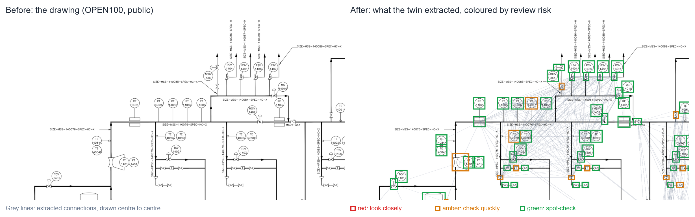

## Data first: what we know, how sure we are

Everything here is built from two datasets (plus five public DEXPI sheets used only to score tag reading), and each
starts with an assessment before anything is built: where the data came from, what has been checked against an
independent source, and what is inferred. **Every output inherits its inputs' confidence; nothing downstream upgrades
it.** The live replay, the mimics, the 3D tours and the LOTO views are **proof-of-concept outputs, built to iterate
on**, and are labelled that way in their own files. One manifest lists all 48 stages of the pipeline;
`python scripts/pipeline.py status` shows which outputs are stale after a correction (all 48 are fresh in this commit;
the live replay and the native acceptance run are recorded by hand because they need a running Ignition gateway), and
`rebuild --from <stage>` carries a correction forward. Per-element confidence: `python scripts/pipeline.py
confidence`. Stage by stage: [docs/DATA_LINEAGE.md](docs/DATA_LINEAGE.md).

### What you can do with only drawings, only process knowledge, or both

The two main tracks have opposite halves of the picture. **TE** has process knowledge (a model checked against the
simulator source, and recorded simulator replay) and no original drawing. **OPEN100** has 12 real drawings and
no process data. Most of a digital twin starter kit needs only the structure, and drawings carry structure: equipment, connections, flow arrows,
off-page links, isolation valves. Values, normal bands, alarms and replay need process data, so OPEN100 can't have
them, and the table says so instead of faking them. What OPEN100 gets from its drawings alone is in
[docs/OPEN100_STRUCTURAL.md](docs/OPEN100_STRUCTURAL.md): flow direction read from arrowheads, flags and pump ports
(361 of 1,133 process links; the rest stay undirected), the 12 sheets stitched into one plant, an ISA-101-style mimic,
a 3D orientation tour and a LOTO isolation view on the real drawing.

<!-- deliverables-matrix:start -->
| Deliverable | TE: process knowledge, no original drawing | OPEN100: drawings, no process data |
|---|---|---|
| Asset model (equipment, instruments, connections, hierarchy) | **Done**: transcribed from the published process; every tag checked against the simulator source (36 confirmed, 1 corrected) and every unit, stream, direction and tag owner against its balances and flow lines (51 confirmed, 4 corrected, 1 unresolvable of 56); 0 items reviewed by operations ([te_topology_check.md](out/te_topology_check.md), [te_source_check.md](out/te_source_check.md)) | **Done**: extracted from the drawings: 2,886 items, all unverified until reviewed, risk tiers 1,833 green / 676 amber / 377 red; on the sealed drawings symbols found F1 0.97, connections 0.89, review load 20.1 per 100 (mean of five round-5 runs; the earlier single round-2 run scored 17.8) ([review_queue.csv](out/twin/r2-tiles-trace/codex/review_queue.csv), [replicates_r5_holdout-a.md](out/replicates_r5_holdout-a.md)) |
| Tag text read from drawings | **Done**: a round trip on the generated sheets: every tag read on clean sheets by both models, 14% (GPT) and 49% (Claude) at the worst scan level; an upper bound for clean house-style drawings, not real-plant accuracy ([roundtrip_scores.md](out/te_pid/roundtrip_scores.md)) | **Not possible**: the public answer keys carry no text, so tag reading cannot be scored here; on three DEXPI example sheets with labelled symbols (round 5) GPT read 29 of 33 tags exactly and Claude 28, and on two more both found 99-100% of 145 identifiers from the published tag lists |
| Ignition tags and PI AF asset structure | **Done**: loaded into a lab gateway; the PI Builder sheet (schema v2) is checked offline against the vendor-published conventions, not imported into a PI System ([te_tags.json](out/ignition/te_tags.json), [pi](out/pi)) | **Done**: same; instrument tags are placeholders until an I/O list maps them, and placeholder PI rows are left unselected ([tags.json](out/twin/r2-tiles-trace/codex/ignition/tags.json), [pi](out/twin/r2-tiles-trace/codex/pi)) |
| Original drawing on screen with each instrument's value | **Not done yet**: no original TE drawing exists; a P&ID is now generated from the model in the OPEN100 style (three sheets, not a drawing of record), but it is not a screen background yet ([101.png](data/te_pid/101.png), [style_fidelity.md](out/te_pid/style_fidelity.md)) | **Done**: 12 drawing screens, checked in a lab gateway; every unmapped value reads 'not connected' ([native-sheet0-not-connected.png](docs/screenshots/native-sheet0-not-connected.png)) |
| Flow direction on connections | **Done**: every stream's direction checked against the simulator's pressure-driven flow lines ([te_topology_check.md](out/te_topology_check.md), [te_process_model.json](data/te_process_model.json)) | **Partial**: read from drawing evidence (arrowheads, off-page flags, pump ports) on 361 of 1,133 process links; the rest stay undirected and show no arrow ([flow_direction.json](out/open100_structural/flow_direction.json), [flow-evidence-sheet5.png](docs/screenshots/open100/flow-evidence-sheet5.png)) |
| Sheets stitched into one plant | **Not applicable**: one process description, no sheets | **Done offline (not in a gateway)**: off-page connectors join the 12 sheets; 38 sheet-to-sheet connections, 36 with a direction ([plant_structure.json](out/open100_structural/plant_structure.json)) |
| Process mimic overview (ISA-101 style) | **Done**: native acceptance in a lab gateway, plus a 390 px overview at /m; proof of concept: layout and key values are first-pass, not reviewed by operations ([native-overview-normal.png](docs/screenshots/native-overview-normal.png), [native-narrow-m-normal.png](docs/screenshots/native-narrow-m-normal.png)) | **Done offline (not in a gateway)**: plant overview and 12 area views from the same screen components; offline render; proof of concept, structure only ([mimic-plant-overview.png](docs/screenshots/open100/mimic-plant-overview.png), [mimic-area-sheet7.png](docs/screenshots/open100/mimic-area-sheet7.png)) |
| Equipment purpose cards | **Done**: one sentence per unit, each citing the simulator lines it restates, shown on the 3D tour's stop cards; not reviewed by an operator ([te_unit_purposes.json](data/te_unit_purposes.json), [02_r-101_normal.jpg](drafts/3d-tour/02_r-101_normal.jpg)) | **Done offline (not in a gateway)**: from the drawings' own equipment schedules and labels (transcribed, unverified); generic class text where the drawing says nothing, marked as such ([open100_equipment_schedule.json](data/open100_equipment_schedule.json)) |
| 3D orientation tour (stills) | **Draft**: proof of concept: placeholder geometry, source-checked topology, colours from recorded replay; no render check fails on twelve stills (15 pass, 2 informational), five committed ([00_overview_normal.jpg](drafts/3d-tour/00_overview_normal.jpg), [verification.md](drafts/3d-tour/verification.md)) | **Draft**: proof of concept: placeholder geometry at drawing positions, stops in inferred flow order, structure only ([3d-00_overview.jpg](docs/screenshots/open100/3d-00_overview.jpg), [3d-01_stop_sheet3.jpg](docs/screenshots/open100/3d-01_stop_sheet3.jpg)) |
| Lockout/tagout isolation view | **Mockup**: isolation points inferred from the seed model (the purge's isolation point now sits at the separator); not a procedure ([40_loto_mockup.jpg](drafts/3d-tour/40_loto_mockup.jpg)) | **Mockup**: isolation points from the extracted symbols, on the real drawing, with sheet and box for each; not a procedure ([loto-isolation-sheet7.png](docs/screenshots/open100/loto-isolation-sheet7.png), [loto_isolation_points.csv](out/open100_structural/loto_isolation_points.csv)) |
| Values on the screens | **Done**: recorded simulator replay (proof of concept: not a live plant, and not a simulator that responds to control) ([native-overview-normal.png](docs/screenshots/native-overview-normal.png)) | **Not possible**: needs process data: an I/O list or historian mapping for these instruments |
| Point mapping to data addresses | **Done**: replay channels mapped in the lab gateway ([build_meta.json](out/ignition/gateway/build_meta.json)) | **Synthetic demo**: a synthetic I/O list shaped like a real export; no real addresses exist for these drawings ([io_lists](data/io_lists)) |
| Normal bands and early warning | **Done**: learned on half the normal run; on all 21 published faults the bands flag 17 (median 48 min after onset) with 0 false alarms in 193 h of held-out normal running, and miss faults 3, 9, 15 and 19 ([fault_detection.md](out/fault_detection/fault_detection.md), [normal_bands.md](out/ignition/normal_bands.md)) | **Not possible**: needs a historian record of normal operation |
| Alarms | **Done**: published setpoints, plus a data-source-lost diagnostic alarm per data source; in the lab gateway the pressure alarm fires on the recorded fault, the diagnostic fires and clears, and the header count matches the alarm table ([IGNITION_ACCEPTANCE.md](docs/IGNITION_ACCEPTANCE.md), [native-current-20261013-alarms.json](out/ignition/gateway/receipts/native-current-20261013-alarms.json)) | **Not possible**: needs setpoints and process data; the drawings name some alarm points but give no setpoints |
| Fault replay and live process tour | **Done**: recorded fault-6 replay; proof of concept: replay is not a simulator that responds to control ([native-overview-fault-alarm.png](docs/screenshots/native-overview-fault-alarm.png)) | **Not possible**: needs recorded process data |
| Operations review | **Not done yet**: tooling built; needs someone who knows the process ([REVIEW_LOOP.md](docs/REVIEW_LOOP.md)) | **Not done yet**: same; the review queue is ready ([review_queue.csv](out/twin/r2-tiles-trace/codex/review_queue.csv)) |
<!-- deliverables-matrix:end -->

| OPEN100 plant overview (offline render) | 3D tour stop, structure only | LOTO isolation view on the real drawing (mockup) |
|---|---|---|
| 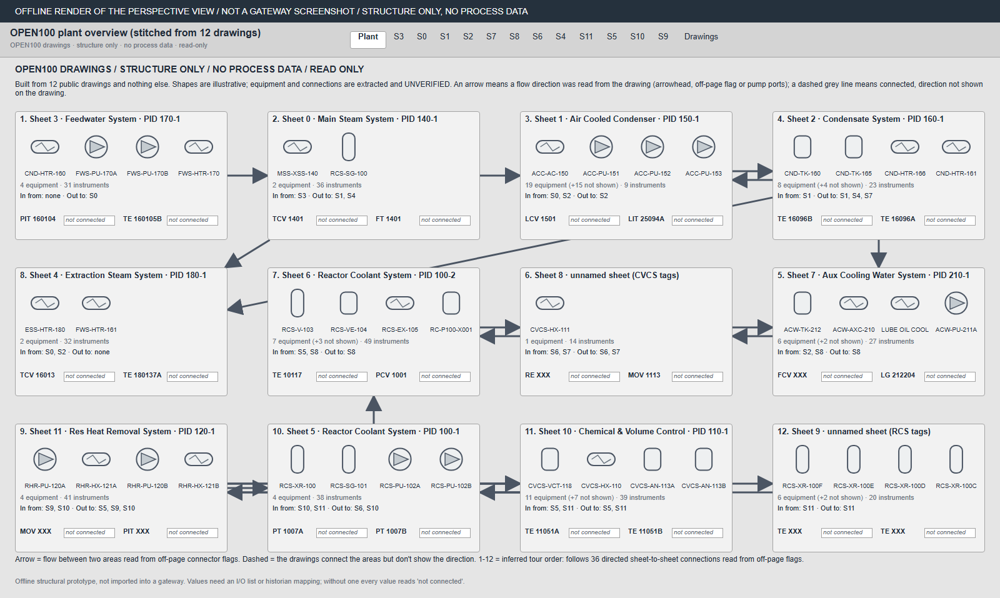 | 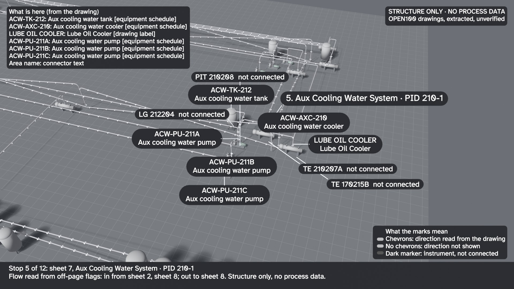 | 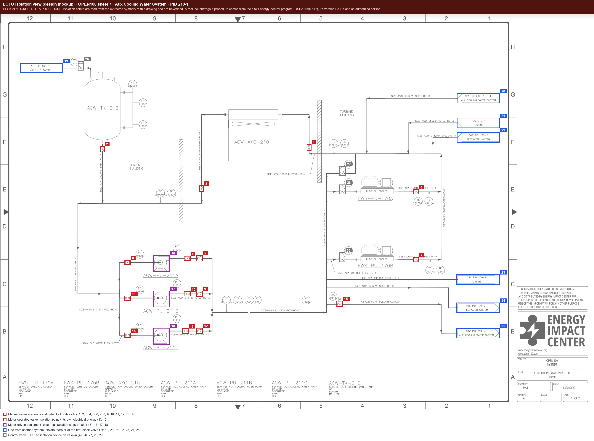 |

## Results (sealed drawings nobody tuned on)

Review load = the corrections a reviewer must make per 100 items on the drawing. Lower is better. Around 100 is
about the same work as drawing it from scratch. Round 2, each method scored once per set:

| Model | Model alone, A / B | Tiling + code line tracing, A / B |
|---|---|---|
| GPT (gpt-6.1-sol, via Codex) | 48.8 / 67.0 | **17.8 / 20.7** |
| Claude (claude-opus-5-5) | 61.1 / 76.6 | **32.4 / 16.5** |
| Gemini (gemini-3.1-pro-preview) | 75.9 / 92.7 | **40.2 / 38.3** |

A = 6 real OPEN100 drawings. B = 20 synthetic drawings in a different drafting style. Each method was scored once
per set; Gemini's numbers are earlier runs and it was not run after round 3. These single round-2 runs are the ones
the round-2 decisions were taken on. Five later reruns of the bold method on A (round 5, below) average **20.1** for
GPT and **29.8** for Claude, the figures to quote for holdout A now. Source: [docs/GOAL.md](docs/GOAL.md#results-round-2-scored-after-the-addendum-above-each-method-once-per-holdout).

- Reviewers get a risk-ranked queue. The twin built from 12 sheets has 2,886 items: 377 red, 676 amber and 1,833
  green. Green items were 94–100% right on drawings nobody tuned on.
- Where it breaks: old-scan image quality roughly triples review load, mostly because the line tracer fails on
  faded ink (table below).
- How "done well" is defined, and the rules that stop me gaming my own score: [docs/EVALUATION.md](docs/EVALUATION.md).
- Cost: $16.57 of metered model spend, plus two flat-rate subscriptions. Reviewer time is the real cost:
  [docs/COSTS.md](docs/COSTS.md).

**Old scans (round 4, pre-registered).** Holdout A degraded to three synthetic scan levels, same method, each level
run once per model:

| Image quality | GPT review load | Claude review load | Connection F1 (GPT / Claude) |
|---|---|---|---|
| Clean (the round-2 run) | 17.8 | 32.4 | 0.89 / 0.78 |
| Photocopy | 20.6 | 29.7 | 0.87 / 0.79 |
| Old scan | 51.5 | 57.0 | 0.51 / 0.45 |
| Bad scan | 72.6 | 70.6 | 0.22 / 0.19 |

Symbol reading fell gently (rough F1 0.94 → 0.77 for GPT, 0.90 → 0.81 for Claude at the worst level). The code
line tracer is what breaks: run on the clean image with the bad-scan symbols, connections recover to 0.53–0.63.
The scans are synthetic degradations, not real archive scans. Details: [GOAL.md, round 4](docs/GOAL.md#round-4-results-scored-once-per-level-as-pre-registered).

**More drawings, tag text and replicates (round 5, pre-registered).** Five fresh runs per model, Claude and GPT:

| | GPT mean (95% across runs / across drawings) | Claude mean (same) |
|---|---|---|
| Holdout A, review load | 20.1 (18.3–21.8 / 14.2–28.0) | 29.8 (27.5–32.1 / 12.8–47.3) |
| DEXPI sheets, review load | 95.4 (53.2–137.6 / 42.1–138.6) | 61.8 (60.5–63.1 / 26.3–127.9) |
| DEXPI tag text, read exactly | 29 of 33 | 28 of 33 |
| DEXPI tag lists, identifiers found | 145 of 145 | 99.4% |

- **GPT vs Claude:** on these six drawings GPT is better by more than run-to-run noise (9.8 points). Across
  drawings like these the gap is not established: the interval includes zero. Six drawings are the limit, not the
  runs.
- **New drawings, worse result.** Five public example and training P&IDs from the DEXPI standards initiative
  (CC BY 4.0), with tag text in their keys. Review load was 2–5× holdout A's. Much of it is what counts as a symbol:
  equipment nozzles and some drawn marks aren't items in the DEXPI key, and GPT reported the nozzles in 3 of 5
  runs, which swung one sheet between about 33 and 145.
- **Tag text, measured for the first time:** on clean vector drawings both models read almost every printed tag.
  The misses are vertical labels, multi-line labels and a number drawn on a separate actuator bubble. Scans and
  real archives remain untested for tags.
- Details and every caveat: [GOAL.md, round 5](docs/GOAL.md#round-5-results-scored-after-the-pre-registration-above).
- **Review time is still unmeasured.** A ready-to-run timing kit for one sheet is in
  [`out/review_kit/sheet-8/`](out/review_kit/sheet-8/README.md).

## How it works

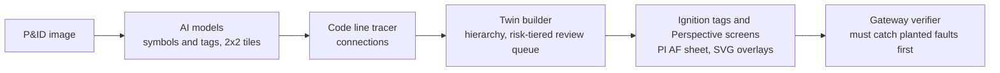

| Platform | What's verified |
|---|---|
| Ignition 8.3 | Historical build: 9/9 verifier checks after catching 5/5 planted faults ([IGNITION_BUILD.md](docs/IGNITION_BUILD.md)). Current 24-view project (after the topology correction): native acceptance passed on 2026-10-13 in a disposable Ignition 8.3.10 gateway: verifier checks V1–V8, 24/24 routes, 284/284 navigation targets, 0 false-good placeholders; the data-source-lost diagnostic fires when a source stops and clears on recovery; the header's alarm count matches the alarm table; a 390 px overview at `/m` ([journal entry 47](docs/JOURNAL.md#47-count-what-the-bands-detect-and-make-lost-data-an-alarm), [receipt](out/ignition/gateway/receipts/native-current-20261013-alarms.json)) On 2026-10-28 the control valves were renumbered to their loops (revision B, [journal entry 51](docs/JOURNAL.md#51-draw-the-control-loops-and-give-each-valve-its-loops-number)); the rebuilt project passed native acceptance again the same day in the local disposable gateway: 5/5 planted faults caught, V1–V9, 24/24 routes, 284/284 clicks, the data-source-lost diagnostic raised and cleared ([receipt](out/ignition/gateway/receipts/native-revB-20261028.json)) |
| AVEVA PI AF | Asset structure generated as a PI Builder sheet following the vendor-published conventions (element templates, documented headers, AF unit abbreviations, custom units defined rather than assumed), checked offline against them by `check_pi_export.py`. **Not imported into a PI System; not import-tested** ([PI_MAPPING.md](docs/PI_MAPPING.md)) |
| Operations review | Tooling built and tested. **No operations or operator review has been done yet** |

## Start wherever you are

| Your plant has | Path | Shown here on |
|---|---|---|
| **P&IDs** (scans, PDFs) | Extract them: AI reads symbols and tags, code traces lines, people review a risk-ranked queue | 12 real OPEN100 sheets (results above) |
| **Process knowledge but no usable drawings** (instrument index, historian tags, a simulator) | Build a model, **generate** P&IDs in your house style from it (`scripts/draw_pid_from_model.py`), then extract and review them like scans | Tennessee Eastman, drawn in the OPEN100 style |
| **Either** | One reviewed model feeds Ignition, PI AF and the [3D tour (proof of concept)](drafts/3d-tour/README.md) | Both |

A generated drawing is **not a drawing of record** until engineering walks it down and accepts it under management
of change. How to capture your own title block and symbol library, and the governance rules:
[AT_YOUR_PLANT.md](docs/AT_YOUR_PLANT.md#start-wherever-you-are).

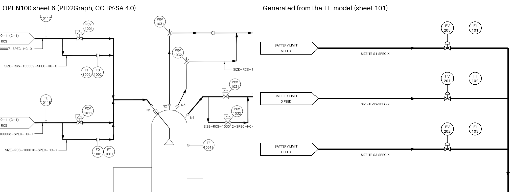

The revision-A sheets sat inside the OPEN100 range on 32 of 36 style measurements: bubble, valve, flag and equipment
sizes, line weights, text height and flag counts. The four outside were symbol counts and one ink figure, because the
model holds no drains, vents or manual valves ([style_fidelity.md](out/te_pid/style_fidelity.md)). That was revision
A. Revision B added the control loops (below) and the count dropped to 30 of 36: controllers, but none of the
block valves and bypasses a real P&ID draws around a control valve. Revision C adds those control valve stations
(two block valves and a globe-valve bypass around each of 10 control valves; the compressor's spill-back valve opts
out, with its reason in the layout) and the count is **35 of 36**. The one outside: sheet 103 has 37 scored symbols
against an OPEN100 minimum of 40. Drains and vents are still not drawn
([journal entry 52](docs/JOURNAL.md#52-put-each-control-valve-in-a-station-block-valves-and-a-bypass)).

**Control loops.** Revision A drew every transmitter and valve but no controller or signal line, and its valve
numbers didn't match the loops that move them: a PFD with bubbles on it. The loops are now read out of the
simulator's closed-loop code (19 running: 11 move a valve, 8 move another loop's setpoint), checked against the
recorded data (every controlled variable within 0.34 SD of its coded setpoint), drawn as DCS functions with dashed
signal lines, and scored by `scripts/te_control_loops.py`: **0 of 19 loops on revision A, 19 of 19 on revision B**,
with every valve carrying its loop's number ([te_loop_audit.md](out/te_loop_audit.md), journal entries
[50](docs/JOURNAL.md#50-find-the-control-loops-before-drawing-them-the-generated-pid-draws-none) and
[51](docs/JOURNAL.md#51-draw-the-control-loops-and-give-each-valve-its-loops-number)). The audit grades the
drawing against the code; it is not an engineering review of the control strategy.

### One plant, end to end (Tennessee Eastman)

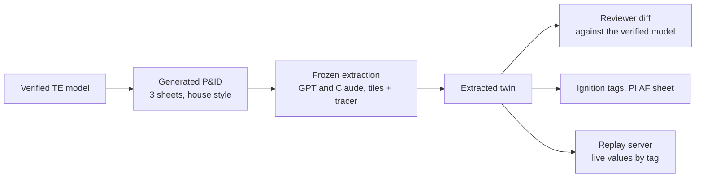

**This is a round trip.** The sheets and their answer keys come from the same model, so the scores measure how
faithfully the frozen method (2×2 tiles, prompt v2, code line tracer; nothing re-tuned) reads our own clean drawings.
They are an upper bound, not real-plant accuracy, and not comparable with the OPEN100 numbers. Gemini was left out.
The runs below read the **revision-A sheets** (kept in [`data/te_pid/rev-a/`](data/te_pid/rev-a/)), so their tags
are quoted in revision-A numbering (FV 201 is now FV-102; the full map is
[`data/te_retag_2026-10-28.json`](data/te_retag_2026-10-28.json)).

**Revision C read back.** The same frozen method and protocol on the sheets with controllers, signal lines and valve
stations ([roundtrip_scores_revC.md](out/te_pid/roundtrip_scores_revC.md), journal entry 54). Clean sheets: review
load 1.26 (GPT) and 1.38 (Claude) per 100, every tag read by both. On bad scans tag text still fails first, and Claude
reads far more of it: 89% against 61% at L2, 50% against 9% at L3. Claude's higher review load at L1 and L2 (4.1 and
10.0 against 1.30 and 1.20) comes from the line tracer, not from reading: its tighter vessel boxes let the tracer
follow a vessel wall as a pipe. Growing those boxes 4 px removes every extra link; that fix is a method change and
will be measured as one.

| Image | Review load /100, GPT · Claude | Tags read exactly, GPT · Claude |
|---|---|---|
| Clean (5 runs each) | 2.1 · 2.2 | 100% · 100% |
| Photocopy, L1 (3 runs each) | 2.1 · 8.0 | 100% · 98% |
| Old scan, L2 | 2.1 · 13.4 | **56%** · 95% |
| Bad scan, L3 | 16.9 · 17.3 | **14%** · **49%** |

Means over runs; ranges and 95% intervals are in [roundtrip_scores.md](out/te_pid/roundtrip_scores.md). 43 printed
tags per run (37 instrument and valve bubbles, 6 equipment tags). This is the project's first tag-reading score,
because the OPEN100 keys carry no text.

- **On clean sheets both models read every tag.** The remaining 2 corrections per 100 come mostly from the agitator
  motor, which both models report as an extra symbol (the tracer then links through it).
- **On old scans the risk is in the text, not the shapes.** GPT kept finding every symbol and line at L2 but read
  FI as PI, LI as LE and FV as PV. Claude at L3 read FV 203, FV 201 and FV 202 as FV 201, FV 202 and FV 203 in one
  run: three real tags, each on its neighbour's valve. A tag-only check and the live check both pass that; only the
  position-aware round trip catches it.
- **The reviewer diff** for the declared chain (GPT, clean, first run) has 10 corrections against the verified model.
  Nine also appear for a perfect reader, so they come from the converter and the model's conventions, not from the
  reading: the feed header is drawn as an in-line symbol, so it becomes a line item and its six feed instruments get
  the reactor as parent; and two extra unit links come from lines that meet at the header and the compressor bypass
  ([diff](out/te_pid/diff_codex-clean-r1.md), [perfect-reader diff](out/te_pid/diff_key.md)).
- **Exporters and live values:** the extracted twin went through the same exporters (Ignition tags and UDTs, PI AF
  sheet, SVG). 36 of its 37 tags resolve to points on the TE replay server, and all 36 moved between reads. SC-212
  has no recorded data ([live check](out/te_pid/live_codex-clean-r1.md)). The extracted twin's tag file was **not**
  imported into a gateway in this pass. The gateway-tested project is built from the verified model, which is what
  the extracted twin becomes after the listed corrections plus the fields no drawing prints (simulator index, units
  of measure), which come from the instrument list.

## Try it

- **No Ignition install (Docker):** [docker/README.md](docker/README.md). Double-click `start-demo.bat`. It restores
  the historical demo backup, not the current project. Clean starts are checked in CI
  ([journal entry 35](docs/JOURNAL.md#35-test-the-packaged-demo-after-the-source-checks-pass)).
- **No Docker, no Ignition:** `python scripts/run_tests.py --source-only` runs the scorer controls and offline checks
  with the standard library, and `python scripts/generate.py` writes the SVG, Ignition and PI AF files to `out/`.
- **Your own Ignition (free trial):** [docs/IGNITION_QUICKSTART.md](docs/IGNITION_QUICKSTART.md).
- **At a real plant:** [docs/AT_YOUR_PLANT.md](docs/AT_YOUR_PLANT.md) covers pilot scope, building your own answer
  key, read-only use, data egress, network zoning and offline models. The step-by-step version is
  [Replicate at your plant](docs/REPLICATE_AT_YOUR_PLANT.md).

## How it was built

AI coding agents (Claude Code, and later Codex) wrote most of the code and the first drafts of the docs. I chose the
problem, set the evaluation rules before seeing results, made the design calls and checked the results. The
[build journal](docs/JOURNAL.md) records each decision, what was rejected and what went wrong, including the agents'
mistakes and mine. [docs/MODELS.md](docs/MODELS.md) says which parts were compared across several models and which
came from Claude alone.

**Contents:** [Status and evidence tracks](#status-and-evidence-tracks) ·
[Drawings only, process knowledge only, or both](#what-you-can-do-with-only-drawings-only-process-knowledge-or-both) ·
[What the numbers mean](#what-the-numbers-mean) ·
[Try it in Ignition](#try-it-in-ignition) · [What this demonstrates](#what-this-project-demonstrates) ·
[Tutorial](#tutorial-reproduce-it) · [Repository map](#repository-map) · [Read next](#read-next) · [Status](#status) ·
[Data and credits](#data-and-credits) · [Environment variables](#environment-variables)

---

## Status and evidence tracks

Three separate pieces of evidence live here. Keep them apart:
- **OPEN100:** drawing extraction, scored outputs and a labeled synthetic point-mapping demo. These are not
  site-verified live plant connections.
- **Tennessee Eastman (TE):** a process model hand-built from the published process, then verified against the
  simulator source: every tag's name and units, and every unit, stream connection, flow direction and tag ownership
  (51 confirmed, 4 corrected, 1 left unresolved; [report](out/te_topology_check.md)). Generated operator screens are
  driven by recorded simulation replay. The model was not extracted from a drawing, tap positions and pipe routes
  are not in the source, and replay is not a process simulator that responds to control changes. Since journal
  entry 44, the model is also drawn as three P&ID sheets and extracted back, so the TE chain runs from a drawing
  (see [One plant, end to end](#one-plant-end-to-end-tennessee-eastman)). That is a round trip on our own drawings,
  not an extraction of a real plant's sheets.
- **PID2Graph Synthetic:** a bounded two-sheet adaptation through the existing scorer and exporters, with unresolved
  ontology and line-semantics review gates. It is neither a held-out generalization result nor plant validation.
  See [the adaptation guide](docs/ADAPT_LABELED_DATASET.md).

Have one local PNG and an existing extraction JSON? The [bounded site-intake recipe](docs/REPLICATE_AT_YOUR_PLANT.md#bounded-local-intake-one-png--an-existing-extraction)
builds a source-preserving, unverified review bundle with the standard library. For a new single-PNG job, the
[frozen extraction handoff](docs/SITE_EXTRACTION_WORKFLOW.md) separates offline preparation from explicitly
authorized model runs. The [PI point mapper](docs/PI_MAPPING.md), [offline Ignition acceptance preflight](docs/REPLICATE_AT_YOUR_PLANT.md#offline-exact-candidate-ignition-preflight)
and a [future human review-effort protocol](docs/REVIEW_EFFORT_PROTOCOL.md) cover the next handoffs. PI import and
the human study have not been run.

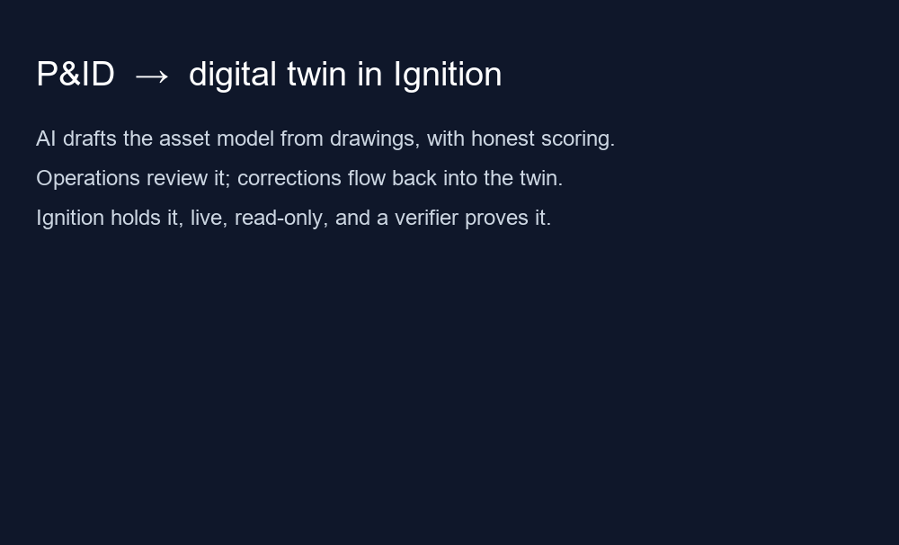

*30 seconds, two separate demonstrations: OPEN100 drawing extraction with synthetic I/O mapping, then the hand-built
Tennessee Eastman model driven by recorded fault-replay data. The TE fault screen was not extracted from the OPEN100
drawing. Made from the repo's historical screens (`scripts/make_demo_gif.py`), so it predates the current screens.*

## What the numbers mean

The goal ([docs/GOAL.md](docs/GOAL.md)) is a digital twin starter kit that needs as little human correction as
possible. The rules, splits and decision rule were committed before any method was tested.

- **AI reads symbols and tags; code traces the lines.** Connections are two-thirds of the work and the models'
  weakest skill. A deterministic line tracer took the best result from about 49 corrections per 100 items to about
  18 in round 2 (one run each: 48.8 → 17.8); five round-5 reruns of the traced method average 20.1.
- **It held on a different drafting style,** so it isn't tuned to one drawing set. Set B is synthetic, so this
  shows a change of style, not a second real plant.
- **Not everything improved.** Choosing the right parent equipment for each instrument got slightly worse (90.9% →
  87.0%), because the tracer links everything on a shared pipe network. Round 3 fixed it for this drafting style
  (two bullets down).
- **The risk tiers mostly work.** Every item has a green / amber / red tier and a plain-language reason. On
  drawings nobody tuned on, the riskiest 20% held 2–4× as many errors as the models' own confidence would point to
  (23 of 24 comparisons). The one failure was the best model with the best method on same-style drawings, where it
  was no better than the model's own confidence. That's reported in [GOAL.md](docs/GOAL.md).
- **Instrument-to-equipment assignment is fixed for this drafting style** (92.2%, up from 87.0%) by following the
  drawn line. On a different style it slipped (67.6% vs 70.8%), so the two rules' disagreements go to review.
- **An open-weight model you can run offline** (Gemma 4 31B, round 1) trailed far behind: about 0.53 "found" F1
  where it finished, against about 0.90 for the frontier models, and it stalled on dense sheets.
- **It runs in a real Ignition gateway, judged by the gateway.** The Tennessee Eastman plant runs from recorded
  open simulation data, with alarms. The 12-sheet extracted twin is honestly "not connected", and every drawing has
  a Perspective screen.
  - A verifier runs checks against the running gateway. Among them: the gateway holds exactly what was sent, no
    tag without a source ever reads Good, outside writes are refused, and the reactor pressure alarm fires on a
    replayed fault.
  - Before its passes counted, it had to catch five faults planted on purpose. It caught all five, and all nine
    checks passed on the historical build. See [docs/IGNITION_BUILD.md](docs/IGNITION_BUILD.md).
- **A review loop is ready for operations.** A reviewer fills in a spreadsheet: confirm, correct or reject, show on
  screen, alarm priority. A script checks every row, applies the decisions with a change record, and regenerates
  Ignition, PI AF and the screens. Removing or inventing an alarm is routed to a change review instead of being
  applied. No real review has gone through it yet. See [docs/REVIEW_LOOP.md](docs/REVIEW_LOOP.md).
- **Placeholders become live points from an I/O list.** Matching never guesses. It also lists the points a plant
  has that the drawing doesn't show, the first sign of an out-of-date drawing. In the demo (a labeled synthetic I/O
  list), 24 mapped instruments read live in Ignition while the rest stay honestly "not connected".
- **Old scans: where it breaks** (round 4, pre-registered). Photocopy quality made no consistent difference. On
  old-scan quality, review load roughly tripled (GPT 17.8 on the clean round-2 run → 51.5); on a bad scan it
  quadrupled (72.6). Most of the loss is the code line tracer, not the models: their symbol reading fell gently,
  and tracing the same symbols on the clean image recovers much of the connection score. An archive of scans needs image cleanup before tracing.
  Details in [GOAL.md](docs/GOAL.md), round 4.

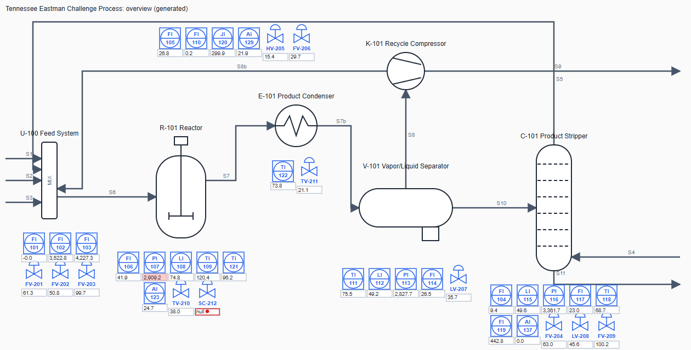

## Try it in Ignition

The current project (24 views) was imported into a disposable Ignition 8.3.10 gateway on 2026-10-13 and passed the
verifier (V1–V8) and a full browser contract: every route loaded and reloaded, every navigation target was clicked,
placeholders stayed "not connected", and the recorded fault raised the alarm. Stopping a data source raises a
"Data source lost" diagnostic alarm, separate from process alarms, and the header counts active alarms the way the
alarm table does. Each gateway run found bugs no offline check had caught; all were fixed with regression tests
([journal entry 38](docs/JOURNAL.md#38-import-the-current-project-into-a-real-gateway-and-watch-what-the-offline-checks-could-not),
[entry 47](docs/JOURNAL.md#47-count-what-the-bands-detect-and-make-lost-data-an-alarm)).
That is a lab result on recorded and synthetic data, not site or operator acceptance. `/m` is a 390 px overview
(alarms first, then the units); the control-room screens stay 1600 px and scroll on a phone.

To build the current project yourself, regenerate it with `python scripts/ignition/build_gateway.py --write-only`.
The committed project ZIP matches a `--write-only` build of the tested commit; [docs/IGNITION_ACCEPTANCE.md](docs/IGNITION_ACCEPTANCE.md)
explains which files belong together and how the acceptance run was done. A kit needs:
- a tag import ([`twin_provider.json`](out/ignition/gateway/twin_provider.json));
- a Perspective project (`PIDTwin.zip`), regenerated locally as above;
- the small replay server that feeds the recorded values ([`te_sim_server.py`](scripts/ignition/te_sim_server.py)).

Loading by hand: **[docs/IGNITION_QUICKSTART.md](docs/IGNITION_QUICKSTART.md)**. By script with every check:
[docs/IGNITION_BUILD.md](docs/IGNITION_BUILD.md).

The screens are generated from the twin in the ISA-101 style: grey when the plant is normal, amber when a value
leaves its learned normal band, red only for a real alarm. In the fault replay, the first value turns amber 294
plant-minutes before the pressure alarm. That is one easy fault: scored on all 21 published faults, the bands flag
17 (median 48 minutes after onset) with no false alarm in 193 hours of held-out normal running, and miss faults 3,
9, 15 and 19 ([EVALUATION.md](docs/EVALUATION.md#4b-fault-detection-with-the-normal-bands-tennessee-eastman-all-21-faults)).
What they infer, and how far to trust it:
[docs/OPERATOR_SCREENS.md](docs/OPERATOR_SCREENS.md). The key values, spans and layout are first-pass choices by
Claude and haven't been reviewed by operations.

| Plant overview, normal | Fault 6 at the alarm | An extracted drawing, live |
|---|---|---|
| 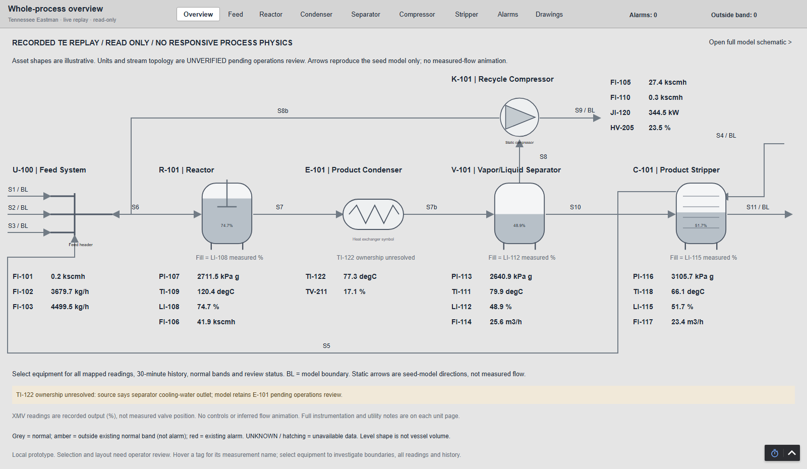 | 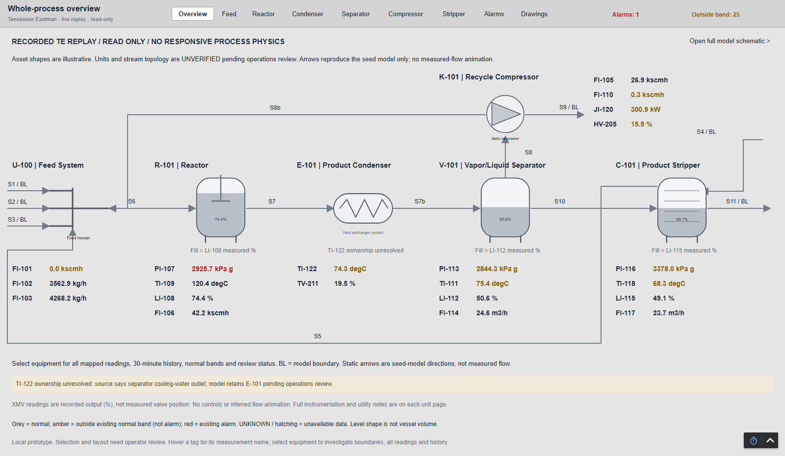 | 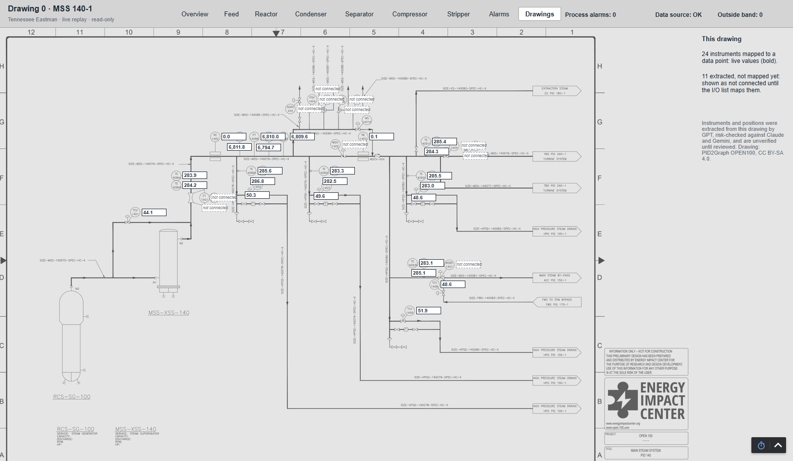 |

Screenshots from the 2026-10-13 run in a disposable gateway.

**Three ways to run it:**
- **Historical Docker demo:** [the Docker demo](docker/README.md) needs Docker Desktop and accepts the Ignition
  trial license. It restores the historical backup, so it shows the October 8 screens, not the current project.
- **Your own isolated Ignition:** [the lab workflow](docs/IGNITION_QUICKSTART.md).
- **Scripted, with every check:** [docs/IGNITION_BUILD.md](docs/IGNITION_BUILD.md).

There's no public live instance. It runs on your own computer, and Ignition's free trial is enough. With the
gateway's settings in place, one command fetches the data, builds and verifies the twin, and keeps it running:
`python scripts/demo.py --build --verify`.

**What it cost:** $16.57 of metered model spend (a $25 cap), plus two flat-rate subscriptions. Machine time is under
a dollar per sheet at API prices; reviewer time is the real cost, and the docs show how to size it. See
[docs/COSTS.md](docs/COSTS.md).

Full results, every method tried (including the losses), and caveats: [docs/GOAL.md](docs/GOAL.md) →
Results, and [docs/EVALUATION.md](docs/EVALUATION.md).

## What this project demonstrates

- **Domain to data.** P&ID conventions (ISA-5.1 tags, off-page connectors, equipment classes) turned into one
  structured model. That model generates SVG graphics, Ignition UDTs and tags, a PI AF hierarchy, and a
  plain-language review sheet for operations.
- **Evaluation you can defend.**
  - Scoring rules were written before any model ran.
  - The scorer was tested with deliberately wrong answers. Its first version gave them 15–32% credit and had to be
    rebuilt.
  - Every result is repeated to measure noise.
  - Failures count as zero.
  - Where I broke one of my own rules, the docs say so.
- **Judgment about tools.** Three cloud models compared fairly, plus an open-weight model as a stand-in for a fully
  offline deployment, with time and cost recorded per drawing.
- **Plant reality.** Every step carries an "At your plant" note covering:
  - messy drawing sets;
  - getting savings from an imperfect draft;
  - Management of Change;
  - read-only, monitoring-only use;
  - data-egress terms;
  - OT network zoning;
  - what an air-gapped model setup would cost.

---

## Tutorial: reproduce it

Requires Python 3.10+ (CI uses 3.12). Steps 1–2 use the standard library only; the rest need
`pip install -r requirements.txt`. Model runs need the relevant CLI or API key and send drawings to the selected
service. File generation and offline tests run locally; installing dependencies, fetching data and gateway
operations are separate networked steps. Use a disposable checkout: generation, source verification with `--write`,
review and mapping can overwrite files. [The replication guide](docs/REPLICATE_AT_YOUR_PLANT.md) walks the bounded
public-data path.

**1. Check the TE model against its source.** The first script checks every tag's name and units against the
open TE simulation code (36 of 37 confirmed, 1 corrected). The second reads the code's mass balances, flow lines and
measurement lines to check every unit, stream, flow direction and tag-to-unit assignment (51 of 56 confirmed,
4 corrected, 1 unresolvable), cross-checked against the revised TE code of Bathelt, Ricker and Jelali (2015):
```
python scripts/verify_te_source.py --write
python scripts/verify_te_topology.py --write
```

**2. Generate the platform outputs.** SVGs, the Ignition tag import, the PI AF sheet and the operations review sheet
go to `out/`:
```
python scripts/generate.py
```

**3. The scoring drawings are already here.** The 12 OPEN100 drawings with their answer keys, and their degraded
"old scan" copies from round 4, are committed under `data/external/pid2graph/` (CC BY-SA 4.0, see
[NOTICE.md](NOTICE.md)). Only the 20 holdout-B drawings (130 MB) are left out; fetch them, or re-fetch the rest from
the source, by reading only the needed parts of the 9.3 GB archive:
```
python scripts/fetch_pid2graph.py --get "Complete/Dataset PID/"
```

**4. Prove the scorer before trusting it.** Start with the standard-library and committed-fixture checks. This
narrower mode is not a full-suite pass:
```
python scripts/run_tests.py --source-only
```
The full suite (also the no-argument and CI default) needs the pinned dependencies, the hash-verified TE replay
files and a locally regenerated project ZIP. Run these in order from the repository root. The build overwrites local
generated files but does not contact a gateway, and the suite fails its preflight rather than silently skipping
tests or downloading data:
```
pip install -r requirements.txt
python scripts/fetch_te_data.py --all   # all 44 Braatz files: the fault evaluation regenerates its results
python scripts/verify_te_topology.py   # downloads the revised TE code its test cross-checks; report only
python scripts/ignition/build_gateway.py --write-only
python scripts/run_tests.py --full --check-prerequisites
python scripts/run_tests.py --full
```
After the integration on 2026-10-13, both suites passed on Windows (21/21 source-only, 32/32 full, with two
symlink sub-cases explicitly skipped because Windows didn't grant symlink rights) and on Linux in a Python 3.12
container (21/21 with the standard library only, 32/32 with the pinned dependencies, no skips). CI runs the full
suite on Linux on every push. See
[replication prerequisites and limits](docs/REPLICATE_AT_YOUR_PLANT.md#c-check-the-pipeline-then-optionally-rerun-public-extraction).
A prerequisite check alone is not a test pass.

**5. Run a model and score it.** Use `claude`, `codex`, or `gemini`; for Gemini, set `GEMINI_API_KEY`:
```
python scripts/run_extraction.py --tool gemini --drawings 0,1,2 --label my-run --prompt extraction/prompt_v2.md
python scripts/scorecard.py --label my-run
```

**6. Trace the connections with code and build the digital twin starter kit:**
```
python scripts/trace_connections.py --src-label my-run --tool gemini --drawings 0,1,2 --label my-run-traced
python scripts/build_twin.py --label runs/my-run-traced/gemini/ --sheets 0,1,2 --score
```
The twin package lands in `out/twin/`: asset hierarchy, review queue, Ignition tags, PI AF rows, and per-sheet SVGs.
See [docs/TWIN_OUTPUTS.md](docs/TWIN_OUTPUTS.md).

**7. Build it into Ignition and verify it** (needs an Ignition 8.3 gateway; the free trial works). The build
script takes a backup, then creates the replay connection, tag provider, tags and screens. The verifier plants five
faults, confirms each is caught, restores the gateway, then runs all nine checks:
```
python scripts/fetch_te_data.py                      # the open TE simulation runs the replay uses
python scripts/ignition/build_gateway.py --fresh
python scripts/ignition/te_sim_server.py --run normal   # recorded values for the screens (leave running)
python scripts/ignition/verify_gateway.py --controls   # stop the replay first: the verifier drives it itself
```
Setup (API key, HTTPS, OPC UA certificate) is in [docs/IGNITION_BUILD.md](docs/IGNITION_BUILD.md). To load the
kit by hand, use [docs/IGNITION_QUICKSTART.md](docs/IGNITION_QUICKSTART.md).

**8. Close the loop: operations review and real data points.** Apply a filled-in review sheet, map instruments
from an I/O list, then regenerate and rebuild (details in [docs/REVIEW_LOOP.md](docs/REVIEW_LOOP.md)):
```
python scripts/apply_review.py data/te_process_model.json reviewed.csv --reviewer "Name, role"
python scripts/map_points.py out/twin/r2-tiles-trace/codex/plant_model.json data/io_lists/open100_sheet0_demo.csv --sheets 0
python scripts/generate.py && python scripts/generate.py out/twin/r2-tiles-trace/codex/plant_model.json
python scripts/demo.py --build --verify       # one command: data, build, nine checks, then running
```

**9. One plant end to end: draw the TE model, read it back, diff it.** The sheets are committed; regenerating
them checks the model against the layout. The extraction needs the `claude` or `codex` CLI:
```
python scripts/draw_pid_from_model.py && python scripts/style_fidelity.py
python scripts/degrade_scans.py --src data/te_pid --drawings 101,102,103 --dest data/te_pid/scan
PID_SHEETS_DIR=data/te_pid python scripts/run_extraction.py --tool codex --drawings 101,102,103 --prompt extraction/prompt_v2.md --tiles 2x2 --label te-clean-tiles-r1
PID_SHEETS_DIR=data/te_pid python scripts/trace_connections.py --src-label te-clean-tiles-r1 --tool codex --drawings 101,102,103 --label te-clean-trace-r1
python scripts/score_te_roundtrip.py --conditions clean --tools codex
PID_SHEETS_DIR=data/te_pid python scripts/build_twin.py --label te-clean-trace-r1 --tools codex --sheets 101,102,103 --holdout-ok --sheet-register data/sheet_registers/te_generated.csv --out out/te_pid/twin/codex-clean-r1
python scripts/te_model_diff.py out/te_pid/twin/codex-clean-r1/plant_model.json
python scripts/te_live_check.py out/te_pid/twin/codex-clean-r1/plant_model.json   # needs fetch_te_data.py first
```
(`PID_SHEETS_DIR=...` is shell syntax; in PowerShell set `$env:PID_SHEETS_DIR` first.)

**10. Read why each step is done this way** in [docs/JOURNAL.md](docs/JOURNAL.md). Each entry ends with how to apply
it at a real site.

## Repository map

| Path | What's there |
|---|---|
| [`docs/`](docs/) | Everything to read; see [Read next](#read-next). Screenshots are in [`docs/screenshots/`](docs/screenshots/) |
| [`pipeline/`](pipeline/stages.json) | The stage manifest and lock: `scripts/pipeline.py` (status, rebuild, confidence), `provenance.py`, and two proof-of-concept generators, `build_scene_data.py` and `export_mimic_layout.py` |
| [`data/te_process_model.json`](data/te_process_model.json) | The Tennessee Eastman model: tags, units, streams and directions verified against the simulator source ([tags](out/te_source_check.md), [topology](out/te_topology_check.md)) |
| [`data/te_unit_purposes.json`](data/te_unit_purposes.json) | One plain-language sentence per TE unit, each citing the simulator lines it restates |
| [`data/te_pid/`](data/te_pid/), [`data/te_pid_layout.json`](data/te_pid_layout.json) | The TE P&ID generated in the OPEN100 style (3 sheets, PNG + SVG) with answer keys emitted from the model, and the drafting layout that places it |
| [`data/sheet_registers/`](data/sheet_registers/) | A drawing index read from the OPEN100 title blocks (an example of what a plant supplies) |
| [`data/io_lists/`](data/io_lists/README.md) | A synthetic I/O list for the point-mapping demo, shaped like a real export |
| [`data/external/pid2graph/`](data/external/pid2graph/) | The 12 OPEN100 drawings with answer keys, and their degraded-scan copies (CC BY-SA 4.0) |
| [`data/drawings/`](data/drawings/) | The drawings greyed for use as screen backgrounds |
| [`extraction/`](extraction/) | The prompts every model got (`prompt_v2.md` is current), hashed into every run record |
| [`scripts/`](scripts/) **, by stage** | |
| · source and data | `verify_te_source.py` (tag names and units), `verify_te_topology.py` (units, streams, directions, ownership), `fetch_te_data.py`, `fetch_pid2graph.py` |
| · extraction | `run_extraction.py` (Claude / Codex / Gemini adapters, cost meter, spend cap), `tiling.py`, `remerge_tiles.py`; `site_extraction_workflow.py` (frozen single-PNG handoff) |
| · line tracing (code, no AI) | `trace_connections.py` |
| · scoring | `score_pid2graph.py` (the frozen scorer), `scorecard.py`, `per_drawing.py`, `score_twin.py`, `score_triage.py`; round 5: `score_tags.py` (tag text), `replicate_stats.py` (means and intervals), `adapt_dexpi.py` (DEXPI drawings to answer keys) |
| · the twin | `build_twin.py` (sheets to hierarchy, review queue, platform files), `confidence.py` + `confidence_model.json` (risk tiers), `generate.py` (SVG, Ignition, PI AF, review sheet) |
| · operator screens | `normal_bands.py` (learned normal bands, checked on unseen normal data and a fault run), `fault_detection_eval.py` (the bands and a PCA T² baseline on all 21 TE faults) |
| · review loop | `apply_review.py` (operations decisions back into the model), `map_points.py` (OPC), `map_pi_points.py` (reviewer-supplied PI references), `review_effort.py` (future study records), `review_kit.py` (one-sheet timed-review kit) |
| · generated drawings (TE) | `draw_pid_from_model.py` (model to house-style sheets + keys), `style_fidelity.py`, `score_te_roundtrip.py` (symbols, tag text, connections, replicates), `te_model_diff.py` (reviewer diff), `te_live_check.py` (tags to replay points) |
| · scans (round 4) | `degrade_scans.py` (geometry-preserving old-scan images), `run_scan_robustness.ps1`, `score_scan_robustness.ps1` |
| · OPEN100 structure (no process data) | `flow_direction.py` (direction from arrowheads, flags, pump ports), `direction_spot_check.py`, `open100_structure.py`, `transcribe_equipment_schedules.py`, `render_open100_structural.py`, `build_open100_3d.py` (with `blender_tour_template.py`, `label_layout.py`), `ignition/build_open100_mimic.py`, `deliverables_matrix.py` |
| · 3D tour (proof of concept) | `build_3d_scene.py` (TE contract to a placeholder Blender scene and stills; Blender code in `blender_tour_template.py`, shared with the OPEN100 tour), `orientation_tour.py` (stop scripts, captions, purpose cards read from `data/te_unit_purposes.json`), `label_layout.py` (label declutter and contrast), `verify_3d_render.py` (render vs Ignition/PI exports, topology, P&ID trace, legibility), `hazard_citations.py` (prototype public-incident matching); data in `data/te_tour_cards.json` and `data/hazard_citations_prototype.json`; see [docs/3D_TOUR_PLAN.md](docs/3D_TOUR_PLAN.md); an interactive browser draft (isometric cutaways, replay scrubber, LOTO mockup) is in [drafts/interactive-tour/](drafts/interactive-tour/README.md) |
| · demo | `demo.py` (one command to a running twin), `make_before_after.py` (also makes the social preview card), `make_demo_gif.py` |
| · Ignition | [`scripts/ignition/`](scripts/ignition/): `build_gateway.py`, `build_hmi.py` (operator screens), `build_views.py`, `prepare_drawings.py`, `import_tags.py`, `te_sim_server.py`, `demo_points_server.py`, `verify_gateway.py`, `acceptance_preflight.py` (offline exact-candidate checks), `acceptance/` (the native acceptance harness), `ua_client.py`, `gw.py`, `make_local_ca.py` |
| · tests and costs | `run_tests.py` (explicit source-only/full cached-data modes; CI defaults to full), `test_*.py`, `cost_report.py`; `*.ps1` reproduce the holdout tables on Windows |
| [`out/`](out/) | Committed results: `scorecard_<label>.md`, [`costs.md`](out/costs.md), the TE outputs (`svg/`, `ignition/`, `pi/`, `ops_review_sheet.csv`) |
| [`out/twin/r2-tiles-trace/codex/`](out/twin/r2-tiles-trace/codex/) | The 12-sheet extracted twin: `plant_model.json`, `review_queue.csv` (risk-tiered), Ignition tags, PI AF sheet, per-sheet SVGs |
| [`out/te_pid/`](out/te_pid/) | The TE round trip: style check, scores, reviewer diffs, live checks, and the extracted TE twins with their Ignition and PI AF files |
| [`out/open100_structural/`](out/open100_structural/) | OPEN100 from drawings alone: flow directions with evidence, plant structure, mimic views, 3D scene, LOTO isolation points, the direction spot check |
| [`out/ignition/gateway/`](out/ignition/gateway/) | The Ignition kit (tag import, Perspective project) and dated verification receipts in `receipts/` |
| [`out/mapping/`](out/mapping/), `out/review/` | Point-mapping reports, and the change records each applied review writes |
| [`docker/`](docker/README.md), `docker-compose.yml`, `*-demo.bat` | Historical Docker demo: Ignition restored from a prepared backup, plus the two data servers and launchers |
| [`runs/`](runs/README.md) | Raw model run records (not committed) and the Gemini spend ledger (committed) |
| [`NOTICE.md`](NOTICE.md), [`LICENSE`](LICENSE), [`CITATION.cff`](CITATION.cff) | Licensing (MIT code; CC BY-SA for files derived from PID2Graph) and how to cite |

## Read next

| Document | For |
|---|---|
| [docs/DATA_LINEAGE.md](docs/DATA_LINEAGE.md) | Each dataset's Stage 0 confidence assessment, then every stage: input, treatment, output, confidence carried, who checked it |
| [docs/GOAL.md](docs/GOAL.md) | The review-load goal, sealed splits and decision rules, and the pre-registration and results of rounds 2–5 |
| [docs/EVALUATION.md](docs/EVALUATION.md) | How "done well" is defined, the anti-Goodhart rules, round-1 results, every later round at a glance, the 21-fault band evaluation and the TE round trip |
| [docs/FROM_DEMO_TO_A_REAL_SITE.md](docs/FROM_DEMO_TO_A_REAL_SITE.md) | What it takes to go from a clean annotated set to a 40-year drawing archive |
| [docs/REAL_UNIT_SELECTION.md](docs/REAL_UNIT_SELECTION.md) | Choosing the next phase: one real unit from a CSB investigation report, with its published trends; candidates, choice (Bayer CropScience) and reuse limits |
| [docs/BAYER_RT.md](docs/BAYER_RT.md) | The Bayer CropScience residue treater: a process model citing the report for every item, a generated P&ID, both checked against the report's own drawing, and its published DCS trend digitized and checked against the report's text |
| [docs/OPEN100_STRUCTURAL.md](docs/OPEN100_STRUCTURAL.md) | What the 12 drawings support with no process data: flow direction, stitching, mimic, 3D tour, LOTO view, and how each was checked |
| [docs/TWIN_OUTPUTS.md](docs/TWIN_OUTPUTS.md) | The digital twin starter kit: each output file and how to load it into Ignition and PI AF |
| [docs/COSTS.md](docs/COSTS.md) | What it cost, per drawing and in total, and how to size it for 1,000 sheets |
| [docs/REVIEW_LOOP.md](docs/REVIEW_LOOP.md) | Operations review back into the twin, and mapping instruments to live data points |
| [docs/SITE_EXTRACTION_WORKFLOW.md](docs/SITE_EXTRACTION_WORKFLOW.md) | Frozen single-PNG prepare/execute/collect workflow, provenance and retry boundaries |
| [docs/PI_MAPPING.md](docs/PI_MAPPING.md) | PI-only point mapping from reviewer-supplied references, staging reconciliation, native-import limits, what the offline check verifies and the steps a PI site would run |
| [docs/REVIEW_EFFORT_PROTOCOL.md](docs/REVIEW_EFFORT_PROTOCOL.md) | Future measured engineering labor and independent residual-error study; no human results yet |
| [docs/review-kit/](docs/review-kit/README.md) | Review day kit: one-sitting checklists per artifact, split into what anyone can check and what needs an operations person; brief for an outside reviewer; how results feed back |
| [docs/IGNITION_QUICKSTART.md](docs/IGNITION_QUICKSTART.md) | Loading the twin into your own isolated Ignition lab by hand |
| [docs/IGNITION_ACCEPTANCE.md](docs/IGNITION_ACCEPTANCE.md) | The current project's native acceptance: matched files, the checklist, results and what it doesn't cover |
| [docs/IGNITION_BUILD.md](docs/IGNITION_BUILD.md) | The twin in a running Ignition gateway: the nine checks, planted faults, results, security |
| [docs/OPERATOR_SCREENS.md](docs/OPERATOR_SCREENS.md) | The generated operator screens: normal bands, early warning, what's data and what's judgement |
| [docs/3D_TOUR_PLAN.md](docs/3D_TOUR_PLAN.md) | The 3D operator-orientation tour (proof of concept): what it adds, what is placeholder, procedural render verification, the review redesign, the LOTO design mockup, video vs interactive |
| [docs/HAZARD_CITATIONS_DESIGN.md](docs/HAZARD_CITATIONS_DESIGN.md) | Citing public CSB/OSHA/EPA incidents per equipment type in the tour (prototype heuristic), and the integration path |
| [docs/MODELS.md](docs/MODELS.md) | Which work used several models, which used Claude alone, and how each was checked |
| [docs/JOURNAL.md](docs/JOURNAL.md) | Each step: what, how, why, lesson, and "at your plant" |
| [docs/AT_YOUR_PLANT.md](docs/AT_YOUR_PLANT.md) | Messy data, savings from imperfect drafts, safety and security, offline models and cost |
| [docs/PLAN.md](docs/PLAN.md) | Phases, decisions, risks, sources, and a dated status of what changed |

## Status

| Phase | State |
|---|---|
| Seed model, generator, platform outputs | Done |
| Answer keys (TE verified; OPEN100 fetched) | Done |
| Extraction comparison (3 cloud models × 3 runs: 2 identical + 1 prompt revision, plus an open-weight model) | Done |
| Round 2: tiling, computer-vision line tracing, extraction-to-twin converter, scored on sealed holdouts | Done |
| Round 3: risk-tiered review queue; instrument parents chosen along the traced line | Done (one partial result, reported) |
| Ignition build: TE replay values and alarms, extracted twin as placeholders, Perspective screens, 9-check verifier with 5 planted faults | Historical build: done, and also verified when loaded by hand ([quickstart](docs/IGNITION_QUICKSTART.md)) |
| Current project in a native gateway | The corrected build (purge on the separator, [entry 42](docs/JOURNAL.md#42-verify-the-te-topology-against-the-simulator-source)) passed in a disposable Ignition 8.3.10 gateway on 2026-10-13: V1–V8, 24/24 routes, 284/284 navigation targets, data-source loss and recovery, header count = alarm table, 390 px `/m` overview ([journal entry 47](docs/JOURNAL.md#47-count-what-the-bands-detect-and-make-lost-data-an-alarm)) |
| Fault detection with the normal bands, all 21 TE faults | Done: 17/21 detected, median 48 min, 0 false alarms in 193 h of held-out normal data; misses 3, 9, 15, 19; PCA T² baseline reimplemented ([EVALUATION.md](docs/EVALUATION.md#4b-fault-detection-with-the-normal-bands-tennessee-eastman-all-21-faults)) |
| Review loop and point mapping: decisions and data addresses flow into Ignition, PI AF and the screens | Tooling done; verified in a running gateway with synthetic data |
| Operator screens (ISA-101 style): overview, unit screens, trends, learned normal bands, drawings as backgrounds | First pass done and checked in a gateway; key values and spans are Claude's choice, not yet reviewed by operations |
| Round 4: robustness on old-scan images, pre-registered | Done (measured; where it breaks is reported) |
| Round 5: DEXPI drawings with tag text, five replicates per model, intervals | Done (pre-registered; the method does worse on the new drawings; GPT vs Claude is a tie across drawings) |
| Timed review (minutes per sheet) | Kit ready (`out/review_kit/sheet-8/`); not measured |
| One-click Docker demo (`start-demo.bat`) | Done for the historical backup; 3/3 clean starts in CI after the packaging fix ([journal entry 35](docs/JOURNAL.md#35-test-the-packaged-demo-after-the-source-checks-pass)) |
| Demo animation and before/after image | Done ([docs/demo.gif](docs/demo.gif)); a narrated video isn't made |
| Twin converter: extracted sheets to hierarchy, Ignition tags, PI Builder sheet, SVG overlays, review queue (`scripts/build_twin.py`) | Done |
| PI AF: asset structure as a PI Builder sheet (schema v2); not imported into a PI System, by decision (below) | Scoped: checked offline against the vendor-published conventions (`check_pi_export.py`), not import-tested |
| Tennessee Eastman topology against the simulator source | Done: 51 confirmed, 4 corrected (purge stream and its three tags), 1 unresolvable (PI-116) ([journal entry 42](docs/JOURNAL.md#42-verify-the-te-topology-against-the-simulator-source)) |
| Data lineage: every output a stage in one manifest, with a freshness check and a confidence rollup | Done: 48 stages, all fresh; the live replay and the native acceptance run need a gateway and are recorded by hand ([DATA_LINEAGE.md](docs/DATA_LINEAGE.md)) |
| One plant end to end: TE P&ID generated in the OPEN100 style and read back | Done: a round trip on our own drawings, so an upper bound (clean sheets 2.1 and 2.2 per 100, every tag read), not real-plant accuracy ([journal entry 44](docs/JOURNAL.md#44-one-plant-end-to-end-draw-the-te-model-in-the-house-style-and-read-it-back)); measured on revision A |
| Control loops on the generated P&ID, from the simulator's closed-loop code | Done: 19 of 19 loops drawn and numbered (revision A: 0 of 19); data-checked against the recorded run; revision B passed native gateway acceptance; not yet read back by the models ([journal entry 51](docs/JOURNAL.md#51-draw-the-control-loops-and-give-each-valve-its-loops-number)) |
| A real unit from the public record: the Bayer CropScience residue treater (CSB report) | In progress: process model citing the report for every item (tags assigned by this project), corrected against the report's Figure 10 (20 of 21 checks; first run 10 of 21); generated P&ID with controllers and interlocks, all 15 of the figure's lines agree; Figure 11's DCS trend digitized, 8 of 11 checks against the report's text agree and the 3 disagreements are written up ([BAYER_RT.md](docs/BAYER_RT.md), [journal entry 56](docs/JOURNAL.md#56-draw-the-real-unit-and-check-it-against-the-reports-own-drawing)). Replay and overview screen not built yet |
| OPEN100 from drawings alone: flow direction, stitched plant, mimic, 3D tour, LOTO view | Done as a proof of concept, structure only: 361 of 1,133 process links directed, 12 sheets stitched, every value "not connected" ([OPEN100_STRUCTURAL.md](docs/OPEN100_STRUCTURAL.md)) |
| 3D orientation tour (TE) | Proof of concept: no render check fails on twelve stills (15 pass, 2 informational), five committed; no video, no operator review ([drafts/3d-tour](drafts/3d-tour/README.md)) |
| Operations review of the Tennessee Eastman model and the screens | Tooling done and tested; the review itself is not done. It needs someone who knows the process, working from the drawings |

**PI is scoped to the asset structure, by decision.** The twin produces a PI AF hierarchy as a PI Builder sheet
(elements, templates, attributes with point references), but it has not been imported into a PI System. Why:
- **No free PI environment exists.** The 45-day developer trial is a full Windows Server install behind an account.
- **The asset structure is PI's transferable value.** PI Vision dropped plain custom-SVG import, so the graphics
  story belongs to Ignition here.
- **Ignition was tested end to end instead.** The historical build passed import, replayed values, alarms and
  verification. The current regenerated project then passed V1–V8 and a 23-route browser contract in a disposable
  Ignition container (journal entry 38), and the corrected 24-view build passed again with 24 routes (journal entry
  47). That is a lab result, not site or operator acceptance.

To validate at a site, publish the sheet to a development AF database with PI Builder, check the hierarchy in PI
System Explorer, then verify real PI point bindings. [The PI-only mapper](docs/PI_MAPPING.md) can stage explicit,
reviewer-supplied archive/point/type/UOM references on a copied extracted model; unmapped attributes keep
`%Server%`/placeholder references. `map_points.py` maps OPC addresses for Ignition and does not fill PI bindings.
Staging CSV columns must be reconciled against the installed PI Builder version before a separately authorized
native import. `scripts/check_pi_export.py` does the offline part: it compares the export with the
vendor-published sheet conventions and units, and lists what a PI administrator must still settle.

## Data and credits

- **PID2Graph** (Zenodo 14803338, CC BY-SA 4.0) and the **OPEN100** design by the Energy Impact Center. The 12
  OPEN100 drawings and answer keys are included, with derived copies (degraded scans, greyed screen backgrounds),
  under the same licence. The holdout-B drawings are fetched by script.
- **Tennessee Eastman process**, Downs & Vogel (1993); open simulation code by the Braatz group (University of
  Illinois). Downloaded by script.
- **DEXPI example P&IDs** from the DEXPI initiative's TrainingTestCases repository (CC BY 4.0). Downloaded by
  script and pinned by SHA-256; not redistributed. See [NOTICE.md](NOTICE.md).
- Code in this repository: MIT. Files derived from PID2Graph are CC BY-SA 4.0; see [NOTICE.md](NOTICE.md).

## Environment variables

| Variable | Used by | What |
|---|---|---|
| `GEMINI_API_KEY` or `GEMINI_KEY_ENV_FILE` | `run_extraction.py --tool gemini` | The key, or a path to a private `.env` file holding it |
| `PID2GRAPH_SET` | extraction, scoring, twin scripts | `Dataset PID` selects the holdout-B set; the default is OPEN100 |
| `PID_SHEETS_DIR` (or `PID_DATA_DIR`, the same setting) | extraction, tracer, scoring, twin scripts | Any folder of `<sheet>.png` + `<sheet>.graphml`, absolute or relative to the repo (e.g. `data/te_pid`, or `data/external/dexpi/sheets` from `adapt_dexpi.py`); overrides `PID2GRAPH_SET` |
| `IGNITION_ENV_FILE` | `scripts/ignition/*` | A private file of the variables below, as `KEY=VALUE` lines |
| `IGNITION_URL`, `IGNITION_API_TOKEN`, `IGNITION_CA_FILE` | `scripts/ignition/gw.py` | Gateway HTTPS address, API key, and the CA that signed the gateway's certificate |
| `IGNITION_BACKUP_DIR`, `IGNITION_SECRETS_DIR` | `build_gateway.py`, `verify_gateway.py`, `ua_client.py` | Private folders for gateway backups, the OPC UA client certificate and the verifier's OPC UA login |
| `IGNITION_UA_URL` | `ua_client.py` | The gateway's OPC UA server (default `opc.tcp://localhost:62541`) |

Keep every one of these outside the repo.
