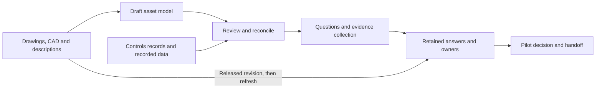
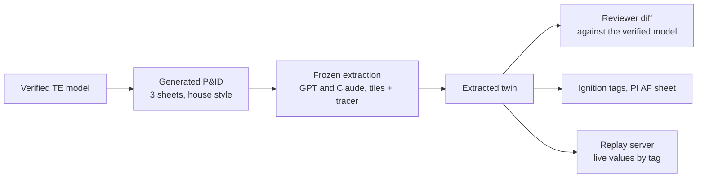
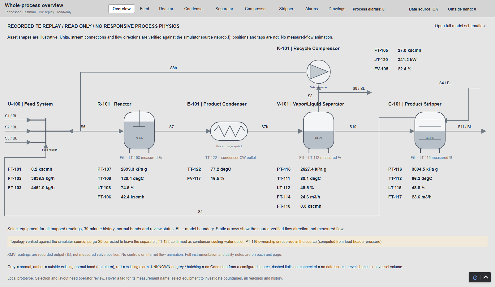
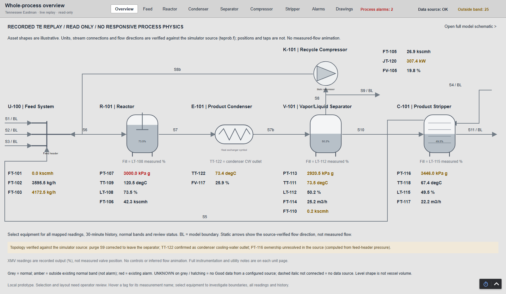

# P&ID → Digital Twin Jumpstart

[](https://github.com/steve-vitale/pid-to-digital-twin/actions/workflows/tests.yml)

**From engineering records to knowledge the organization can own.**

The aim is an engineering foundation for future manufacturing tools: a shared understanding of the plant that
people can inspect, improve and maintain. Equipment identities and connections are part of it. So are the
documents supporting an answer, its operating context, the questions still unresolved, and the people responsible
for the next decision. A drawing becomes one view into that larger body of engineering knowledge.

This repository develops that foundation through local, reviewable workflows. Drawings and supported CAD exports
can seed a draft asset model; a written description can support one an engineer authors. Controls records and
historian CSVs have their own checks and analyses. Linking their findings to assets requires reviewed identity
mapping. Check the model's claims where a model is used, investigate useful questions and retain the answers
with their evidence. The intended result is a portable engineering packet that another person can understand
and continue, and that future applications can build on.

These are prototype tools tested on public inputs. The software examples do not establish an organization's
source authority, an engineer's approval or measured operational value. The [first-pilot brief](examples/first-pilot/README.md)
connects the tools to one real decision, with a sponsor, baseline, observation and accountable recipient.

P&ID extraction was the first tested entry point: AI vision models read symbols and tags on piping and
instrumentation diagrams, code traces the lines, and a builder produces a draft asset model and platform staging
files. Extraction from real drawings is scored against public third-party answer keys; the generated drawings
and the reconstructed real unit use checks this project wrote, and say so. Scoring rules were committed before
the model runs (the one rule I later bent is logged in [EVALUATION.md](docs/EVALUATION.md), rule 7).

## How each piece contributes

The common thread is an engineering decision and the evidence needed to maintain it. The steps include people's
work as well as scripts; running a command does not complete an engineering review.



| Piece | What it contributes | Where to start |
|---|---|---|
| **Document and drawing intake** | Establish an initial asset structure from the records available. Keep source references and reported omissions so the next engineer can check the interpretation. | [Drawing](examples/own-drawing/README.md), [DEXPI XML](examples/from-dexpi-xml/README.md), [written description](examples/from-description/README.md) |
| **A model with stable identities and typed relationships** | Connect equipment, instruments and controls in a reusable structure. Keep a direct pipe connection distinct from membership of the same line network. An identifier still needs reconciliation with the site's identifiers. | [Graph contract](docs/GRAPH_EXPORT.md) |
| **Source review, loop checks and signal mapping** | Check what a source actually says, compare drawn loops with controls records, and map instruments to supplied signal addresses. A source match and current plant truth remain separate verdicts. | [Statement review](docs/STATEMENT_REVIEW.md), [loop audit](examples/loop-audit/README.md), [mapping](examples/review-and-mapping/README.md) |
| **The question engine** | Turn the model into specific energy and controls investigations: why a question applies, which assets it concerns, what evidence to collect and how that evidence could settle it. A finding remains a question. | [Screening guide](docs/OPPORTUNITY_SCREEN.md), [a generated question and partial answer](examples/context-register/bayer/README.md) |
| **Historian tools and impact estimates** | Examine supplied operating history, replay recorded data, and turn a measured change into a first-draft energy, cost and emissions estimate. Retain false alarms, assumptions and missing measurements. | [Historian CSVs](examples/historian-csv/README.md), [impact estimates](docs/IMPACT_ESTIMATE.md) |
| **The context register** | Keep answers, owners, competing evidence and dated decisions together. Refresh against released source revisions to reopen affected answers while retaining the earlier reasoning. It runs locally and does not monitor documents or authenticate people. | [Offline and public-source examples](examples/context-register/README.md), [maintenance guide](docs/CONTEXT_REGISTER.md) |
| **A bounded engineering pilot** | Choose one useful decision with its sponsor and intended user. Record the baseline, observation, resource use and outcome before expanding; a supported decision to stop is useful evidence too. | [Pilot guide and brief](examples/first-pilot/README.md) |
| **Portable handoff and platform staging** | Carry the model, source manifest, context history and open questions to the next engineer or system. Ignition and PI exports supply asset/tag structure; signal values stay placeholders until mapped. Receiving systems require an explicit adapter and acceptance check. | [Versioned handoff](docs/CONTEXT_REGISTER.md#versioned-handoff-and-limits), [platform outputs](docs/TWIN_OUTPUTS.md) |
| **Reproducibility and change checks** | Make the foundation inspectable: compare claims with committed results, re-score saved predictions, report stale generated outputs, and show where tools fail on other public inputs. These checks support review without conferring plant authority. | [Checks](AGENTS.md), [lineage](docs/DATA_LINEAGE.md), [generalization](docs/GENERALIZATION.md) |

Maintenance, energy improvement, controlled change and future AI applications need different interfaces. The
purpose here is to let them build on engineering context whose identities, evidence and limits can travel with it.
The [full feature table](#start-wherever-you-are) below lists the runnable entry points and their exact example evidence.

**Try the P&ID entry point:**

- **You put in** one P&ID as a PNG. For a PDF or a scanned PDF, convert each page first (`pip install pymupdf`):
  `python -c "import pymupdf,sys; d=pymupdf.open(sys.argv[1]); [p.get_pixmap(dpi=200).save(f'{sys.argv[2]}/{i}.png') for i,p in enumerate(d)]" drawing.pdf mysheets`
  writes `mysheets/0.png`, `1.png` and so on (the folder must exist).
- **You get** a draft asset list and a review sheet ranked for checking, plus an Ignition tag file and a PI Builder
  sheet. Those two are placeholder shells: no point is connected until your I/O list maps it.
- **Time:** machine time was 88 s of commands for one new sheet, measured once. Review time has not been measured;
  [COSTS.md](docs/COSTS.md) *assumes* about 45 minutes per sheet, at an assumed 1 minute per correction.
- **Old scans:** on synthetic old-scan copies, the review load (differences from the answer key per 100 items)
  roughly tripled (GPT 17.8 → 51.5,
  [table](#results-held-out-drawings-and-how-they-were-used)). The runbook is
  [examples/own-drawing](examples/own-drawing/README.md); its extraction step needs a model CLI and subscription.

**Who did what.** I chose the problem, set the goals and the evaluation rules before seeing results, made the design
calls and checked the results. AI coding agents (Claude Code, and later Codex) wrote most of the code and the first
drafts of the docs. The [build journal](docs/JOURNAL.md) logs where they and I were wrong.

**Start here:**

- *Plant engineers:* [your own drawing](examples/own-drawing/README.md) · [at your plant](docs/AT_YOUR_PLANT.md) ·
  [costs and review time](docs/COSTS.md) · [keep the answers and context current](examples/context-register/README.md)
- *Engineers starting a transformation pilot:* [one problem, one decision, one evidence pack](examples/first-pilot/README.md)
- *Maintenance and reliability:* [from a reported failure to reviewable execution and outcome evidence](examples/context-register/metropt3/README.md)
- *Controls and Ignition integrators:* [the output files](docs/TWIN_OUTPUTS.md) ·
  [gateway acceptance](docs/IGNITION_ACCEPTANCE.md) · [PI mapping](docs/PI_MAPPING.md)
- *Energy and sustainability:* [questions to ask of a drawing](docs/OPPORTUNITY_SCREEN.md) ·
  [from a measured change to cost and CO2e](docs/IMPACT_ESTIMATE.md)
- *Process safety reviewers:* [what the Bayer replay can't show](docs/BAYER_RT.md#the-evening-replayed-through-the-model-scriptsbayer_replaypy) ·
  [LOTO view limits](docs/OPEN100_STRUCTURAL.md#5-loto-isolation-view) ·
  [generated drawings are not drawings of record](docs/AT_YOUR_PLANT.md#start-wherever-you-are)
- *Researchers:* [evaluation rules and layers](docs/EVALUATION.md) · [where each tool holds and breaks](docs/GENERALIZATION.md) ·
  [what already exists, and what this adds](docs/PRIOR_ART.md)

**What has been checked:**

- **Keeping questions and answers together.** An actual generated question retains its source-backed partial
  answer and original collection requests. A linked PRONTO packet keeps disagreements between the public records
  unresolved; disposable source revisions reopen dependent answers without discarding history. These are software
  examples and independent agent checks, with no human approval or measured adoption. [Context examples](examples/context-register/README.md),
  [journal 66](docs/JOURNAL.md#66-keep-the-questions-answers-and-next-owner-together)
- **Reading real drawings.** On six drawings held out from tuning (a same-plant validation split that also chose
  the method), symbols are found with F1 0.93 and network connections 0.87 over five runs (F1 runs 0 to 1 and combines
  items missed with items wrongly added; 1 is perfect), leaving about 20 differences from
  the answer key per 100 items for a person to check. The 2,886 extracted
  items arrive ranked by risk: 377 to check first. [Results](#results-held-out-drawings-and-how-they-were-used)
- **Drawing what matters.** A P&ID generated from a verified model had every instrument and no control loops: 0 of
  19. The loops were read out of the simulator's own code and drawn. [Journal 50](docs/JOURNAL.md#50-find-the-control-loops-before-drawing-them-the-generated-pid-draws-none)
- **Checked in a lab Ignition gateway, on the Tennessee Eastman kit.** That project is read back out of a running
  local gateway by a verifier that first had to catch 5 planted faults. A bundle made from your own drawing has not
  been import-tested on a gateway, and nothing was imported into PI. [Acceptance](docs/IGNITION_ACCEPTANCE.md)
- **A real unit from a public investigation.** A model written from the CSB report's text got the report's own
  drawing wrong in four places (10 of 21 checks agreed at first; corrected, 20 of 21). The report's DCS trend is digitized and checked against
  its text, disagreements included. [Bayer residue treater](docs/BAYER_RT.md)
- **Not done:** no reviewer has been timed, no operator has reviewed the screens, nothing is imported into a PI
  System, and no plant's own data was used.
- **Check it yourself.** `python scripts/check_claims.py` checks that every headline number here matches the
  committed results file it comes from (standard library only, under a minute). `python scripts/rescore.py --check`
  then re-scores the committed per-drawing predictions ([predictions/](predictions/README.md): the parsed answers,
  without the raw model text, which stays out of git, [why](runs/README.md)) and diffs every regenerated scorecard
  and replicate table against the committed one. 30 of 35 regenerate in their original formats, including the
  round-5 headline replicates below, every holdout-B and round-4 scorecard, and both Tennessee Eastman round trips
  ([which](predictions/README.md)). Five earlier diagnostic tables still lack predictions; they are reported as
  gaps. Parsed predictions recovered from preserved research working copies carry a
  [hash receipt](predictions/RECOVERY.json). If you'd rather have your coding agent do it,
  [AGENTS.md](AGENTS.md) tells it what to run and which limits to report back. More: [REVIEWING.md](docs/REVIEWING.md).
- **What was tried.** Every tuning attempt with its number and verdict (most are single runs), and the ideas not
  tried yet: [TRIED.md](docs/TRIED.md), generated from `data/attempts.json` and checked in CI.
- **Using it on your own drawings.** [A runbook](examples/own-drawing/README.md) that runs offline from a clean clone on
  a public sheet, then the same steps for yours. Most of the repository is this project's research record;
  [which is which](#whats-a-tool-and-whats-a-record).


**Latest tool checks (2026-10-29).** The [corpus matrix](docs/GENERALIZATION.md) covers eight selected workflows:
63 cells pass, 23 fail and 8 are not applicable. Pipe tracing reaches F1 0.912 on the OPEN100 validation sheets
(derived truth, only partly blind), while the mixed vendor-render pool still fails at 0.776. Scan cleanup and
daily-cycle historian bands are optional tools with measured failures; their results do not replace the original
model-extraction benchmarks. [Journal 65](docs/JOURNAL.md#65-finish-the-tool-handoff-and-check-the-public-story)
explains the changes, review findings and remaining gaps.

## Data first: what we know, how sure we are

The main demos use two datasets and one real unit rebuilt from a public investigation report; the wider corpus
also checks the tools on other public drawings and historian data. Each main demo
starts with an assessment before anything is built: where the data came from, what has been checked against an
independent source, and what is inferred. **Every output inherits its inputs' confidence; nothing downstream upgrades
it.** The live replay, the mimics, the 3D tours and the LOTO views are **proof-of-concept outputs, built to iterate
on**, and are labelled that way in their own files. One manifest lists all 52 stages of the pipeline;
`python scripts/pipeline.py status` shows which outputs are stale after a correction (all 52 are fresh in this commit;
the live replay and the native acceptance run are recorded by hand because they need a running Ignition gateway), and
`rebuild --from <stage>` carries a correction forward. Per-element confidence: `python scripts/pipeline.py
confidence`. Stage by stage: [docs/DATA_LINEAGE.md](docs/DATA_LINEAGE.md).

### Drawings only, process knowledge only, or both

The two main tracks have opposite halves of the picture: **TE** (Tennessee Eastman) has process knowledge and no
original drawing, and **OPEN100** has 12 real drawings and no process data. In short:

| Deliverable | TE: process knowledge, no original drawing | OPEN100: drawings, no process data |
|---|---|---|
| Asset model | Done, checked against the simulator source | Done, extracted; every item unverified until reviewed |
| Ignition tags and PI AF structure | Loaded into a lab Ignition gateway; PI sheet checked offline, not imported | Same, with every data point a placeholder until an I/O list maps it |
| Values, normal bands, alarms, replay | Done on recorded simulator replay (proof of concept) | Not possible: needs process data |
| Flow direction, mimic, 3D tour, LOTO view | Done or draft | Partial or offline proof of concept. The LOTO view is a mockup, not a procedure: a valve the extraction missed is not on the list |
| Operations review | Not done | Not done |

Every row with its evidence, in full: [the deliverables matrix](docs/DELIVERABLES.md).

## Results (held-out drawings, and how they were used)

**The number to quote.** On six held-out OPEN100 drawings, GPT with tiling and code line tracing leaves **20.1**
differences from the answer key per 100 key items for a person to check, and Claude leaves **29.8**. Each is the
mean of five round-5 runs ([replicates_r5_holdout-a.md](out/replicates_r5_holdout-a.md)). This is the review load:
missed, extra or wrong symbols and connections per 100 key items. Lower is better; 100 means as many counted
differences as key items. Network-pair differences are not independent engineering edits. It counts differences,
not a reviewer's minutes: no review has been timed.

**What kind of test this is.** A same-plant validation split: OPEN100 sheets 6–11 (holdout A) against development
sheets 0–5, from one plant in one drafting style. Holdout A also chose each tool's method, and round-1 outputs had
been seen for all 12 sheets, so these are selection numbers, not an untouched test ([GOAL.md](docs/GOAL.md)).
Holdout B, 20 synthetic drawings in a different drafting style, is the check of that choice.

**No clear winner across these six drawings.** Resampling the six drawings (a bootstrap), Claude minus GPT is 9.8
points with a 95% interval of −4.5 to 26.5, which includes zero; this does not establish equivalence. Holding the same six drawings fixed, run-to-run
noise alone gives 7.3 to 12.2, so on these six drawings GPT did better. Six drawings are the limit, not the runs.

**How it got there.** Round 2, each method scored once per set:

| Model | Model alone, A / B | Tiling + code line tracing, A / B |
|---|---|---|
| GPT (gpt-6.1-sol, via Codex) | 48.8 / 67.0 | **17.8 / 20.7** |
| Claude (claude-opus-5-5) | 61.1 / 76.6 | **32.4 / 16.5** |
| Gemini (gemini-3.1-pro-preview) | 75.9 / 92.7 | **40.2 / 38.3** |

A = 6 real OPEN100 drawings; B = 20 synthetic drawings in a different style. One run per method and set, the runs the
round-2 decisions were taken on (Gemini's are earlier runs; it was not run after round 3). Five later reruns of the
bold method on A give the figures above ([GOAL.md](docs/GOAL.md#results-round-2-scored-after-the-addendum-above-each-method-once-per-holdout)).

- Reviewers get a risk-ranked queue. The twin built from 12 sheets has 2,886 items: 377 red, 698 amber and 1,811
  green. Green items were 94–100% right on the held-out drawings. The tiers come from agreement between
  extractions (other models, the other pass, the line tracer, a clean tag). What the item does is a separate floor:
  an item whose tag reads as a relief device, shutdown valve, trip switch or isolation valve is never green
  ("safety-relevant: always checked"), which moved 22 instruments from green to amber. The floor only sees what a
  tag says, so an untagged or manual block valve can still be green
  ([docs/TWIN_OUTPUTS.md](docs/TWIN_OUTPUTS.md#the-safety-floor)).
- **Connections are scored on the network layer:** two items count as connected when they are on the same drawn
  line network, not when a pipe runs directly from one to the other (the pipe layer is scored separately). So these
  numbers **can't be compared directly with the PID2Graph paper**: it uses edge mAP on individual graph edges,
  including connector nodes, while these results use F1 on collapsed network pairs
  ([EVALUATION.md §7](docs/EVALUATION.md#7-which-layer-each-evaluation-measures), checked against the paper).
- **Seen before?** PID2Graph (holdout B included) and the DEXPI examples are public, and the models were trained on
  web data, so exposure during their training can't be ruled out. Holdout B was sealed from tuning, not from the
  web. Only the drawings this project generated (Tennessee Eastman and Bayer) are certainly new to the models.
- Cost: $16.57 of metered model spend plus two flat-rate subscriptions; reviewer time is the real cost
  ([COSTS.md](docs/COSTS.md)). The rules that stop me gaming my own score: [EVALUATION.md](docs/EVALUATION.md).

**Old scans (round 4, pre-registered).** Holdout A degraded to three synthetic scan levels, same method, each level
run once per model:

| Image quality | GPT review load | Claude review load | Connection F1 (GPT / Claude) |
|---|---|---|---|
| Clean (the round-2 run) | 17.8 | 32.4 | 0.89 / 0.78 |
| Photocopy | 20.6 | 29.7 | 0.87 / 0.79 |
| Old scan | 51.5 | 57.0 | 0.51 / 0.45 |
| Bad scan | 72.6 | 70.6 | 0.22 / 0.19 |

Symbol reading fell gently (rough F1 0.94 → 0.77 for GPT, 0.90 → 0.81 for Claude at the worst level). The code
line tracer is what breaks: run on the clean image with the bad-scan symbols, connections recover to 0.53–0.63.
The scans are synthetic degradations, not real archive scans. Details: [GOAL.md, round 4](docs/GOAL.md#round-4-results-scored-once-per-level-as-pre-registered).

**More drawings, tag text and replicates (round 5, pre-registered).** Five fresh runs per model, Claude and GPT:

| | GPT mean (95% across runs / across drawings) | Claude mean (same) |
|---|---|---|
| Holdout A, review load | 20.1 (18.3–21.8 / 14.2–28.0) | 29.8 (27.5–32.1 / 12.8–47.3) |
| DEXPI sheets, review load | 95.4 (53.2–137.6 / 42.1–138.6) | 61.8 (60.5–63.1 / 26.3–127.9) |
| DEXPI tag text, read exactly | 29 of 33 | 28 of 33 |
| DEXPI tag lists, identifiers found | 145 of 145 | 99.4% |

- **New drawings, worse result.** Five public example and training P&IDs from the DEXPI standards initiative
  (CC BY 4.0) gave 2–5× holdout A's review load. Much of it is what counts as a symbol: equipment nozzles and some
  drawn marks aren't items in the DEXPI key, and GPT reported the nozzles in 3 of 5 runs, which swung one sheet
  between about 33 and 145.
- **Tag text, measured for the first time:** on clean vector drawings both models read almost every printed tag.
  The misses are vertical labels, multi-line labels and a number drawn on a separate actuator bubble. Scans and
  real archives remain untested for tags. Every caveat: [GOAL.md, round 5](docs/GOAL.md#round-5-results-scored-after-the-pre-registration-above).
- **Review time is still unmeasured.** A timing kit for one sheet: [`out/review_kit/sheet-8/`](out/review_kit/sheet-8/README.md).

## From one engineer's pilot to ongoing organizational use

Use the local toolkit to establish a bounded, reviewable engineering packet and learn where the starting records
are incomplete. Keep the original source pack, stable asset IDs, mappings, answers, ownership history, unresolved
questions and pilot outcome together. An engineer should be able to inspect that packet without an account.

When a model review rejects an item, [refresh the question screen](examples/opportunity-screen/review-refresh/README.md)
so that item stops supplying evidence or hiding a collection need. Refresh the retained context register against
the revised model and questions; previous decisions remain visible even when their question no longer applies.

When several teams depend on it, the ongoing work includes deciding which revisions govern, reconciling identities
across systems, assigning accountable owners, controlling access, reviewing changes and retaining decisions across
projects. Those responsibilities belong in the organization's working processes and systems. The local register
records supplied identities and compares evidence when run; it does not provide a shared service, authenticated
approvals, automatic monitoring or live synchronization.

The [handoff contract](docs/CONTEXT_REGISTER.md#versioned-handoff-and-limits) preserves the starting point for that
transition. A receiving system must retain source revisions and locations, relationship meanings, unknown and
disputed states, and review history. Its adapter needs a staged import and readback check before anyone claims
compatibility. No downstream live integration of the context register has been verified here.

For the intended closed loop—one reviewed context, versioned generator inputs, draft outputs and proposed changes
returned for review—see [the context lifecycle](docs/CONTEXT_LIFECYCLE.md). It separates original records, generated
views and authored documents, lists the formats each tool actually reads, and defines what a future integration
must demonstrate before claiming to keep a company's documents synchronized.

## The platform demonstration and its acceptance boundary

The reusable drawing route produces a draft model, review material, Ignition tags and PI staging. Working screens
and native gateway acceptance below belong to the repository's Tennessee Eastman demonstration and recorded lab
checks. Generating a new bundle does not repeat those runtime checks for a site's own unit.

| Platform | What's verified |
|---|---|
| Ignition 8.3 | Historical build: 9/9 verifier checks after catching 5/5 planted faults ([IGNITION_BUILD.md](docs/IGNITION_BUILD.md)). Current 24-view project (after the topology correction): native acceptance passed on 2026-10-13 in a disposable Ignition 8.3.10 gateway: verifier checks V1–V8, 24/24 routes, 284/284 navigation targets, 0 false-good placeholders; the data-source-lost diagnostic fires when a source stops and clears on recovery; the header's alarm count matches the alarm table; a 390 px overview at `/m` ([journal entry 47](docs/JOURNAL.md#47-count-what-the-bands-detect-and-make-lost-data-an-alarm), [receipt](out/ignition/gateway/receipts/native-current-20261013-alarms.json)) On 2026-10-28 the control valves were renumbered to their loops (revision B, [journal entry 51](docs/JOURNAL.md#51-draw-the-control-loops-and-give-each-valve-its-loops-number)); the rebuilt project passed native acceptance again the same day in the local disposable gateway: 5/5 planted faults caught, V1–V9, 24/24 routes, 284/284 clicks, the data-source-lost diagnostic raised and cleared ([receipt](out/ignition/gateway/receipts/native-revB-20261028.json)) |
| AVEVA PI AF | Asset structure generated as a PI Builder sheet following the vendor-published conventions (element templates, documented headers, AF unit abbreviations, custom units defined rather than assumed), checked offline against them by `check_pi_export.py`. **Not imported into a PI System; not import-tested** ([PI_MAPPING.md](docs/PI_MAPPING.md)) |
| Operations review | Tooling built and tested. **No operations or operator review has been done yet** |

## Start wherever you are

What each job needs from you, how long it takes, and what you get back. Every output is a draft for review.
*Proven* means committed example outputs, tests, and a passing independent review whose file hashes still match
those outputs; the other Evidence words and each row's evidence are explained in [FEATURES.md](docs/FEATURES.md),
which this table is generated from.

<!-- use-matrix:start -->
| I need to... | Why it matters | You need | Time | You get | Evidence |
|---|---|---|---|---|---|
| [Get a starting asset model out of a P&ID without retyping it](examples/own-drawing/README.md) | Retyping drawings into asset lists takes manual effort in historian, HMI and digital twin projects. A draft turns some of that typing into checking; the time saved has not been measured. | One P&ID as a PNG; a model subscription (or the committed example) | 88 s of commands on one new sheet (sheet 8), measured once; sheet 0's recorded run took 75 s plus 1 s; review time not measured | Extracted symbols, tags and links as a draft model, a review sheet ranked for checking, Ignition tags and PI staging | proven |
| [Show someone what came out of a drawing, and what still needs checking](examples/own-drawing/README.md) | Whoever approves the work needs one page that says what was found and what is still unchecked, without opening a spreadsheet of 445 rows. | A review bundle from the step above | Under a second | One page: the drawing with every item boxed, what is still to check first and why, what a person has already decided (shown with the decision and left out of the to-check list), next steps, limits. Refuses if any generated column of the review sheet doesn't match what the model gives now; the reviewer's OPS_ entries aren't checked, so decisions not yet applied with apply_review.py don't appear | proven |
| [Use a DEXPI file my CAD tool already exports](examples/from-dexpi/README.md) | A CAD export already represents symbols and connections as data. Reading supported DEXPI content directly avoids a visual model-reading step; conversion limits and omissions still need review. | One of the three public DEXPI example sheets, prepared once by adapt_dexpi.py (downloads them; needs PyMuPDF). For your own DEXPI XML, use the DEXPI reader instead | Seconds once the sheets are prepared | The same bundle with no model reading: tags are the drawn label text, and links are the drawn connections, undirected, with each pipe tee expanded into pairwise links | proven |
| [Turn the DEXPI XML my CAD tool exports into a model, keeping line sizes, specs and design limits](examples/from-dexpi-xml/README.md) | A CAD export can hold sizes, specifications and design limits. The reader preserves supported attributes with XML element citations, and reports what it folds, cannot place or drops. | A DEXPI P&ID XML file (tested on DEXPI 1.3, and on DEXPI 1.2 exports from SPPID, Comos, AVEVA and AutoCAD); a rendered PNG only if you also want the drawing bundle | Seconds per sheet | A process model the export, graph and screen tools accept, plus a report of what was kept, folded and dropped, and why | proven |
| [Build a model of a unit that has no usable drawing](examples/from-description/README.md) | Many older units have no usable drawing but do have procedures and design notes. A model with a source on every item lets you build asset lists and screens for them anyway, and shows where the text and the plant disagree. | A written description (procedure, design basis, report); someone to cite every item | Writing the model is the work; exports take seconds | Ignition tags, PI staging and overview screens from the model; a P&ID once a drafting layout is written | proven |
| [Load the model into an asset register, graph database or change system](docs/GRAPH_EXPORT.md) | A plant model is a web of relationships: this transmitter measures that line, this controller moves that valve. Kept as a graph, it answers questions a flat tag list can't, like what a valve's failure affects or which instruments nobody has checked, and other systems can load it without retyping. | Any model this repository produces | Seconds | One open JSON graph: assets, typed links in three layers (pipe segments and tees, line networks, and network pairs), every attribute with its source and status; plus a smaller core profile (identity, settings, impact relations and sources) for loading into another system, with everything it leaves out counted | proven |
| [Get the model into Ignition and PI](docs/TWIN_OUTPUTS.md) | Generating the Ignition tag structure and PI asset staging from one model keeps them consistent with each other and avoids repeated manual entry. Native import still needs a lab check. | A reviewed model | Seconds to generate; import is a manual step in a lab gateway | Ignition tag import with UDTs, PI Builder staging sheets; values are placeholders until mapped | proven |
| [Check whether a drawing shows the control loops the DCS actually runs](examples/loop-audit/README.md) | Drawings drift from what the control system actually runs. A quick check shows which loops a drawing misses before someone relies on it to troubleshoot or plan a change. | A loop list exported from the DCS or PLC configuration (controller, measurement, output) | Seconds | Each loop drawn, partly drawn (and what's missing) or not drawn | proven |
| [Find out whether a digitization tool or vendor is actually accurate on our drawings](examples/vendor-evaluation/README.md) | Vendors quote accuracy on their own test drawings. Scoring them on yours, with a deliberately wrong answer scored beside them, shows whether the number means anything. | A few of our sheets labelled by hand, and the tool's output for them | Seconds once labelled; labelling takes hours | A score beside perfect, wrong and empty answers, per sheet, refusing to report if the scorer can be fooled | proven |
| [Decide whether to trust this repository at all](docs/REVIEWING.md) | Before trusting any tool with your plant's data, you should be able to check its claims yourself in minutes. | Python alone for claim and freshness checks; full tests also need pinned packages and required public caches; optional-source omissions are reported separately | Under a minute for the claim check | Headline claims checked against results files, stage freshness, and selected tests with skipped cases and coverage limits visible | proven |
| [Learn normal operating bands from history, or test screens against recorded data](examples/historian-csv/README.md) | History can highlight unusual changes, and replaying recorded data lets you test new screens without touching the live system. Detection before an operational alarm is not guaranteed. | Historian exports as CSV: one of normal running, optionally one of an upset. Standard library only; the replay server also needs asyncua | Seconds | Bands per tag with false-alarm rates, the first tag to leave its band in an upset, and an OPC UA server replaying the CSV | proven |
| [Feed operators' review decisions back into the model, and connect instruments to real signals](examples/review-and-mapping/README.md) | A model is only useful once someone who knows the unit has checked it and its instruments point at real signals. This records who decided what and when, so every change can be traced. | A filled review sheet; the plant's I/O list | Seconds per apply; the review itself is people's time | An updated model with a dated change record, and instruments mapped to OPC or PI addresses | proven |
| [Find out whether a tool will work on drawings or data like mine, not just the ones it was built on](docs/GENERALIZATION.md) | A workflow that only saw one set of drawings can fail on the next. Eight selected workflows run across registered applicable inputs, showing where they hold and break, red cells included; other features have their own tests and examples. | Nothing to read the page; the public datasets (fetched by script) to re-run it | Reading: minutes. Re-running everything: about 25 minutes of cell time, plus downloading the public data once | A pass/fail grid of tools against inputs, the reason for every failure, and the public datasets that would close each gap | proven |
| [Find energy, heat-grade and control questions worth asking about my unit, and what data answers each](docs/OPPORTUNITY_SCREEN.md) | Many energy and controls questions can be spotted on a P&ID before anyone collects data: a throttled pump, high-pressure steam let down for a low-temperature job, heat dumped to cooling water, a loop with no controller. A solo engineer rarely has time to look. This lists the questions with the evidence by tag and exactly what to collect, and where, to settle each one, without inventing a savings number. | A process model or extracted drawing set; optionally the plant's loop list and equipment schedules | Seconds | Per question and asset: the evidence by tag, what to collect and where (down to a blank field on a named schedule), how the data decides it, and what public sources say is typical. A screen, not an audit | proven |
| [Turn a change I measured into an annual energy, cost and greenhouse-gas figure](docs/IMPACT_ESTIMATE.md) | A measured change becomes a first-draft cost and emissions figure, good enough to decide whether to collect better data, with every constant's source shown and every assumption listed. If you don't have a constant, it tells you exactly which bill, contract or public table has it. | What you measured (kW before and after, steam lb/h, fuel saved, hours) and your tariff, gas price, emission factors and boiler efficiency, or labelled public typical values | Minutes | A first-draft estimate, marked as one: annual kWh or MMBtu, cost and CO2e with the formula and source of every constant, the assumptions it rests on, and the data to collect (and where) to replace each one; or, per question, what to measure and where each constant comes from | proven |
| [Measure how often the model's statements match their sources, and let an operator check a unit in plain English](docs/STATEMENT_REVIEW.md) | "Does this look right?" has no answer you can track. A sampled review of plain sentences against their sources gives an error rate for each kind of statement, and keeps 'matches the drawing' apart from 'true in the plant', which only someone who knows the unit can say. | A graph export (twin-graph-1), plus the sheet image or report PDF its sources cite | Seconds to render; review time per statement not yet measured | A stratified sample of plain sentences, each beside its drawing crop or report page, with two separate verdict columns; an error rate with a 95% interval; and the verdicts written back into the graph as dated events | proven |
| [Turn a set of starting documents and questions into context the team can maintain and own](docs/CONTEXT_REGISTER.md) | Answers and their reasons get lost between drawings, spreadsheets and people. A persistent register keeps responsibility, competing evidence and the need for a new review beside each question. | A draft model or graph, a question list, local source documents and their revision/locator manifest; an engineer to assign and review answers | Local workflow; engineering review time has not been measured | A readable context report, evidence-bound dated decisions and ownership history, unanswered/disputed/stale queues, and versioned JSON plus enriched graph/questions for a reviewed handoff | proven |
<!-- use-matrix:end -->

Only scripts marked as tools in [docs/SCRIPTS.md](docs/SCRIPTS.md) are built for other inputs; the longer path for a
real pilot is [REPLICATE_AT_YOUR_PLANT.md](docs/REPLICATE_AT_YOUR_PLANT.md). A generated drawing is **not a drawing of
record** until engineering walks it down and accepts it under management of change. Do not operate, isolate or permit
from it ([governance](docs/AT_YOUR_PLANT.md#start-wherever-you-are), with how to capture your own title block).


**Drafting style.** Revision C sits inside the OPEN100 range on **35 of 36** style measurements (revision A 32,
revision B 30). That measures resemblance to the OPEN100 sheets, not engineering quality. Its control valve stations
(block valves and a bypass around 10 control valves) are a drafting assumption, not process design: the TE model has
none. Drains and vents are not drawn ([style_fidelity.md](out/te_pid/style_fidelity.md), [journal entry 52](docs/JOURNAL.md#52-put-each-control-valve-in-a-station-block-valves-and-a-bypass)).

**Control loops.** Revision A drew every transmitter and valve but no controller or signal line: a PFD with bubbles
on it. The 19 loops are now read out of the simulator's closed-loop code, checked against the recorded data, drawn
with dashed signal lines and scored by `scripts/te_control_loops.py`: **0 of 19 loops on revision A, 19 of 19 on revision D**
(the current sheets; [te_loop_audit.md](out/te_loop_audit.md), journal entries
[50](docs/JOURNAL.md#50-find-the-control-loops-before-drawing-them-the-generated-pid-draws-none) and
[51](docs/JOURNAL.md#51-draw-the-control-loops-and-give-each-valve-its-loops-number)). 0 of 19 is the real finding;
19 of 19 is a regression check on the generator's answer key, not the image: it doesn't show that a model can read
the loops off the sheet, and it is not an engineering review of the control strategy.

### One plant, end to end (Tennessee Eastman)



**This is a round trip.** The sheets and their answer keys come from the same model, so the scores measure how
faithfully the frozen method (2×2 tiles, prompt v2, code line tracer; nothing re-tuned) reads our own clean drawings.
They are an upper bound, not real-plant accuracy, and not comparable with the OPEN100 numbers. Gemini was left out.

**Revision A sheets** (no controllers; kept in [`data/te_pid/rev-a/`](data/te_pid/rev-a/), tags since renumbered
by [this map](data/te_retag_2026-10-28.json); the extracted twin below was built from them): review load 2.1 (GPT)
and 2.2 (Claude) per 100 with every tag read on clean sheets, rising to 16.9 and 17.3 at the bad-scan level, where
only **14%** and **49%** of tags were read exactly ([roundtrip_scores.md](out/te_pid/roundtrip_scores.md)).

**Revision C sheets** (controllers, signal lines and valve stations; same frozen method and protocol;
[roundtrip_scores_revC.md](out/te_pid/roundtrip_scores_revC.md), journal entry 54):

| Image | Review load /100, GPT · Claude | Tags read exactly, GPT · Claude |
|---|---|---|
| Clean (5 runs each) | 1.26 · 1.38 | 100% · 100% |
| Photocopy, L1 (3 runs each) | 1.30 · 4.1 | 100% · 100% |
| Old scan, L2 | 1.20 · 10.0 | **61%** · 89% |
| Bad scan, L3 | 14.9 · 15.7 | **9%** · **50%** |

On bad scans tag text fails first, controller tags before the rest. Claude's higher load at L1 and L2 comes from my
line tracer following a vessel wall inside its tighter boxes; growing them 4 px removes every extra link, but that is
a method change and will be measured as one. 43 printed tags per run: the project's first tag-reading score, because
the OPEN100 keys carry no text. In full: [EVALUATION.md §6](docs/EVALUATION.md#6-one-plant-end-to-end-tennessee-eastman).
- **On old scans the risk is in the text, not the shapes.** GPT kept finding every symbol and line at L2 but read
  FI as PI, LI as LE and FV as PV. Claude at L3 put three real feed-valve tags each on its neighbour's valve in one
  run. A tag-only check and the live check both pass that; only the position-aware round trip catches it.
- **The reviewer diff** (GPT, clean, first run) has 10 corrections against the verified model. Nine also appear for
  a perfect reader, so they come from the converter and the model's conventions, not from the reading
  ([diff](out/te_pid/diff_codex-clean-r1.md), [perfect-reader diff](out/te_pid/diff_key.md)).
- **Live values:** 36 of the extracted twin's 37 tags resolve to points on the TE replay server, and all 36 moved
  between reads; SC-212 has no recorded data ([live check](out/te_pid/live_codex-clean-r1.md)). Its tag file was
  **not** imported into a gateway: the gateway-tested project is built from the verified model.

## Try it

- **No Ignition install (Docker):** [docker/README.md](docker/README.md). Double-click `start-demo.bat`. It restores
  the historical demo backup, not the current project. Clean starts are checked in CI
  ([journal entry 35](docs/JOURNAL.md#35-test-the-packaged-demo-after-the-source-checks-pass)).
- **No Docker, no Ignition:** `python scripts/run_tests.py --source-only` runs the scorer controls and offline checks
  with the standard library, and `python scripts/generate.py` writes the SVG, Ignition and PI AF files to `out/`.
- **Your own Ignition (free trial):** [docs/IGNITION_QUICKSTART.md](docs/IGNITION_QUICKSTART.md).
- **At a real plant:** [AT_YOUR_PLANT.md](docs/AT_YOUR_PLANT.md) (pilot scope, your own answer key, read-only use,
  data egress, zoning, offline models), step by step in [REPLICATE_AT_YOUR_PLANT.md](docs/REPLICATE_AT_YOUR_PLANT.md).

## How it was built

The [build journal](docs/JOURNAL.md) records each decision, what was rejected and what went wrong, including the
agents' mistakes and mine; [docs/MODELS.md](docs/MODELS.md) says which parts came from Claude alone.

**Reference below:** [tools vs record](#whats-a-tool-and-whats-a-record) · [tutorial](#tutorial-reproduce-it) ·
[repository map](#repository-map) · [read next](#read-next) · [status](#status) · [environment variables](#environment-variables)

---

## Status and evidence tracks

Four separate pieces of evidence live here. Keep them apart:
- **OPEN100:** drawing extraction, scored outputs and a labeled synthetic point-mapping demo, not site-verified live plant connections.
- **Tennessee Eastman (TE):** a process model hand-built from the published process and verified against the
  simulator source ([report](out/te_topology_check.md)); screens driven by recorded simulation replay. The model was
  not extracted from a drawing, tap positions and pipe routes are not in the source, and replay is not a process
  simulator that responds to control changes. The model drawn as P&ID sheets and read back
  ([above](#one-plant-end-to-end-tennessee-eastman)) is a round trip on our own drawings, not a real plant's sheets.
- **PID2Graph Synthetic:** a bounded two-sheet adaptation through the existing scorer and exporters, with unresolved
  ontology and line-semantics review gates; neither a held-out generalization result nor plant validation
  ([guide](docs/ADAPT_LABELED_DATASET.md)).
- **Bayer CropScience residue treater:** a real unit rebuilt from the U.S. Chemical Safety Board's report, checked
  against the report's own drawing and its published DCS trend. Tags are assigned by this project; no plant data or
  drawing of record was used ([docs/BAYER_RT.md](docs/BAYER_RT.md)).

PI import and the human review-time study have not been run; the handoffs for both are in
[REPLICATE_AT_YOUR_PLANT.md](docs/REPLICATE_AT_YOUR_PLANT.md).


*Two separate demonstrations: OPEN100 extraction with synthetic I/O mapping, then the hand-built TE model in recorded
fault replay (not extracted from the OPEN100 drawing). Made from historical screens, so it predates the current ones.*

## What the numbers mean

The goal ([docs/GOAL.md](docs/GOAL.md)): a starter kit needing as little human correction as possible, judged by rules
committed before any method was tested.

- **AI reads symbols and tags; code traces the lines.** Connections are two-thirds of the work and the models'
  weakest skill. A deterministic line tracer took the best result from about 49 corrections per 100 items to about
  18 in round 2 (one run each: 48.8 → 17.8); five round-5 reruns of the traced method average 20.1. It held on a
  different drafting style; set B is synthetic, so that shows a change of style, not a second real plant.
- **Not everything improved.** Choosing each instrument's parent equipment got slightly worse with the tracer
  (90.9% → 87.0%). Following the drawn line fixed it for this drafting style (92.2%); on a different style it
  slipped (67.6% vs 70.8%), so the two rules' disagreements go to review.
- **The risk tiers mostly work.** On held-out drawings the riskiest 20% held 2–4× as many errors as the models' own
  confidence would point to (23 of 24 comparisons). The one failure was the best model with the best method on
  same-style drawings, where it was no better than the model's own confidence ([GOAL.md](docs/GOAL.md)).
- **An open-weight model you can run offline** (Gemma 4 31B, round 1) trailed far behind: about 0.53 "found" F1
  where it finished, against about 0.90 for the frontier models, and it stalled on dense sheets.
- **The review loop and point mapping are built, not yet used.** A reviewer's spreadsheet decisions are checked,
  applied with a change record and regenerated into Ignition, PI AF and the screens; removing or inventing an alarm
  goes to change review instead. Mapping from an I/O list never guesses, and lists the points the drawing doesn't
  show. No real review has gone through it; the demo maps 24 instruments from a labeled synthetic I/O list
  ([docs/REVIEW_LOOP.md](docs/REVIEW_LOOP.md)).


## Try it in Ignition

The current project's native acceptance runs are summarised [above](#the-platform-demonstration-and-its-acceptance-boundary) and written up, with which files
belong together, in [docs/IGNITION_ACCEPTANCE.md](docs/IGNITION_ACCEPTANCE.md). Each gateway run found bugs no
offline check had caught; all were fixed with regression tests ([journal entry 38](docs/JOURNAL.md#38-import-the-current-project-into-a-real-gateway-and-watch-what-the-offline-checks-could-not),
[entry 47](docs/JOURNAL.md#47-count-what-the-bands-detect-and-make-lost-data-an-alarm)). That is a lab result on
recorded and synthetic data, not site or operator acceptance; the control-room screens stay 1600 px and scroll on a
phone (`/m` is a 390 px overview). There's no public live instance: run it on Ignition's free trial by hand
([IGNITION_QUICKSTART.md](docs/IGNITION_QUICKSTART.md)), by script with every check
([IGNITION_BUILD.md](docs/IGNITION_BUILD.md)), or with `python scripts/demo.py --build --verify`.

The screens are generated from the twin in the ISA-101 style: grey when the plant is normal, amber when a value
leaves its learned normal band, red only for a real alarm. In the fault replay, the first value turns amber 294
plant-minutes before the pressure alarm. That is one easy fault: scored on all 21 published faults, the bands flag
17 (median 48 minutes after onset) with no false alarm in 193 hours of held-out normal running, and miss faults 3,
9, 15 and 19 ([EVALUATION.md](docs/EVALUATION.md#4b-fault-detection-with-the-normal-bands-tennessee-eastman-all-21-faults)).
What they infer, and how far to trust it:
[docs/OPERATOR_SCREENS.md](docs/OPERATOR_SCREENS.md). The key values, spans and layout are first-pass choices by
Claude and haven't been reviewed by operations.

| Plant overview, normal | Fault 6 at the alarm | An extracted drawing, live |
|---|---|---|
|  |  |  |

The two overview screenshots are from the revision D acceptance run in the local disposable gateway (2026-10-29); the extracted-drawing screenshot is from the 2026-10-13 run.

Full results, every method tried (including the losses), and caveats: [docs/GOAL.md](docs/GOAL.md) →
Results, and [docs/EVALUATION.md](docs/EVALUATION.md).

## What this project demonstrates

- **Domain to data.** P&ID conventions (ISA-5.1 tags, off-page connectors, equipment classes) turned into one
  structured model. That model generates SVG graphics, Ignition UDTs and tags, a PI AF hierarchy, and a
  plain-language review sheet for operations.
- **Evaluation you can defend.** Rules written before any model ran; a scorer tested with deliberately wrong answers
  (its first version gave them 15–32% credit and was rebuilt); repeated runs where noise matters, single runs
  labelled as such; failures count as zero; and where I broke one of my own rules, the docs say so.
- **Judgment about tools.** Three cloud models compared fairly, plus an open-weight model as a stand-in for a fully
  offline deployment, with time and cost recorded per drawing.
- **Plant reality.** Every step has an "At your plant" note: messy drawing sets, savings from an imperfect draft,
  Management of Change, read-only use, data egress, OT zoning, and what an air-gapped model setup would cost.

---

## Tutorial: reproduce it

Requires Python 3.10+ (CI uses 3.12); steps 1–2 use the standard library only. Installing dependencies, fetching data,
model runs (which send drawings to the selected service) and gateway operations are networked steps. Use a disposable
checkout: generation, `--write`, review and mapping can overwrite files. The bounded public-data path is
[the replication guide](docs/REPLICATE_AT_YOUR_PLANT.md).

**1. Check the TE model against its source.** The first script checks every tag's name and units against the
open TE simulation code (36 of 37 confirmed, 1 corrected). The second reads the code's mass balances, flow lines and
measurement lines to check every unit, stream, flow direction and tag-to-unit assignment (51 of 56 confirmed,
4 corrected, 1 unresolvable), cross-checked against the revised TE code of Bathelt, Ricker and Jelali (2015):
```
python scripts/verify_te_source.py --write
python scripts/verify_te_topology.py --write
```

**2. Generate the platform outputs** (SVGs, Ignition tag import, PI AF sheet, operations review sheet) into `out/`:
```
python scripts/generate.py
```

**3. The scoring drawings are already here** (12 OPEN100 drawings, keys and round-4 scan copies, in
`data/external/pid2graph/`, CC BY-SA 4.0, [NOTICE.md](NOTICE.md)). The 20 holdout-B drawings (130 MB) are fetched
from the 9.3 GB archive, reading only the parts needed:
```
python scripts/fetch_pid2graph.py --get "Complete/Dataset PID/"
```

**4. Prove the scorer before trusting it.** Start with the standard-library and committed-fixture checks. This
narrower mode is not a full-suite pass:
```
python scripts/run_tests.py --source-only
```
The full suite (the no-argument and CI default) needs the pinned dependencies, the hash-verified TE replay files and
a locally regenerated project ZIP (the build contacts no gateway); its preflight fails rather than skip or download:
```
pip install -r requirements.txt
python scripts/fetch_te_data.py --all   # all 44 Braatz files: the fault evaluation regenerates its results
python scripts/verify_te_topology.py   # downloads the revised TE code its test cross-checks; report only
python scripts/ignition/build_gateway.py --write-only
python scripts/run_tests.py --full --check-prerequisites
python scripts/run_tests.py --full
```
CI runs the full selection on every push, but successful script exits can include skipped cases. The summary
reports unittest skips, platform notices and additional skipped-check notices separately; platform notices explain
cases rather than adding another case count. Any omission withholds the complete-suite message. CI's setup stages
TE data and revised code, not every optional DEXPI source/render cache. The [reviewer guide](docs/REVIEWING.md)
explains that coverage; a [small offline example](examples/test-coverage/README.md) demonstrates the distinction.
A prerequisite check alone is not a test pass ([limits](docs/REPLICATE_AT_YOUR_PLANT.md#c-check-the-pipeline-then-optionally-rerun-public-extraction)).

**5–8. Run a model, trace the lines, build the twin, load it into Ignition, close the review loop.** Each step's
commands live in the guide that owns it. Extraction, scoring, line tracing and the twin build:
[REPLICATE_AT_YOUR_PLANT.md](docs/REPLICATE_AT_YOUR_PLANT.md) and [TWIN_OUTPUTS.md](docs/TWIN_OUTPUTS.md) (model
runs need the `claude`, `codex` or `gemini` CLI; Gemini needs `GEMINI_API_KEY`). The gateway build and the verifier
that plants five faults before its nine checks: [IGNITION_BUILD.md](docs/IGNITION_BUILD.md) (an Ignition 8.3 gateway;
the free trial works), or by hand, [IGNITION_QUICKSTART.md](docs/IGNITION_QUICKSTART.md). Review decisions and
I/O-list mapping: [REVIEW_LOOP.md](docs/REVIEW_LOOP.md).

**9. One plant end to end: draw the TE model, read it back, diff it.** The sheets are committed; regenerating
them checks the model against the layout. The extraction needs the `claude` or `codex` CLI:
```
python scripts/draw_pid_from_model.py && python scripts/style_fidelity.py
python scripts/degrade_scans.py --src data/te_pid --drawings 101,102,103 --dest data/te_pid/scan
PID_SHEETS_DIR=data/te_pid python scripts/run_extraction.py --tool codex --drawings 101,102,103 --prompt extraction/prompt_v2.md --tiles 2x2 --label te-clean-tiles-r1
PID_SHEETS_DIR=data/te_pid python scripts/trace_connections.py --src-label te-clean-tiles-r1 --tool codex --drawings 101,102,103 --label te-clean-trace-r1
python scripts/score_te_roundtrip.py --conditions clean --tools codex
PID_SHEETS_DIR=data/te_pid python scripts/build_twin.py --label te-clean-trace-r1 --tools codex --sheets 101,102,103 --holdout-ok --sheet-register data/sheet_registers/te_generated.csv --out out/te_pid/twin/codex-clean-r1
python scripts/te_model_diff.py out/te_pid/twin/codex-clean-r1/plant_model.json
python scripts/te_live_check.py out/te_pid/twin/codex-clean-r1/plant_model.json   # needs fetch_te_data.py first
```
(`PID_SHEETS_DIR=...` is shell syntax; in PowerShell set `$env:PID_SHEETS_DIR` first.)

**10. Read why each step is done this way** in [docs/JOURNAL.md](docs/JOURNAL.md). Each entry ends with how to apply
it at a real site.

## What's a tool and what's a record

Three kinds of thing live in this repository. Only the first is designed for other inputs.

**Tools for your own drawings and systems.** Prototypes exercised on public inputs by workflow. The drawing route
has not been validated on a plant's own drawings; organizational adoption and operational benefit remain unmeasured.
Start with [the runbook](examples/own-drawing/README.md); the inputs a plant has to supply are in
[REPLICATE_AT_YOUR_PLANT.md](docs/REPLICATE_AT_YOUR_PLANT.md).

| Step | Scripts | Guide |
|---|---|---|
| Extract a drawing | `run_extraction.py` then `trace_connections.py` (the method behind the results; point `PID_SHEETS_DIR` at a folder with your PNG), or `site_extraction_workflow.py` (one PNG with a full audit trail, but a simpler recipe: no tiles, no tracing) | [the runbook](examples/own-drawing/README.md), [SITE_EXTRACTION_WORKFLOW.md](docs/SITE_EXTRACTION_WORKFLOW.md) |
| Build the draft model and exports | `import_site_drawing.py` (one PNG plus its extraction to a review bundle: model, review sheet, Ignition tags, PI AF staging, SVG); `generate.py` regenerates exports after review | [the runbook](examples/own-drawing/README.md), [TWIN_OUTPUTS.md](docs/TWIN_OUTPUTS.md) |
| Review and map to data | `apply_review.py`, `review_kit.py`, `map_points.py`, `map_pi_points.py`, `check_pi_export.py` | [REVIEW_LOOP.md](docs/REVIEW_LOOP.md), [PI_MAPPING.md](docs/PI_MAPPING.md) |
| Load into Ignition | Import the bundle's `ignition/tags.json` in Designer (Tag Browser, Import Tags) into a lab gateway. Not `build_gateway.py`: that builds this repository's Tennessee Eastman demo | [the runbook](examples/own-drawing/README.md#5-into-ignition) |
| Score an extraction against your own answer key | `score_pid2graph.py` (keys in the PID2Graph GraphML format, labelled by hand for a few of your sheets) | [EVALUATION.md](docs/EVALUATION.md) |

**Checks on this repository.** `check_claims.py`, `pipeline.py status` and `run_tests.py`. Nothing to configure;
see [REVIEWING.md](docs/REVIEWING.md).

**This project's research record.** Read it, or rerun it to reproduce a result; it isn't built for other inputs. It
includes `build_twin.py` with its OPEN100-trained risk tiers and the Ignition demo build and verifier; every script's
kind (tool, check, support or research record) is in [docs/SCRIPTS.md](docs/SCRIPTS.md). Outputs: `out/` (scores,
exports, receipts), `drafts/` (proof-of-concept pages, tours and stills), the generated sheets in `data/te_pid/` and
`data/bayer_rt/`, and the [journal](docs/JOURNAL.md). `pipeline.py` regenerates them; edit the inputs, never an output.

## Repository map

| Path | What's there |
|---|---|
| [`docs/`](docs/) | Everything to read; see [Read next](#read-next). Screenshots are in [`docs/screenshots/`](docs/screenshots/) |
| [`pipeline/`](pipeline/stages.json) | The stage manifest and lock: `scripts/pipeline.py` (status, rebuild, confidence), `provenance.py`, and two proof-of-concept generators, `build_scene_data.py` and `export_mimic_layout.py` |
| [`data/te_process_model.json`](data/te_process_model.json) | The Tennessee Eastman model: tags, units, streams and directions verified against the simulator source ([tags](out/te_source_check.md), [topology](out/te_topology_check.md)) |
| [`data/te_pid/`](data/te_pid/), [`data/te_pid_layout.json`](data/te_pid_layout.json) | The TE P&ID generated in the OPEN100 style (3 sheets, PNG + SVG) with answer keys emitted from the model, and the drafting layout that places it |
| [`data/sheet_registers/`](data/sheet_registers/), [`data/io_lists/`](data/io_lists/README.md) | A drawing index read from the OPEN100 title blocks, and a synthetic I/O list for the point-mapping demo: examples of what a plant supplies |
| [`data/external/pid2graph/`](data/external/pid2graph/), [`data/drawings/`](data/drawings/) | The 12 OPEN100 drawings with answer keys, their degraded-scan copies (CC BY-SA 4.0), and the drawings greyed as screen backgrounds |
| [`extraction/`](extraction/) | The prompts every model got (`prompt_v2.md` is current), hashed into every run record |
| [`scripts/`](scripts/) | Every script with its kind and what it does: [docs/SCRIPTS.md](docs/SCRIPTS.md). The Ignition build, replay server and verifier are in [`scripts/ignition/`](scripts/ignition/); `*.ps1` reproduce the holdout tables on Windows |
| [`out/`](out/) | Committed results: `scorecard_<label>.md`, [`costs.md`](out/costs.md), the TE outputs (`svg/`, `ignition/`, `pi/`, `ops_review_sheet.csv`), point-mapping reports in [`mapping/`](out/mapping/) and review change records in `review/` |
| [`out/twin/r2-tiles-trace/codex/`](out/twin/r2-tiles-trace/codex/) | The 12-sheet extracted twin: `plant_model.json`, `review_queue.csv` (risk-tiered), Ignition tags, PI AF sheet, per-sheet SVGs |
| [`out/te_pid/`](out/te_pid/) | The TE round trip: style check, scores, reviewer diffs, live checks, and the extracted TE twins with their Ignition and PI AF files |
| [`out/open100_structural/`](out/open100_structural/) | OPEN100 from drawings alone: flow directions with evidence, plant structure, mimic views, 3D scene, LOTO isolation points, the direction spot check |
| [`out/ignition/gateway/`](out/ignition/gateway/) | The Ignition kit (tag import, Perspective project) and dated verification receipts in `receipts/` |
| [`docker/`](docker/README.md), `docker-compose.yml`, `*-demo.bat` | Historical Docker demo: Ignition restored from a prepared backup, plus the two data servers and launchers |
| [`runs/`](runs/README.md) | Raw model run records (not committed) and the Gemini spend ledger (committed) |
| [`NOTICE.md`](NOTICE.md), [`LICENSE`](LICENSE), [`CITATION.cff`](CITATION.cff) | Licensing (MIT code; CC BY-SA for files derived from PID2Graph) and how to cite |

## Read next

- **What the data supports:** [DATA_LINEAGE.md](docs/DATA_LINEAGE.md) (every stage: input, treatment, confidence
  carried, who checked it) · [DELIVERABLES.md](docs/DELIVERABLES.md) (each track, row by row) ·
  [OPEN100_STRUCTURAL.md](docs/OPEN100_STRUCTURAL.md) (the 12 drawings with no process data) ·
  [BAYER_RT.md](docs/BAYER_RT.md) (a real unit from a CSB report; why that unit: [REAL_UNIT_SELECTION.md](docs/REAL_UNIT_SELECTION.md))
- **Results and method:** [GOAL.md](docs/GOAL.md) (the goal, sealed splits, rounds 2–5) ·
  [EVALUATION.md](docs/EVALUATION.md) (what "done well" means, every round, the 21-fault bands, the TE round trip,
  which line layer each score measures) · [MODELS.md](docs/MODELS.md) (which work used Claude alone) ·
  [JOURNAL.md](docs/JOURNAL.md) (each step: what, why, lesson, at your plant) · [PLAN.md](docs/PLAN.md) (phases,
  decisions, risks, dated status)
- **Outputs and Ignition:** [TWIN_OUTPUTS.md](docs/TWIN_OUTPUTS.md) · [IGNITION_QUICKSTART.md](docs/IGNITION_QUICKSTART.md)
  (by hand) · [IGNITION_ACCEPTANCE.md](docs/IGNITION_ACCEPTANCE.md) (what the native acceptance covers and doesn't) ·
  [IGNITION_BUILD.md](docs/IGNITION_BUILD.md) (nine checks, planted faults, security) ·
  [OPERATOR_SCREENS.md](docs/OPERATOR_SCREENS.md) (what's data and what's judgement) ·
  [3D_TOUR_PLAN.md](docs/3D_TOUR_PLAN.md) and [HAZARD_CITATIONS_DESIGN.md](docs/HAZARD_CITATIONS_DESIGN.md) (proof of concept)
- **Review and mapping:** [REVIEW_LOOP.md](docs/REVIEW_LOOP.md) · [PI_MAPPING.md](docs/PI_MAPPING.md) ·
  [REVIEW_EFFORT_PROTOCOL.md](docs/REVIEW_EFFORT_PROTOCOL.md) (a future timed study; no human results yet) ·
  [review day kit](docs/review-kit/README.md)
- **At a plant:** [AT_YOUR_PLANT.md](docs/AT_YOUR_PLANT.md) · [FROM_DEMO_TO_A_REAL_SITE.md](docs/FROM_DEMO_TO_A_REAL_SITE.md)
  (a clean set vs a 40-year archive) · [SITE_EXTRACTION_WORKFLOW.md](docs/SITE_EXTRACTION_WORKFLOW.md) ·
  [COSTS.md](docs/COSTS.md) (per drawing, and sized for 1,000 sheets)

## Status

| Phase | State |
|---|---|
| Seed model, generator, platform outputs; answer keys (TE verified, OPEN100 fetched); extraction comparison (3 cloud models × 3 runs: 2 identical + 1 prompt revision, plus an open-weight model); round 2 (tiling, computer-vision line tracing, extraction-to-twin converter `build_twin.py`, scored on sealed holdouts) | Done |
| Round 3: risk-tiered review queue; instrument parents chosen along the traced line | Done (one partial result, reported) |
| Ignition build: TE replay values and alarms, extracted twin as placeholders, Perspective screens, 9-check verifier with 5 planted faults | Historical build: done, and also verified when loaded by hand ([quickstart](docs/IGNITION_QUICKSTART.md)) |
| Current project in a native gateway | The corrected build (purge on the separator, [entry 42](docs/JOURNAL.md#42-verify-the-te-topology-against-the-simulator-source)) passed in a disposable Ignition 8.3.10 gateway on 2026-10-13: V1–V8, 24/24 routes, 284/284 navigation targets, data-source loss and recovery, header count = alarm table, 390 px `/m` overview ([journal entry 47](docs/JOURNAL.md#47-count-what-the-bands-detect-and-make-lost-data-an-alarm)) |
| Fault detection with the normal bands, all 21 TE faults | Done: 17/21 detected, median 48 min, 0 false alarms in 193 h of held-out normal data; misses 3, 9, 15, 19; PCA T² baseline reimplemented ([EVALUATION.md](docs/EVALUATION.md#4b-fault-detection-with-the-normal-bands-tennessee-eastman-all-21-faults)) |
| Review loop and point mapping: decisions and data addresses flow into Ignition, PI AF and the screens | Tooling done; verified in a running gateway with synthetic data |
| Operator screens (ISA-101 style): overview, unit screens, trends, learned normal bands, drawings as backgrounds | First pass done and checked in a gateway; key values and spans are Claude's choice, not yet reviewed by operations |
| Round 4: robustness on old-scan images, pre-registered | Done (measured; where it breaks is reported) |
| Round 5: DEXPI drawings with tag text, five replicates per model, intervals | Done (pre-registered; the method does worse on the new drawings; no clear winner across the six drawings; equivalence not established) |
| Timed review (minutes per sheet) | Kit ready (`out/review_kit/sheet-8/`); not measured |
| One-click Docker demo (`start-demo.bat`), demo animation, before/after image | Done for the historical backup; 3/3 clean starts in CI after the packaging fix ([journal entry 35](docs/JOURNAL.md#35-test-the-packaged-demo-after-the-source-checks-pass)); [demo.gif](docs/demo.gif) done, a narrated video isn't made |
| PI AF: asset structure as a PI Builder sheet (schema v2); not imported into a PI System, by decision (below) | Scoped: checked offline against the vendor-published conventions (`check_pi_export.py`), not import-tested |
| Tennessee Eastman topology against the simulator source | Done: tag names and units 36 confirmed, 1 corrected; units, streams, directions and tag owners 51 confirmed, 4 corrected (purge stream and its three tags), 1 unresolvable of 56 (PT-116) ([journal entry 42](docs/JOURNAL.md#42-verify-the-te-topology-against-the-simulator-source)) |
| Data lineage: every output a stage in one manifest, with a freshness check and a confidence rollup | Done: 52 stages, all fresh; the live replay and the native acceptance run need a gateway and are recorded by hand ([DATA_LINEAGE.md](docs/DATA_LINEAGE.md)) |
| One plant end to end: TE P&ID generated in the OPEN100 style and read back | Done: a round trip on our own drawings, so an upper bound (clean sheets 2.1 and 2.2 per 100, every tag read), not real-plant accuracy ([journal entry 44](docs/JOURNAL.md#44-one-plant-end-to-end-draw-the-te-model-in-the-house-style-and-read-it-back)); measured on revision A |
| Control loops on the generated P&ID, from the simulator's closed-loop code | Done: revision A drew 0 of 19 loops; the generator now draws all 19 and the audit fails if one goes missing (it reads the answer key, not the image); data-checked against the recorded run; revision B passed native gateway acceptance; revision C read back by both models, every tag read on clean sheets (journal entry 54; [journal entry 51](docs/JOURNAL.md#51-draw-the-control-loops-and-give-each-valve-its-loops-number)) |
| A real unit from the public record: the Bayer CropScience residue treater (CSB report) | Done (proof of concept): process model citing the report for every item (tags assigned by this project), corrected against the report's Figure 10 (20 of 21 checks; first run 10 of 21); generated P&ID with controllers and interlocks, all 15 of the figure's lines agree; Figure 11's DCS trend digitized, 8 of 11 checks against the report's text agree and the 3 disagreements are written up; the trend replayed through the model's interlocks and limits, five limited consistency checks against the report's account of the evening agree (two use proxies; rules written after seeing the data) ([BAYER_RT.md](docs/BAYER_RT.md), journal entries [56](docs/JOURNAL.md#56-draw-the-real-unit-and-check-it-against-the-reports-own-drawing) and [57](docs/JOURNAL.md#57-replay-the-evening-through-the-interlocks)); a generated overview screen replays it, proof of concept, every row checked against the replay file ([drafts/bayer-overview](drafts/bayer-overview/verification.md), [journal entry 58](docs/JOURNAL.md#58-an-overview-screen-for-the-unit)); the report's six timed events walked through beside it, 13 of 16 checks agree and the 3 that don't are the figure-against-text disagreements ([journal entry 59](docs/JOURNAL.md#59-walk-the-reports-timeline-beside-the-screen)) |
| OPEN100 from drawings alone: flow direction, stitched plant, mimic, 3D tour, LOTO view | Done as a proof of concept, structure only: 361 of 1,133 process links directed, 12 sheets stitched by 38 sheet-to-sheet connections, 36 with a direction, every value "not connected" ([OPEN100_STRUCTURAL.md](docs/OPEN100_STRUCTURAL.md)) |
| 3D orientation tour (TE) | Proof of concept: no render check fails on twelve stills (15 pass, 2 informational), five committed; no video, no operator review ([drafts/3d-tour](drafts/3d-tour/README.md)) |
| Operations review of the Tennessee Eastman model and the screens | Tooling done and tested; the review itself is not done. It needs someone who knows the process, working from the drawings |

**PI is scoped to the asset structure, by decision:** no free PI environment was available. Unmapped attributes keep
`%Server%`/placeholder references, and `map_points.py` fills OPC addresses for Ignition, not PI bindings. Why, and the
steps a PI site would run: [TWIN_OUTPUTS.md](docs/TWIN_OUTPUTS.md#pi-af-asset-structure-only-by-decision), [PI_MAPPING.md](docs/PI_MAPPING.md).

## Data and credits

- **PID2Graph** (Zenodo 14803338, CC BY-SA 4.0) and the **OPEN100** design by the Energy Impact Center. The 12
  OPEN100 drawings and answer keys are included, with derived copies (degraded scans, greyed screen backgrounds),
  under the same licence. The holdout-B drawings are fetched by script.
- **Tennessee Eastman process**, Downs & Vogel (1993); open simulation code by the Braatz group (University of
  Illinois). Downloaded by script.
- **DEXPI example P&IDs** from the DEXPI initiative's TrainingTestCases repository (CC BY 4.0). Downloaded by
  script and pinned by SHA-256; not redistributed. See [NOTICE.md](NOTICE.md).
- Code in this repository: MIT. Files derived from PID2Graph are CC BY-SA 4.0; see [NOTICE.md](NOTICE.md).

## Environment variables

| Variable | Used by | What |
|---|---|---|
| `GEMINI_API_KEY` or `GEMINI_KEY_ENV_FILE` | `run_extraction.py --tool gemini` | The key, or a path to a private `.env` file holding it |
| `PID2GRAPH_SET` | extraction, scoring, twin scripts | `Dataset PID` selects the holdout-B set; the default is OPEN100 |
| `PID_SHEETS_DIR` (or `PID_DATA_DIR`, the same setting) | extraction, tracer, scoring, twin scripts | Any folder of `<sheet>.png` + `<sheet>.graphml`, absolute or relative to the repo (e.g. `data/te_pid`, or `data/external/dexpi/sheets` from `adapt_dexpi.py`); overrides `PID2GRAPH_SET` |
| `IGNITION_ENV_FILE` | `scripts/ignition/*` | A private file of the variables below, as `KEY=VALUE` lines |
| `IGNITION_URL`, `IGNITION_API_TOKEN`, `IGNITION_CA_FILE` | `scripts/ignition/gw.py` | Gateway HTTPS address, API key, and the CA that signed the gateway's certificate |
| `IGNITION_BACKUP_DIR`, `IGNITION_SECRETS_DIR` | `build_gateway.py`, `verify_gateway.py`, `ua_client.py` | Private folders for gateway backups, the OPC UA client certificate and the verifier's OPC UA login |
| `IGNITION_UA_URL` | `ua_client.py` | The gateway's OPC UA server (default `opc.tcp://localhost:62541`) |

Keep every one of these outside the repo.
