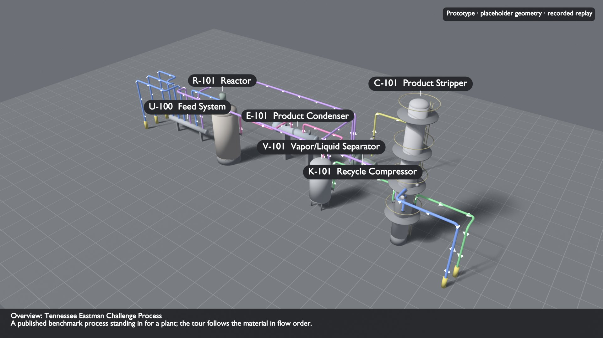
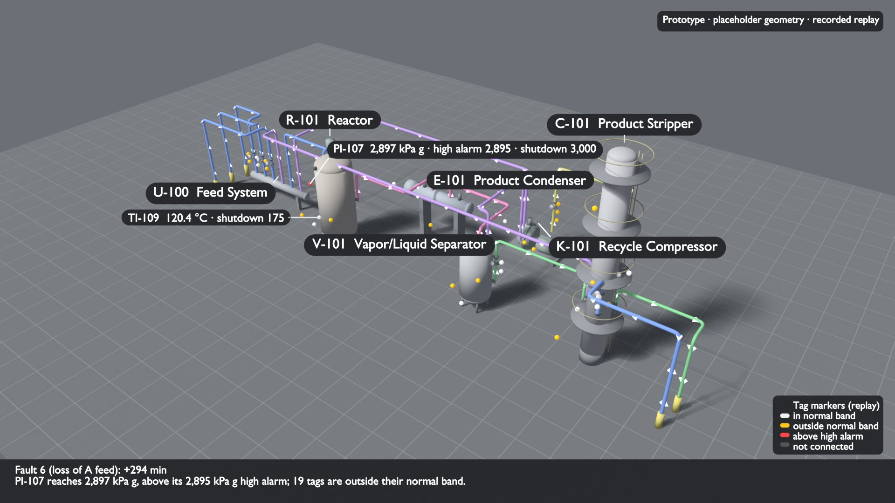
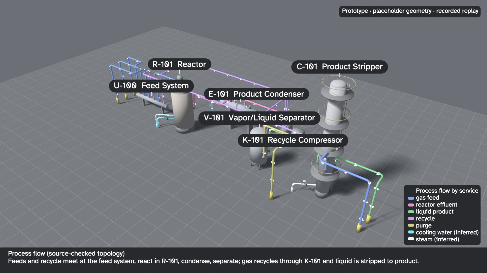
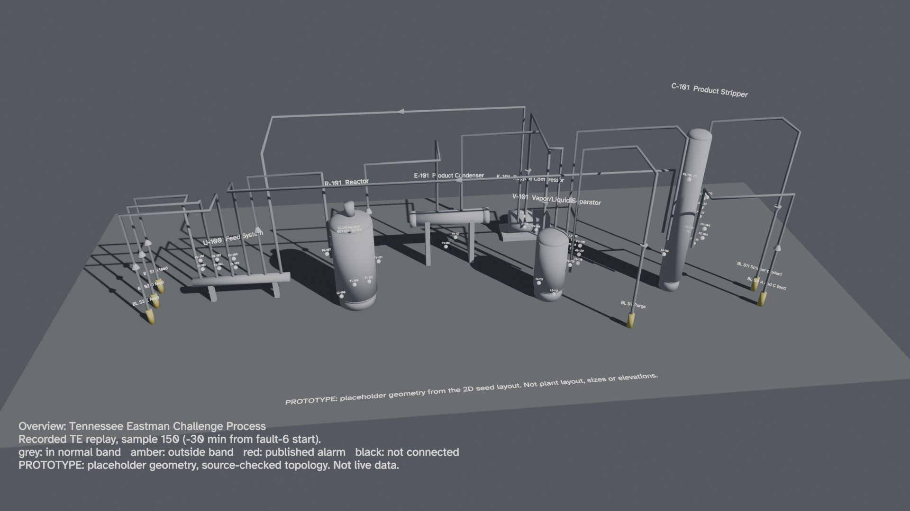
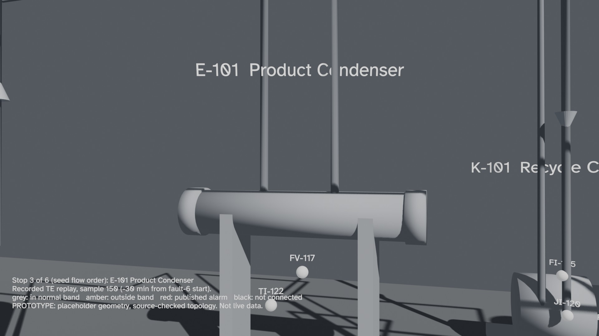

# A 3D process tour for operations training: scope and first prototype

**Status: proof of concept.** Built to iterate on, not a validated deliverable: geometry is placeholder, the replay is
recorded, the LOTO points are inferred and the script is Claude's, not reviewed by an operator. This page scopes
whether a 3D tour is worth building, what it may and may not claim, and records the generator that was actually run.
Since the merge (2026-10-13) the tour reads the source-checked topology (the purge leaves from V-101), takes each
purpose sentence from `data/te_unit_purposes.json`, and labels in Atkinson Hyperlegible; twelve stills were
re-rendered and verified (no check failed: 15 pass, 2 informational), five are committed in [drafts/3d-tour/](../drafts/3d-tour/README.md).

**Second pass (2026-10-12):** the render is checked procedurally against the twin contract, the Ignition and PI
exports, the P&ID trace and its own pixels ([Procedural verification](#procedural-verification)). Those checks found
and fixed label clutter, two tag markers buried inside the reactor, and two pipes ending in mid-air. After Steve's
review of the first version ("quite a bit of cleanup and review"), the scene was redesigned
([Review redesign](#review-redesign-2026-10-12)):
- focus per stop and one label system;
- recognizable equipment, and pipes coloured by service with flow chevrons;
- purpose cards and an eye-height camera;
- a lockout/tagout design mockup ([LOTO mode](#lockouttagout-mode-design-and-a-mockup-still-not-a-procedure)).

Only five review stills have been rendered since; the narrated video waits for approval of the stills. The script
and purpose text are Claude's and have not been reviewed by an operator.

The prototype uses the **Tennessee Eastman (TE) seed model**, the same one the 2D operator screens use. It does
not use the OPEN100 extracted twin, whose stream directions are `unknown` and which has no units arranged as a
process (see [Adapting it](#how-a-plant-would-adapt-it)).


## What a 3D tour adds for operators

The 2D screens answer "what is the process doing". A tour answers "where is it, and how do I get there":

- **Physical layout.** Which unit is next to which, what is upstream, where the pipe rack runs. A new operator
  builds this mental map on walkdowns; a tour lets them rehearse it before and between walkdowns.
- **Walking the flow path.** The camera visits units in flow order (feed, reactor, condenser, separator,
  compressor, stripper), the same order an outside operator would follow a stream.
- **Where each instrument physically sits.** A tag on a screen is abstract. A marker on the vessel shell or on
  the line it measures connects the screen value to the thing an operator would go and look at.
- **Fault walkthroughs.** Replaying a recorded fault on the 3D layout shows how a disturbance travels: in TE
  fault 6 (loss of A feed) the A-feed flow and valve leave their normal band first, then the compressor, purge
  and pressures, and 294 plant-minutes later the reactor pressure alarm. The same story the 2D overview tells, told
  in space.
- **A repeatable script.** The tour is generated, not hand-animated, so every trainee sees the same sequence and a
  change to the plant model changes the tour.

What it does **not** add: any new process information. Every value, band and alarm comes from the existing twin.
A 3D tour is a presentation of the same contract, and it is only as right as that contract.

## What it must not claim

A P&ID is a topology drawing. It says what connects to what and which instruments exist. It says nothing reliable
about elevations, distances, vessel sizes, nozzle orientations, pipe routes or where a transmitter is mounted. The
TE source is a process description, not a plant. So in this prototype:

| Element | Source | Status |
|---|---|---|
| Units, their names and types | `data/te_process_model.json` (Downs & Vogel 1993) | Sourced; unit/stream topology checked against the simulator code (`out/te_topology_check.md`), not reviewed by operations |
| Stream endpoints | model `from`/`to` and `direction` | Source-checked: endpoints from the component balances, direction from the pressure-driven flow lines (the purge leaves from V-101). The display layout's old seed `direction_adapter` is no longer needed |
| Tags, units of measure, which unit/stream a tag belongs to | seed model, checked against `teprob.f` (36 confirmed, 1 corrected) | Sourced |
| Which stream or unit a tag sits on | the 2D display layout's reviewed cards (26 tags); seed ownership only for 10 tags; 1 marked unavailable | Sourced association, **approximate**; not a tap location |
| Plan position of each unit | the 2D seed-layout pixel coordinates × 0.03 m | **Placeholder** (relative arrangement from the 2D screen, not a plot plan) |
| Vessel sizes, heights, skirts, supports, nozzle elevations | `PRIMITIVES` in `scripts/build_3d_scene.py` | **Placeholder**, chosen by Claude to look plausible |
| Pipe routes (up to a rack lane, across, down) | generator rule | **Placeholder**, schematic only |
| Height of a marker on a shell (pressure high, level low…) | generator rule by measured variable | **Placeholder** |
| Label positions, leader lines, camera views | declutter and view choice computed per still (below) | Presentation only; says nothing about the plant |
| Narration, captions, "what this unit does" | Claude-written prose around numbers computed from data files | **Not reviewed by an operator**; labelled on every caption |
| "Why this matters" citations | prototype keyword match against public incident records, curated by Claude | **Heuristic**; mechanism analogies, not a hazard analysis |
| Tag colours | recorded TE replay (`d06_te.dat`, SHA-256 checked), committed normal bands, published alarm setpoints | Sourced data; **recorded replay, not live**; bands are display aids, not limits |
| Agitator SC-212 | no replay source (XMV12 absent) | Shown black, "NOT CONNECTED", never animated |
| TI-122, PI-116 | the topology check settled TI-122 on E-101 (same cooling-water circuit); PI-116's owner is unresolvable in the source | A tag is marked "owner disputed" only while the layout records an open discrepancy about it: PI-116 now, not TI-122 |

Every rendered frame carries a caption saying recorded replay, placeholder geometry and source-checked (not operations-reviewed) topology. The
GLB carries the same statement as text on the ground plane. Renders hide that text: the caption already says it,
and text lying flat on the ground is read at an oblique angle (it was never measured by the legibility checks). If
a plant uses this for training, the placeholders must be replaced from real sources and walked down (below); a tour
that puts a valve in the wrong place teaches the wrong thing.

## One contract for 2D and 3D

The 2D screens and the 3D scene must not be able to drift. The prototype does not add a new source of truth:

```
data/te_process_model.json   ──┐   units, streams, tags (the twin contract)
data/te_display_layout.json  ──┼─► scripts/build_3d_scene.py ─► out/3d/te_scene.json ─► Blender script / GLB
normal bands, alarm setpoints ─┤                                  (derived, regenerable)
recorded replay (optional)   ──┘
```

- The generator calls the same `display_contract.require_display_layout` the 2D renderer uses. A layout written
  for another model, a card for an unknown tag, or a unit missing from the model fails **before anything is
  drawn**. These are tested.
- The 3D shape of a unit comes from the 2D layout's symbol `kind` (`reactor`, `stripper`…). An unknown kind becomes
  a labelled generic box, never a guessed shape.
- Tag placement reuses the 2D cards' `association` (stream or unit). Tags without a card say so in
  `placement_basis`.
- Arrows follow the 2D rule: only an explicit direction, or the layout's adapter, authorizes one. Without it there
  are no arrows and the tour is in model order, labelled as such.
- The scene JSON is deterministic and inspectable. The glTF export carries each marker's tag id, placement basis
  and connection state in node `extras`, so a viewer binds values by tag, the same key Ignition uses.

**What a fuller contract needs (not built).** A shared equipment/ports/tag contract would help.
 The current model has units and streams but no ports, so nozzles are generated. A next step would add an
optional, additive `ports` list per unit (`id`, which stream, a reviewed position when one is known, else
`unresolved`), validated like the display cards. Route state is the other idea: a line or valve shown as
**requested** (a command or controller output), **feedback-confirmed** (a measured position or limit switch says
so), or **unknown**. TE cannot support this honestly: recorded XMV values are controller outputs, not measured
positions, so every TE valve would be "requested, no feedback". That is worth showing, but it needs a plant with
position feedback to mean anything.

## Showing values: rendered video or interactive 3D

| | Blender, rendered video/stills | three.js (or similar) in a browser, from the exported GLB | Embedded in Ignition Perspective |
|---|---|---|---|
| What the trainee gets | A fixed, narrated walkthrough; same for everyone | Free navigation, click a tag for its value and source | The tour beside the real screens, one login |
| Live or replay values | Baked in at render time (keyed to replay samples); re-render to change | Read at view time from a replay file or a data API, by tag id | Perspective tags drive it; needs a bridge (an embedded web page receiving values) or a third-party 3D module |
| Effort for this repo | Done for the prototype; adding narration and more fault segments is incremental | A small viewer page plus a value feed; the GLB and tag ids already exist | Viewer page plus Perspective embedding and security review; native components were **not** evaluated here |
| Runs on | Any video player; renders need a GPU or patience | A modern browser with WebGL | The gateway's clients |
| Risk | Low: read-only by construction | Low if read-only | Highest: it sits next to controls; it must stay read-only and must not look authoritative |
| Best for | Classroom/onboarding material, procedure videos | Self-paced exploration, "where is this tag" lookups | Day-to-day reference once geometry is verified |

Notes on the comparison:
- Blender is free (GPL) and scriptable headless; this prototype ran the official portable 5.2.2 LTS ZIP from a
  user folder with no install. It is a content tool, not a runtime: nothing updates after rendering.
- The GLB export means the two paths share one geometry source; picking one now does not lock out the other.
- Ignition 8.3 Perspective has no built-in 3D viewer that this project verified. An Inline Frame hosting a web
  viewer is the general route; third-party modules exist but were not examined. Treat any claim here as untested.
- Game engines (Unity, Unreal) give better interaction and VR, at a much higher build and licensing cost. Not
  justified until a plant has verified geometry worth exploring.

## Fault walkthroughs as executable cases

The prototype computes each tag's display state per replay sample from the same normal bands and published alarm
setpoints the screens use (`replay_states`): `normal`, `outside_band`, `alarm`, `unknown` (missing or nonfinite),
`not_connected`. A fault case could become a small file: replay file and hash, fault start, the samples to show,
and the expected states at each. The renderer shows it; a test asserts it. The test here already checks the
classification rules on synthetic rows (a nonfinite reading is never shown as normal; only a published setpoint
makes red). Turning the fault-6 stills into such a case is a small, worthwhile next step, because it would catch a
band or alarm change silently altering the training material.

At sample 258 (+294 minutes), 19 tags are outside their band and PI-107 is in alarm. Analyzer markers show the
first component's channel only (AI-123 = component A); the screens show every component.

## The prototype

`scripts/build_3d_scene.py` reads the contract and writes `out/3d/te_scene.json` and `out/3d/te_scene_blender.py`
(from `scripts/blender_tour_template.py`). Given a Blender executable, it renders 1920×1080 stills and measures
them. It can also render the narrated orientation video and a GLB.

```
python scripts/fetch_te_data.py        # optional: the recorded replay that colours the tags and drives the fault script
python scripts/build_3d_scene.py       # scene JSON, Blender script, SRT and script JSON (no Blender needed)
python scripts/build_3d_scene.py --blender "<path to blender 5.2>" \
    --only 00_overview_normal,02_r-101_normal,21_overview_fault_alarm,30_flow_legend,40_loto_mockup
python scripts/verify_3d_render.py     # accuracy, topology, P&ID trace and legibility checks on the last render
python scripts/test_build_3d_scene.py  # contract -> scene/tour checks; stdlib only, no Blender
python scripts/test_verify_3d_render.py  # the verifier against committed exports and committed render evidence
```

`--only` picks stills by name. Without it, every non-optional still renders. The optional stills are an
"all tags" still per stop and the LOTO mockup. `--animation --voice` renders the narrated video, but **the video has
not been re-rendered since the review below and must not be until the stills are approved**. Renders go to
`out/3d/renders/`, which is regenerable and ignored by git. JPEG copies of the review stills are committed under
`drafts/3d-tour/` (`--publish`), with the measured label boxes and the verification report beside them.

### Review redesign (2026-10-12)

Steve looked at the first version of the reactor still and said it needed "quite a bit of cleanup and review". The
coordinator turned that into ten rules, followed by a second round asking to show the process flow, explain why
each piece exists, and design a lockout/tagout version. What changed:

| Rule | What the generator does now |
|---|---|
| **Focus per stop** | The unit in focus is full colour; every other unit, pipe and valve is ghosted at 25% opacity. Each stop shows 2-4 key tags: tags with a published alarm, then the main final element, then instruments by variable. The remaining tags go to an optional "all tags" still. |
| **One label system** | Small rounded pills on short leaders. They are placed outside the focus unit's projected silhouette, the cards and every marker, and never overlap each other. Text is 25 px em (tags) and 30 px (units) at 1080p. No all-caps text in the scene. |
| **Limits** | Normal stops show the operating high alarm the Ignition screens use (PI-107 2,895 kPa g). Published shutdown limits (PI-107 3,000 kPa g, TI-109 175 °C) appear only on fault stills, labelled "shutdown". The fault narration states the distinction once. The red limits box is gone. |
| **Pipes** | Orthogonal routes at two rack elevations (6.2 and 5.0 m) instead of one lane per stream stacked from 7 m. Bends are rounded. Each line is coloured by service: gas feed, reactor effluent, liquid product, recycle, purge, plus cooling water and steam. Flat chevrons point in the flow direction. Utilities show only when their unit is in focus, and on the flow still. |
| **Equipment** | Vertical vessels with 2:1 heads, a skirt or legs, and nozzles where streams connect. A taller stripper column with platforms and a ladder. A shell-and-tube exchanger with a channel head and saddles. A centrifugal compressor (casing, volute) with a motor on a baseplate. A feed manifold with branch take-offs and control-valve symbols. Matte neutral materials with slight colour coding, a 2 m ground grid, soft shadows. Sizes are still placeholders. |
| **Camera** | An elevated three-quarter overview, fitted exactly and re-centred. Each stop is at a 5 m eye height (mezzanine), fitted to the unit, its key tags and utilities with margins. The renderer picks, from six bearings, the first view that hides the fewest key markers. Video moves are eased (Bezier keys) along the flow path; designed, not rendered. |
| **Disclaimers** | A small corner badge on every still: "Prototype · placeholder geometry · recorded replay". The full disclaimer is in the intro narration, the SRT and this page, not on every frame. |
| **Caption bar** | Two lines: the stop title and one sentence. The "why this matters" citation has its own card. |
| **Narration** | Natural sentences, at most 70 words a stop (about 25 s), built from the data: the purpose, the 1-3 key tags with normal bands and high alarm, the first sign in fault 6, and the cited public case. SRT lines are balanced so there are no orphan words. |
| **Hazard citation** | The aptness check found no gas-phase reactor case in the corpus. Kuraray (a reactor taken above its pressure limit) now leads; Bayer CropScience is kept, phrased generally. See [HAZARD_CITATIONS_DESIGN.md](HAZARD_CITATIONS_DESIGN.md). |
| **Process flow made visible** | A "flow legend" still shows every stream in its service colour with chevrons, the inferred utilities, and a legend card. Recycle loops (separator to compressor to feed, and the stripper overhead back to the feed) read as loops by colour and arrow direction. |
| **Why each piece exists** | A purpose card at each stop gives one plain sentence on what the unit does for the process and one on its essential function. The purpose sentence comes from `data/te_unit_purposes.json`, the model's own file: one sentence per unit, each citing the `teprob.f` lines it restates, checked by `scripts/test_te_topology.py`. The function line and the highlights come from the tour's `data/te_tour_cards.json`. The parts doing the job are highlighted: cooling-water lines at the reactor and condenser, the vapour outlet and level band at the separator, the feed valves at the feed system. |

Cooling water and steam are **not streams in the contract**. A stub is drawn only where a final element's own
description names the utility (TV-121 and FV-117 "cooling water", FV-119 "steam"). Each stub is labelled inferred in
the scene data and in the legend. TV-121's marker sits at its valve symbol on that line; the position is still a
placeholder.

| Overview (elevated three-quarter) | Reactor stop (focus, purpose and why cards) |
|---|---|
|  |  |
| **Fault 6 at the high alarm (+294 min)** | **Process flow by service** |
|  |  |

Measured on the author's desktop (GTX 1060 6 GB, Eevee): the five review stills, with measurement, render in about
25 seconds including Blender start-up. The portable Blender ZIP is about 400 MB, checksum verified against
blender.org. No model API was called; metered spend was zero.

## Procedural verification

`scripts/verify_3d_render.py` checks the render in four groups. It reads files only: the scene, the committed
exports and the label boxes Blender measured. It never contacts a gateway.

**A. Accuracy against the Ignition and PI exports.** Each of the 37 scene tags must map 1:1 to:
- the gateway tag import (`out/ignition/gateway/twin_provider.json`, `TE_Plant/<unit>/<tag>`);
- the seed Ignition UDT export (`out/ignition/te_tags.json`);
- the PI AF staging sheet (`out/pi/pi_builder_af.csv`, `\\TE Plant\<unit>|<attribute>`, with the data reference
  pointing at the same tag);
- a binding in the Perspective project (`PIDTwin.zip`), under the tag's own unit view.

Owning unit, unit of measure and description must agree. The normal bands and published setpoints used by the 3D
markers and pills must equal the gateway tag parameters. The 16 extra analyzer component channels in Ignition
(AI-123-B and so on) are reported as explained: the 3D marker shows only the first component. Stream membership is
checked against the contract only, because neither export carries a stream field.

**B. Geometry and flow.**
- Each pipe's two ends are matched to the unit or battery-limit post they physically touch. The derived from/to
  pairs must reproduce the contract's 13 streams.
- The orthogonal corners must be axis-aligned, and rounding the bends must not move a pipe end.
- No marker may sit inside equipment.
- Utility stubs must be labelled inferred and point at a final element of their unit. Valve symbols must map to
  contract final elements on the right stream.
- The camera tour must be a valid walk: each stop is reached by a directed stream from the battery limit or an
  earlier stop. The directions are the unverified seed.

**C. Trace to the P&ID.** A scene tag counts as traced if its record has a drawing id and a bounding box (the
extracted-twin `provenance` shape). Otherwise it must be declared seed or synthetic. For TE the honest result is
**0 of 37 traced to a drawing**: the TE model was built from a paper, not extracted from a P&ID. All 37 are declared
seed and checked against `teprob.f`; none is unexplained.

**D. Legibility from the rendered pixels.** After each still renders, Blender exports `label_boxes.json`. For every
pill and overlay card it gives:
- the 2D box;
- occlusion, by raycast to the marker and to a 7×3 grid over the text (ghosted geometry does not count);
- the focus unit's projected silhouette rectangles;
- every visible marker's screen position;
- text contrast, measured from the PNG.

The checks:
- no overlap;
- no crowding;
- no pill covering a marker;
- no pill on the focus silhouette;
- no all-caps runs;
- nothing off-screen or hidden;
- text line height at least 18 px at 1080p (box height ÷ lines);
- contrast at least 4.5:1 (WCAG AA for normal text).

Pillow re-reads the same pixels independently and agrees with Blender to 0.00 on every box. OCR was not run:
tesseract is not installed here, and the verifier does not install it.

**Results.** "Before" is the 429d7a7 layout reproduced with `--label-layout legacy` and measured by the same code
under the same rules.

| Check | Before (429d7a7, 10 stills) | Review redesign (5 stills) |
|---|---|---|
| Label overlaps | 25 | 0 |
| Crowded plate-less labels | 5 | 0 |
| Labels covering a marker | 9 | 0 |
| Pills on the focus unit's silhouette | n/a (no focus) | 0 |
| All-caps runs in the scene | 0 counted | 0 |
| Labels cut off at the frame edge | 13 | 0 |
| Labels or markers hidden by geometry | 105 | 0 |
| Text under 18 px at 1080p | 160 (smallest 4.6 px) | 0 (smallest 18.4 px) |
| Contrast under 4.5:1 | 241 (lowest 1.13:1) | 0 (lowest 8.03:1) |
| Pipe ends that do not touch their unit | 2 (S4, S11 at the stripper) | 0 |
| Markers inside equipment | 2 (FI-106, AI-123 inside the reactor) | 0 |
| Ignition / PI / Perspective 1:1 mapping | pass | pass |
| Verifier result | 14 of 17 checks not failed | 17 of 17 |

Caveats:
- The all-caps check is new. The before set has no three-word all-caps run on one line: "NOT CONNECTED" is two
  words, and the first redesign's "PUBLISHED SHUTDOWN LIMITS" box is not in either set.
- 18 px is the review's requirement. An earlier pass used 20 px, which is why an earlier table said 166 small labels
  for the same before set.
- Passing these checks means legible and consistent with the exports. It does not mean an operator finds it useful.

The E-101 / K-101 defect: the two labels did not overlap. They sat 13 px apart on one baseline in the overview, so
they read as one string. The overlap test missed it; the crowding rule, the grid occlusion check, the 11 px text
height and the 2.9 and 3.2:1 contrast catch it. The crowding rule and grid occlusion were added after looking at
that case.

The two "before" stills below were re-rendered at the merge (2026-10-13) from the current model with the old label
rules (`--label-layout legacy`), so they show the corrected purge; the numbers in the table above were measured on the
original 429d7a7 render. On the merged tour the redesign fails none of the 17 checks on twelve stills (15 pass; 2 are informational:
drawing coverage, and the OCR read-back, not run)
([verification.md](../drafts/3d-tour/verification.md)).

| Before: overview (old label rules) | Before: E-101 stop |
|---|---|
|  |  |

## Orientation tour for operators

The generator writes a walkthrough for new operators, or for experienced operators meeting a new process. It has
12 segments:
- an introduction with the full disclaimer;
- the six units in flow order;
- four fault-6 segments: before, +120 min, the high alarm at +294 min, and the reactor;
- a close.

Each stop narration is at most 70 words. Every number in it comes from a data file. Outputs:
- `out/3d/orientation_tour.srt` and `out/3d/orientation_script.json`, regenerated by every build (not committed).
  Their timings are estimated from word count until the voice is regenerated.
- Optional synthetic voice (`--voice`): Windows' built-in offline System.Speech (SAPI), voice "Microsoft David
  Desktop", one WAV per segment, muxed by ffmpeg with soft subtitles. The audio track is titled "Synthetic voice
  (Windows SAPI), not a person". The first subtitle cue says so too.

**Not produced in this pass:** the narrated MP4. A full render was started earlier, then stopped on the
coordinator's instruction before it finished, and its partial output was deleted. The video path in the template was
also simplified during the redesign: per-hold label keys and the animated chevron offset need finishing before any
video render.

Reactor stop, as generated now:

> Stop 2: the reactor, R-101. The gas feeds react here to form the liquid products G and H, and the reactions give
> off heat. Watch PI-107, pressure: normally 2,669 to 2,741 kPa g, with a high alarm at 2,895. Also TI-109,
> temperature: normally 120.3 to 120.5 °C. In fault 6, its first sign was AI-123, 48 minutes after the fault started.

### Essential-function animations (design, for the video; not built)

Each asset gets one simple visual of its mechanism. Magnitudes come from the recorded replay where a tag exists;
otherwise they are constant and labelled "illustrative":

| Asset | Visual | Driven by |
|---|---|---|
| Reactor | Heat produced in the vessel, carried away by cooling water: a warm-to-cool gradient along the inferred CW return and supply | TV-121 valve output and TI-121 outlet temperature (replay); the gradient itself illustrative |
| Condenser | Vapour in at the top, cooled stream out | FV-117 and TI-122 (owner settled on E-101 by the topology check) |
| Separator | Phases splitting: vapour chevrons up and out to recycle, a liquid level band holding at the LI-112 value | LI-112, FI-114 (replay) |
| Compressor | A pulsing arrow on the recycle line for the pressure boost | JI-120 compressor work, FI-105 recycle flow (replay) |
| Stripper | Stripping gas and steam rising, product falling to the base | FI-119 steam flow, FI-117 product flow (replay) |
| All lines | Chevron offset animated so the flow moves; speed ∝ the stream's recorded flow where it has a flow tag | FI-101…FI-117 (replay); untagged streams illustrative |

## Hazard emphasis

Two kinds of emphasis come from data, and both now appear as compact annotations on the tag pills:
- **Limits:** PI-107's operating high alarm at normal stops. The published shutdown limits on PI-107 and TI-109,
  the trip points of the simulator, appear only on fault stills.
- **First warning:** the unit whose tags leave their band first in the recorded fault. In TE that is U-100, where
  FI-101 and FV-101 leave at the fault start. It is in the narration and the data, with no box.

A third element comes from a prototype: one **"Why this matters"** card per stop, citing a public incident. It is
matched to the unit's equipment kind by a keyword heuristic over a public-incident
corpus and curated by Claude. The sources are CSB, OSHA and EPA RMP records, with their URLs as recorded in that
corpus. The method, the 21 citations, the reactor aptness check, the false positives and the integration path are in
[HAZARD_CITATIONS_DESIGN.md](HAZARD_CITATIONS_DESIGN.md). The citations are mechanism analogies, not a hazard
analysis.

## Lockout/tagout mode (design and a mockup still; not a procedure)

The idea: a mode of the same scene in which every energy-isolation point is highlighted and tagged, and the tour
walks through:
- isolation in steps;
- verification of zero energy (try the start, check pressure and temperature are gone);
- restoration in reverse order.


What the mockup shows, all inferred from the TE seed model and marked `*`:
- battery-limit block valves on every boundary stream (the contract has no block valves; control valves such as
  FV-102 are not positive isolation);
- the K-101 motor and the R-101 agitator motor (electrical isolation; SC-212 is the agitator tag);
- cooling water in and out at R-101 and E-101 (from TV-121 and FV-117);
- steam at C-101 (from FV-119).

**This is not a lockout/tagout procedure, and nothing here may be used as one.** A real procedure comes from:
- the site's energy-control program under OSHA 29 CFR 1910.147;
- its verified P&IDs and isolation lists;
- an authorized person who writes and signs it.

The mockup carries no sequence logic. Its numbers are the order the points were listed, not an isolation order.

What a real build would need:
- a reviewed isolation list per job: point, energy type, isolating device, lock/tag, verification method;
- the site's procedure as the source of the steps, with the 3D scene only showing where each point is;
- a link from each point to the site's isolation permit, so the walk-through shows the permit
  status and nothing else.

## Effort and cost for a real site

The software is the cheap part. In this prototype the generator, test and renders are a small, single-session
build on free tools. A site version's cost is dominated by things software cannot produce:

1. **Geometry from a real source.** In order of preference: an existing 3D plant design model (many sites built
   in a 3D CAD system have one, possibly out of date), a laser scan or photogrammetry of the unit, general
   arrangement and plot plan drawings, then walkdown measurements. Each placeholder in the table above maps to one
   of these.
2. **Instrument locations from the field.** Tap locations are on isometrics or found on a walkdown, not on the
   P&ID. This is the step that makes the tour useful for training, and the one most likely to be skipped.
3. **Operations review of the tour script.** Which stops, what each stop should teach, which faults to replay. The
   current stop order and fault choice are Claude's, from the seed model.
4. **Upkeep under management of change.** A tour is training material; if the plant changes and the tour does not,
   it teaches the old plant. Regeneration from the contract is cheap; keeping geometry current is not.

Machine cost stays small: free renderer, minutes of GPU time, a web viewer with no licence. A plant should size the
effort by equipment count and the number of instrument locations needing a walkdown.

## How a plant would adapt it

1. Start from the plant's reviewed twin (the same one the screens use), not from the drawing directly.
2. Write or reuse a display layout that names each unit's symbol kind and each tag's stream or unit association,
   and declare stream directions explicitly. Without directions the tour falls back to model order and draws no
   arrows, which is the honest result.
3. Replace placeholders one class at a time, recording the source of each: plan positions from a plot plan, sizes
   from equipment data sheets, nozzle and tap locations from isometrics or the 3D model. Keep `geometry_status` per
   item so the tour can show what is still a placeholder.
4. Walk it down with an operator before using it for training.
5. Pick the output: rendered video for classroom material, the GLB in a browser for self-paced lookup. Keep both
   read-only.

For the OPEN100 extracted twin specifically: units are per-sheet symbol boxes, there are 1,881 extracted links with
direction `unknown`, and no unit-level process arrangement. A 3D view of it would be a 3D copy of each drawing,
which adds little. The method fits a reviewed, unit-level twin.

## Recommendation

**For now: Blender-rendered video from the generator, as the training artifact; keep the GLB export as the bridge
to an interactive viewer later.** Reasons:
- The geometry is placeholder. A fixed, captioned video is the format least likely to be mistaken for an
  engineering model; free navigation invites people to read distances and elevations that do not exist.
- It needs no runtime, no gateway change and no security review, and it cannot write to anything.
- The interactive path stays open at no extra cost because the same scene exports to GLB with tag ids attached.

Move to an interactive viewer (browser first, Perspective embedding after a security review) when a site has
verified geometry and instrument locations, because that is when exploration teaches something true. Before either,
finish the native Ignition and PI acceptance already queued.

## Open items

- **Steve's approval of the five review stills** before anything else is rendered. Next after approval: the other
  five stops in the new style, then the video.
- **Video path:** per-hold label keys and the animated chevron offset (dash flow) were simplified out of the
  template during the redesign and must be finished. Then re-voice (SAPI) and mux.
- Essential-function animations, as designed above.
- Have an operator review the purpose sentences (`data/te_unit_purposes.json`, already checked against `teprob.f`)
  together with the tour script.
- Fault-6 stills as an executable case file with expected states (small, recommended). The narration already
  computes the fault profile; a case file would pin it.
- Process-safety review of the hazard citations ([HAZARD_CITATIONS_DESIGN.md](HAZARD_CITATIONS_DESIGN.md)), and
  importing a site's PHA/HAZOP ranking instead of inferring emphasis.
- LOTO mode: only a mockup exists. A real build needs a site isolation list and the site's procedure as its source.
- OCR read-back of the labels, if tesseract is ever installed. The verifier runs it only when the executable is
  already on PATH.
- Optional `ports` and route-state fields in the contract, once there is a plant with position feedback.
- A browser viewer reading the GLB and a replay file, if interactive use is wanted. A first draft of an interactive browser tour, drawn as isometric cutaways rather than from the GLB, is in
  [drafts/interactive-tour/](../drafts/interactive-tour/README.md) (proof of concept, not reviewed).
- Not done: any comparison with another model's choices, any operator review, any plant geometry.
