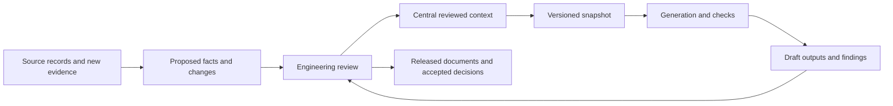

# One reviewed context, several engineering outputs

The toolkit's role is to help an engineer start this process on one problem and produce a portable evidence and
decision packet. The shared company system becomes the place to maintain organizational context as participation
and responsibility grow. The local examples demonstrate the handoff requirements; they are not a company-wide
governance application. Start with [one source question or bounded pilot](../examples/first-pilot/README.md), then
establish that shared home.

The intended organizational pattern is a central record of reviewed engineering context, with specialized tools
working from versioned snapshots. That record holds asset identities, sourced claims, unresolved questions,
responsibility and decisions. A generator produces a view of that context; a reviewer decides whether an output
or proposed correction should be accepted. The tools in this repository supply parts of this workflow. A hosted
hub, authenticated approval process and live integration are not implemented here.

## The return path is part of the design

Use one organizational authority for accepted changes. A local model, CSV review sheet or context register is a
working copy with evidence to return through that authority. Importing its user-entered reviewer name or
`accepted` field must not grant organizational approval. Preserve that local history as provenance and make the
receiving system's approval a separate, authorized decision.

Single authority also permits uncertainty. Competing claims, unknown plant truth and unanswered questions belong
in the record. A central location does not make a claim correct or justify selecting one value without review.

## When execution stays in the existing system

An organization can keep work orders, change approvals, releases and execution in its existing systems. Assign
authority by record type: the system owning a work order owns its status and completion; the controlled document
system owns the released revision. A reviewed-context record can link and interpret those records without
becoming a second approval queue. Preserve the original identity, revision, scope and access restrictions on each
reference. A copied status or local `accepted` field cannot authorize work in the owning system.

Start with a recurring engineering job, such as assembling the evidence for a proposed modification or checking
which answers a revised manual reopens. Source-backed answers, conflicting claims and missing-data questions can
help before anything is executed. The examples here exercise local parts of that investigation; their practical
value still needs a site pilot. Importing more documents alone is not an outcome.

Learning whether a change worked requires a further return path: the attributed decision, what was actually
executed, the resulting configuration, observations and effectiveness review. Those records may come from the
existing execution system. A generated recommendation, a completed task flag or improved document coverage
alone does not establish a successful operational outcome. Keep observations separate from causal conclusions.
Without that return path, the maintained context can improve its evidence and consistency but cannot establish
which interventions worked. The repository implements no incumbent connector or reliable delivery/reconciliation
service. Any such integration needs its own permission, identity, replay and readback acceptance checks.

## Different documents need different update rules

| Document class | What the central record tracks | What happens on change |
|---|---|---|
| **Original source records**: drawings of record, vendor manuals, controlled procedures, controls exports, recorded measurements | Stable document ID, revision, raw-byte hash, exact locator, authority/owner and where the original is retained | Keep the previous version. Stage the incoming version and identify dependent claims for review. Do not rewrite an original to agree with an extracted model. Originals may remain in the organization's existing document system under controlled references. |
| **Reviewed engineering context**: asset identity, connections, configuration, sourced interpretations and decisions | Stable identities, typed relationships, evidence links, unresolved states, accepted changes and authenticated decision history in the organizational system | Review the proposed change, including its scope and conflicting evidence. Release a new context snapshot after an authorized decision. Retain prior decisions and the evidence they used. |
| **Generated outputs**: asset lists, tag staging, graph views, question reports and derived tables | The exact context snapshot, generator version/configuration, input hashes, dependency list, output hash, intended use and review/release state | Mark an output as needing review or rebuild when its declared dependencies change. Generate a new draft from the selected snapshot, show its differences and release it under the site's process. Retain the prior released output. |
| **Authored documents with generated sections**: an engineer's report or a procedure containing a generated asset table | Document and section owners, the last released document, explicitly managed section boundaries, source dependencies and each section's base-content hash | Propose changes to managed sections with a diff. Preserve authored text. If a person edited a managed section or its base is stale, require reconciliation before replacement. This repository does not implement managed-section merging or procedure approval. |

A source arriving for review is already useful information. Keep the last accepted snapshot, but show that new
evidence is pending so people do not mistake an unexamined revision for settled context. Rejection or acceptance
of that evidence needs its own reason. A generated artifact can match its snapshot byte for byte while the
snapshot still contains open engineering questions.

## Use explicit projections for the existing tools

The tools do not all read the same format. The hub-to-tool adapter must produce the actual supported input and
report anything it cannot represent. Retain the full source snapshot alongside that projection. Do not hide
unsupported relationships or review states inside a flat asset list and call the result a complete transfer.

| Tool or route | Current input | Output and integration boundary |
|---|---|---|
| Description authoring | Source text and an engineer or approved assistant | An authored, source-cited process model. No supplied raw-text interpreter packages this step. See the [current connection map](../README.md#what-connects-today-the-hub-and-spokes). |
| `draw_pid_from_model.py` | Process-model fields plus an authored drafting-layout JSON | Detailed draft PNG/SVG P&ID sheets and a key. No automatic detailed layout or general graph/extracted-twin conversion into this drawing contract. |
| `generate.py` | This repository's process-model JSON or extracted-twin JSON | Platform staging and the outputs supported by that model kind. A `twin-graph-1` file is not a direct generator input. Signal mapping and native acceptance remain separate steps. |
| `question_engine.py` | Process-model or extracted-twin JSON; optional loop list and equipment schedules | Questions, asset references and collection requests. Findings propose investigations; they do not mutate the model or establish savings. |
| `graph_export.py` | Process-model or extracted-twin JSON, with optional questions/review records | `twin-graph-1`, including the source/status information represented by the input. It is an export, with no general graph-to-process-model inverse. |
| `apply_review.py`, then `generate.py` | A supported working model and its engineer-filled `OPS_` review sheet | The existing [local model-correction route](REVIEW_LOOP.md): preview with `--dry-run`, apply whitelisted corrections with old values and review history, then regenerate. Apply updates that working model in place; valid rows may persist when other rows refuse. Preserve the base and inspect its diff/change record. A hub integration must stage the resulting changes under its authority rather than treating local CSV entries as organizational acceptance. |
| `statements.py` | `twin-graph-1`, with supplied source images/report and optional machine-check model | Statements, samples and review material. Applied reviews change statuses and add review events; they do not change engineering values or authenticate the reviewer. See the current [binding and application rules](STATEMENT_REVIEW.md). |
| `context_register.py` | Process model or graph, questions and a manifest of actual local source documents | `context-register-1` and enriched graph/questions. Treat local answers and ownership history as a review packet when transferring into an organizational authority. It does not update the original process model. |
| Historian CSV tools | Recorded data in the documented CSV shape | Analysis and replay of the supplied history. Joining channels to canonical plant assets is a separate mapping task; an unusual trend is not a validated diagnosis. |
| `estimate_impact.py` | A strict JSON specification containing measurements and site constants, or explicitly requested public defaults | A first-draft calculation with assumptions and source notes. The model alone does not supply the measurements; generator provenance belongs in a sidecar rather than unrecognized calculation fields. |
| `pipeline.py` | The repository's declared stages, inputs, code and configuration | Freshness and rebuilds for its configured research demonstrations. An organization's own recipes and service orchestration need an explicit implementation; the existing stage list is not a universal plant integration. |

In particular, a receiving asset registry's import format may retain only a subset of the graph. Identity,
relationship layers, per-claim evidence, unresolved questions and decision history need declared mappings and
readback checks. A successful asset-count check alone does not prove that the engineering context survived.

## What a generation receipt needs to record

This is a proposed integration contract, not a new accepted file format or an implemented service. For each job,
retain:

- The context snapshot ID, version and content hash, including the identity namespace and scope.
- The authority and approval record releasing that snapshot. Keep imported local review provenance separate.
- The supported input profile and adapter version, plus a report of fields/relationships not represented.
- Original source document IDs, revisions, hashes and locators; mappings and calculation specifications used.
- The tool/code version, configuration, command or recipe, environment requirements and input hashes.
- The intended output, its declared dependencies, output hashes and differences from the previous released version.
- Explicit unknown/disputed/stale states, required reviewer, acceptance checks and release outcome.

Generate into a new draft location. Publishing a result should check that the intended base snapshot and target
document version still match. If someone accepted a conflicting change meanwhile, return the draft for review
instead of overwriting the newer state. Repeating a job should not silently create duplicate accepted decisions.

The [pipeline](DATA_LINEAGE.md) already checks input/code/configuration freshness in the research demonstrations.
The [context register](CONTEXT_REGISTER.md) already checks answer dependencies when explicitly refreshed. Those
are useful local mechanisms to connect to an organizational service; neither is a service connection by itself.

## Prove one complete loop before promising ongoing synchronization

1. Select one unit and one useful decision with a named engineer, operational counterpart and source owner. Use
   the [pilot brief](../examples/first-pilot/README.md) to establish the baseline and intended outcome.
2. Prepare a source-backed packet, including an appropriate generator model, graph, context, source manifest and
   reviewed identity mappings. Keep unsupported fields and unknowns visible.
3. Stage that packet in the receiving system. Read it back and compare assets, typed relationships, source
   locators, owners, questions, disputes and history. Resolve mappings and losses before organizational acceptance.
4. Export a versioned snapshot through a declared projection. Run one existing generator and a check appropriate
   to its output. Retain the receipt and draft differences, then have the responsible person review release.
5. Introduce one actual subsequent source revision or engineering change. Confirm that affected claims and
   outputs are flagged, that an owner receives the review, and that accepting the correction rebuilds only the
   outputs declared to depend on it. Keep the previous version and unsuccessful attempts.
6. Reconcile a manual edit or concurrent context change without losing it. Demonstrate a repeated job, a rejected
   proposal, an interrupted job and a rollback. Measure the human effort and whether the intended user benefited.

This loop is the acceptance target for an eventual hub integration. Public software examples are not evidence
that a company has completed it. The current repository has no live organizational snapshot exporter, automatic
document synchronization, managed-section update service or verified organizational-context round trip.
