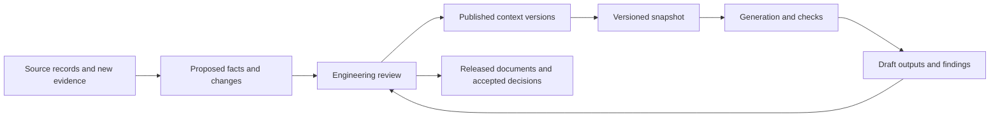

# Engineering context across teams

Start with one useful engineering question and a portable evidence and decision packet. As more departments
participate, organize context into owned, versioned scopes that other teams can depend on. Process engineering,
maintenance and controls can keep their working tools while the company establishes which records and decisions
each team owns. The local examples prepare that handoff; they do not provide a shared governance application.
Begin with the [bounded pilot](../examples/first-pilot/README.md) and establish the company acceptance route.

The intended organizational pattern is coherent context assembled from published versions of those owned scopes.
It needs consistent identities, sourced claims, unresolved questions, responsibility and decision history. A
generator consumes a declared snapshot and produces a draft for review. Shared context can reference several
authoritative company systems; it does not require one department to maintain every record or one file to hold
the whole organization. A hosted hub, authenticated approval process and live integration are not implemented here.

## Make team boundaries explicit

The scalable unit is an owned scope with a published revision and declared dependencies. Choose boundaries that
match actual engineering responsibility, such as a process unit, package or discipline. Keep working drafts
separate from versions other teams may rely on. The company decides how those versions are accepted and released.
This is an integration pattern, not a new file format or a multi-user service supplied by the toolkit.

| Boundary | What a team hands over | Current toolkit limit |
|---|---|---|
| Ownership | Scope, responsible role, source owners, unresolved decisions and intended use | Local owner/reviewer text records attribution; it grants no organizational authority. |
| Identity | Site/project namespace, engineering identity and reviewed aliases, alongside exact source document revisions | Native IDs are local to a selected model. Equal tags in different packets do not establish the same equipment. Source-revision identities are not engineering merge keys. |
| Dependencies | Exact published input versions, hashes, locators and unsupported fields used by a draft | Pinned byte mismatches refuse first. After source reconciliation, explicit refresh reopens decisions citing changed documents together; field-level impact analysis is not implemented. |
| Parallel work | Separate team drafts, their base versions, competing claims and proposed changes | Local registers have no concurrent-write control. Teams must not use one register file as a shared editing database. |
| Acceptance | The receiving record owner, reconciliation outcome and newly released version | The company system must detect an outdated base and resolve conflicts before acceptance. The toolkit does not merge department histories or choose the last writer. |
| Access and capacity | Only the approved source scope needed by the recipient, with a bounded retrieval route | Snapshot MCP serves its selected packet. It supplies neither user authorization nor a whole-company search service. |

Publish references to accepted versions rather than repeatedly copying another team's working state. Preserve
conflicting claims until the responsible reviewers resolve them. A changed flow basis may reopen a maintenance
or controls investigation; it does not transfer authority to edit that team's released equipment or logic records.
Keep the previous evidence and distinguish a proposed change from an authorized company decision.

Use natural document and package boundaries to contain review work. Do not remove source pins, ignore changed
content or equate unchanged displayed values with unchanged engineering meaning to reduce the review queue.
The generation receipt below records the selected scope and versions; the company acceptance route owns release.

The local snapshot reader limits each input to 32 MiB and each result to 2 MiB. These are bounded prototype
limits, not demonstrated organizational capacity. Keep selected packets manageable, retain full evidence outside
projections and measure representative load, refresh and retrieval work before claiming scale. A shared service
needs the separate [identity, permission and connectivity checks](INTERNAL_CONNECTIVITY.md#connect-the-approved-client).

## The return path is part of the design

Assign one authoritative acceptance route for each released record or scope. A local model, CSV review sheet or context register is a
working copy with evidence to return through that authority. Importing its user-entered reviewer name or
`accepted` field must not grant organizational approval. Preserve that local history as provenance and make the
receiving system's approval a separate, authorized decision.

An authoritative record can still contain uncertainty. Competing claims, unknown plant truth and unanswered questions belong
in the record. A central location does not make a claim correct or justify selecting one value without review.

## When execution stays in the existing system

An organization can keep work orders, change approvals, releases and execution in its existing systems. Assign
authority by record type: the system owning a work order owns its status and completion; the controlled document
system owns the released revision. A reviewed-context record can link and interpret those records without
becoming a second approval queue. Preserve the original identity, revision, scope and access restrictions on each
reference. A copied status or local `accepted` field cannot authorize work in the owning system.

Start with a recurring engineering job, such as assembling the evidence for a proposed modification or checking
which answers a revised manual reopens. Source-backed answers, conflicting claims and missing-data questions can
help before anything is executed. The examples here exercise local parts of that investigation; their practical
value still needs a site pilot. Importing more documents alone is not an outcome.

Learning whether a change worked requires a further return path: the attributed decision, what was actually
executed, the resulting configuration, observations and effectiveness review. Those records may come from the
existing execution system. A generated recommendation, a completed task flag or improved document coverage
alone does not establish a successful operational outcome. Keep observations separate from causal conclusions.
Without that return path, the maintained context can improve its evidence and consistency but cannot establish
which interventions worked. The repository implements no incumbent connector or reliable delivery/reconciliation
service. Any such integration needs its own permission, identity, replay and readback acceptance checks.

## Different documents need different update rules

| Document class | What the central record tracks | What happens on change |
|---|---|---|
| **Original source records**: drawings of record, vendor manuals, controlled procedures, controls exports, recorded measurements | Stable document ID, revision, raw-byte hash, exact locator, authority/owner and where the original is retained | Keep the previous version. Stage the incoming version and identify dependent claims for review. Do not rewrite an original to agree with an extracted model. Originals may remain in the organization's existing document system under controlled references. |
| **Reviewed engineering context**: asset identity, connections, configuration, sourced interpretations and decisions | Stable identities, typed relationships, evidence links, unresolved states, accepted changes and authenticated decision history in the organizational system | Review the proposed change, including its scope and conflicting evidence. Release a new context snapshot after an authorized decision. Retain prior decisions and the evidence they used. |
| **Generated outputs**: asset lists, tag staging, graph views, question reports and derived tables | The exact context snapshot, generator version/configuration, input hashes, dependency list, output hash, intended use and review/release state | Mark an output as needing review or rebuild when its declared dependencies change. Generate a new draft from the selected snapshot, show its differences and release it under the site's process. Retain the prior released output. |
| **Authored documents with generated sections**: an engineer's report or a procedure containing a generated asset table | Document and section owners, the last released document, explicitly managed section boundaries, source dependencies and each section's base-content hash | Propose changes to managed sections with a diff. Preserve authored text. If a person edited a managed section or its base is stale, require reconciliation before replacement. This repository does not implement managed-section merging or procedure approval. |

A source arriving for review is already useful information. Keep the last accepted snapshot, but show that new
evidence is pending so people do not mistake an unexamined revision for settled context. Rejection or acceptance
of that evidence needs its own reason. A generated artifact can match its snapshot byte for byte while the
snapshot still contains open engineering questions.

## Use explicit projections for the existing tools

Use the [supported workflows and format contracts](WORKFLOWS.md#tool-input-and-output-contracts) for the
exact inputs each existing tool accepts. That page is the implementation map; this page describes the intended
company responsibility and return path. An adapter must report information it cannot represent and retain the
full source snapshot alongside any projection.

In particular, a receiving asset registry's import format may retain only a subset of the graph. Identity,
relationship layers, per-claim evidence, unresolved questions and decision history need declared mappings and
readback checks. A successful asset-count check alone does not prove that the engineering context survived.

## What a generation receipt needs to record

This is a proposed integration contract, not a new accepted file format or an implemented service. For each job,
retain:

- The context snapshot ID, version and content hash, including the identity namespace and scope.
- The authority and approval record releasing that snapshot. Keep imported local review provenance separate.
- The supported input profile and adapter version, plus a report of fields/relationships not represented.
- Original source document IDs, revisions, hashes and locators; mappings and calculation specifications used.
- The tool/code version, configuration, command or recipe, environment requirements and input hashes.
- The intended output, its declared dependencies, output hashes and differences from the previous released version.
- Explicit unknown/disputed/stale states, required reviewer, acceptance checks and release outcome.

Generate into a new draft location. Publishing a result should check that the intended base snapshot and target
document version still match. If someone accepted a conflicting change meanwhile, return the draft for review
instead of overwriting the newer state. Repeating a job should not silently create duplicate accepted decisions.

The [pipeline](DATA_LINEAGE.md) already checks input/code/configuration freshness in the research demonstrations.
The [context register](CONTEXT_REGISTER.md) already checks answer dependencies when explicitly refreshed. Those
are useful local mechanisms to connect to an organizational service; neither is a service connection by itself.

## Maintain one local packet between reviews

For a bounded investigation, an engineer can operate the existing tools without a shared service:

1. Preserve the last packet, its original sources and current register. Record the source revision arriving for
   review. A changed file with a pinned source hash refuses until its owner deliberately checks and updates that
   revision/hash; never remove the pin just to make the command pass.
2. Refresh using `context_register.py apply` with the current model, questions, source manifest and preserved
   `--register`, omitting `--answers`. Inspect reopened answers and removed questions in `context.md`. Explicit
   rejection of a referenced record is evidence change; ordinary confirmation bookkeeping is not. Old source and
   plant verdicts remain historical. Refresh does not notify an owner or verify the new source's meaning.
3. Prepare a new review folder with the preserved register, give the relevant source and question brief to its
   owner through the company's existing process, and record a new attributed review only after it happens.
   Apply that new sheet with the current register. Reusing an old sheet against changed evidence refuses.
4. Generate the supported output into a new draft folder from the selected reviewed snapshot. Retain its previous
   version, input/code hashes and differences. Reconcile authored text and any changed drawing layout manually;
   this toolkit does not merge reports or rewrite controlled originals. Publish through the document owner's
   existing release process. Local `accepted` is not organizational release.
5. If using the [snapshot MCP starter](../examples/internal-mcp/README.md#read-the-complete-context-packet), select
   the matching enriched graph and context register explicitly. Stop the old process and start a new one with
   that cleared pair. Check `snapshot_summary`, both returned byte hashes, a changed question's current state and
   its complete decision history. A running process keeps the old bytes in memory even if its files change.
   Repeated requests never fetch new documents or silently update that snapshot.

This is an explicit local maintenance procedure, with source/output protection and retained decision history.
It supplies no scheduler, owner notification, cross-system delivery guarantee, concurrent editing, rollback of
company records or automatic document synchronization. Keep the existing organizational record as the authority.
Use the [acceptance plan](ACCEPTANCE.md) to distinguish these offline controls from an actual company pilot.

## Prove one complete loop before promising ongoing synchronization

First establish one useful investigation with a named engineer, operational counterpart and source owner through
the [pilot brief](../examples/first-pilot/README.md). Then rehearse process engineering, maintenance and controls
as three participant roles. These are proposed integration acceptance cases, not completed company or large-team
performance tests:

1. Prepare independently identifiable, source-backed packets with model/graph/context, pinned source versions,
   reviewed identity mappings and visible unknowns. Equal tags in different sites cannot silently join equipment.
2. Introduce a subsequent source revision, reconcile its pin and explicitly refresh. Dependent consumers reopen;
   independently sourced work stays current. Keep complete previous evidence and decisions and show why answers
   reopened. A changed source cannot authorize editing another team's controlled originals.
3. Stage each packet in the receiving system. Its owner reads back identities, typed relationships, locators,
   owners, questions, disputes and history, and resolves mappings and omissions before organizational acceptance.
4. Submit two proposals from the same base. The company acceptance route must preserve both conflicting claims
   and detect an outdated target before replacing it. Demonstrate manual-edit reconciliation, repeated and rejected
   jobs, interruption recovery and restoration of the previous version without losing history.
5. Test different user permissions, excluded sources, revocation and bounded readback in the actual receiving
   system and approved client. A local test client or separate snapshot selection does not prove access enforcement.
6. Export an accepted version through a declared projection, run one generator and an appropriate check, and
   retain its receipt and draft differences. The responsible company reviewers authorize release. Confirm that
   only declared dependencies drive proposed rebuilds and that the next owner can reconstruct the handoff.
7. Measure human review effort and whether the intended users benefited. Keep unsuccessful attempts and require
   actual participant observations through the [acceptance exercise](ACCEPTANCE.md).

Keep these company observations marked not run until participants perform them. The repository has no live
organizational snapshot exporter, concurrent-edit service, automatic document synchronization, managed-section
update service or verified organizational-context round trip.
