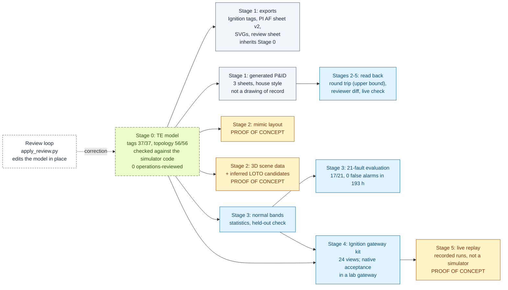
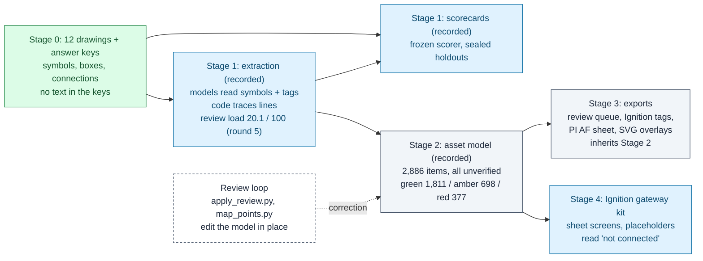

# Data lineage: what we start from, how sure we are, and what each step adds

Every output in this repository is built from one of two datasets (a third, five public DEXPI sheets, is used only to
score tag reading). Before anything is built, each dataset gets a
**Stage 0: data state and confidence assessment**: where the data came from, what has been checked against an
independent source, what is inferred or unknown, and how sure we are about each class of element. Every later
stage is written as **input → treatment → output → confidence carried forward → who or what checked it**.

Two rules hold throughout:

1. **An output inherits its inputs' confidence.** Nothing downstream upgrades it. A stage can only add doubt
   (placeholder geometry, an inferred isolation point) or name the specific check that adds evidence.
2. **The simulation replay, the mimic, the 3D tour data and the LOTO candidates are proof-of-concept outputs, built
   to iterate on.** They are not validated deliverables, and every file says so.

The same stages are machine-readable in [`pipeline/stages.json`](../pipeline/stages.json), and
[`scripts/pipeline.py`](../scripts/pipeline.py) follows them:

```
python scripts/pipeline.py status                    # is each stage fresh, and what confidence does it carry?
python scripts/pipeline.py confidence                # per-element confidence, rolled up per dataset
python scripts/pipeline.py rebuild --from te.source  # after a correction: rebuild everything downstream
```

A stage is **stale** when any of its inputs, its code or its config changed since it was last built (hashes in
[`pipeline/pipeline.lock.json`](../pipeline/pipeline.lock.json)). So a correction made at the start, such as a review
applied to a model, shows every downstream stage going stale, and one rebuild carries it through. The test
[`scripts/test_pipeline.py`](../scripts/test_pipeline.py) proves that on a temp copy: one TE tag moved to another unit
by `apply_review.py` reaches the Ignition tags, the PI AF sheet, the review sheet, the mimic layout and the 3D scene
data, with no file edited by hand. To walk the lineage yourself and confirm each step, see
[review-kit/FOLLOW_THE_DATA.md](review-kit/FOLLOW_THE_DATA.md).

**Contents:** [Tennessee Eastman](#tennessee-eastman-te) · [OPEN100](#open100) · [DEXPI](#dexpi-tag-text-only) ·
[Proof-of-concept outputs](#proof-of-concept-outputs) · [What this does not prove](#what-this-does-not-prove) ·
[Adding a stage](#adding-a-stage)

---

## Tennessee Eastman (TE)

A model of a published chemical process, checked against the open simulator code, plus recorded simulator runs
that drive the screens. There is no original drawing behind it. A P&ID is generated from the model in the OPEN100
house style (`te.pid`) and read back by the frozen extraction method: a round trip on our own drawings.

<a id="te-stage-0"></a>
### Stage 0: data state and confidence assessment

**Sources and licences**

| Source | What it gives | Licence and handling |
|---|---|---|
| Downs & Vogel (1993), *Computers & Chemical Engineering* 17(3) | The process: units, streams, the 41 measurements and 12 manipulated variables | Journal article, cited and not redistributed. The seed model was transcribed by Claude from the published process ([MODELS.md](MODELS.md)) |
| `teprob.f`, the Braatz group's open TE code (University of Illinois) | The simulator source: every XMEAS and XMV with its name and units | NCSA-style licence; downloaded to `data/external/`, not redistributed |
| Recorded runs `d00_te.dat` (normal) and `d06_te.dat` (fault 6) | Values for the screens, the normal bands and the alarm check | Downloaded by `scripts/fetch_te_data.py`, checked against fixed SHA-256 hashes |

**What is verified, and how**

- **Instruments and final elements (37):** each description and unit checked line by line against `teprob.f` by
  `scripts/verify_te_source.py`: 36 confirmed, 1 corrected (TT-122's description). Report:
  [`out/te_source_check.md`](../out/te_source_check.md).
- **Units, streams, flow directions and tag ownership (56 elements):** read out of the same code's component balances,
  pressure-driven flow lines and measurement lines by `scripts/verify_te_topology.py`, cross-checked with the revised
  TE code (Bathelt, Ricker & Jelali 2015): 51 confirmed, 4 corrected (the purge stream S9 and FT-110, FV-110, AT-129
  moved from the compressor K-101 to the separator V-101), 1 unresolvable. Report:
  [`out/te_topology_check.md`](../out/te_topology_check.md).
- **Control loops (19 running):** read out of the closed-loop code `temain_mod.f` by `scripts/te_control_loops.py`
  (measurement, valve or cascade target, mode, scan period; file comments ignored) and checked against the recorded
  normal run: every controlled variable within 0.34 SD of its coded setpoint. The same script scores the generated
  P&ID: 0 of 19 loops drawn on revision A, 19 of 19 since revision B (now revision C). The controllers are written into the model
  (`--write-model`), so the drawing and every export take them from there. Table: `data/te_control_loops.json`; report:
  [`out/te_loop_audit.md`](../out/te_loop_audit.md).
- **Unit purposes:** one sentence per unit in `data/te_unit_purposes.json`, each citing the `teprob.f` lines it
  restates; `scripts/test_te_topology.py` checks every citation.
- **Alarm setpoints:** published values only; the gateway verifier (V8) proves the reactor pressure alarm fires on
  the recorded fault.
- **Normal bands:** statistics on the published normal run, fitted on one half and tested on the other half and on
  the fault run ([OPERATOR_SCREENS.md](OPERATOR_SCREENS.md)); then scored on all 21 published faults with a rule fixed
  before scoring: 17 detected, 0 false alarms in 193 h of normal running the bands never saw
  ([fault_detection.md](../out/fault_detection/fault_detection.md)).

**What is inferred or unknown**

- **One element the source cannot settle:** PT-116 is documented as stripper pressure but computed from the
  feed-header pressure. It stays on C-101, flagged. (When the topology check was merged, the model's fields changed
  and every stage below went stale until rebuilt, which is the point of this page.)
- **Tag numbers are assigned by this project.** TE publishes indices (XMEAS 7), not plant tags (PT-107). The index is
  kept on every item.
- **TT-122's owner,** the open question from the first source check, is settled (E-101) and kept in the model as
  `resolved_question`.
- **Physical facts are in no source:** tap positions, vessel sizes, elevations, pipe routes. Anything 3D about them
  is placeholder.
- **No operations review has been done.** The review loop is built and tested; nobody who has run a process plant
  has gone through the model yet.

**Confidence per element class** (`python scripts/pipeline.py confidence --dataset te`)

| Class | Count | Source check | Operations review | Notes |
|---|---|---|---|---|
| Instruments | 25 | 24 confirmed, 1 corrected (TT-122's description); FT-110 and AT-129 moved to V-101 | 0 of 25 | TT-122's owner resolved |
| Final elements (valves, outputs) | 12 | 12 confirmed; FV-110 moved to V-101 | 0 of 12 | XMV is the recorded controller output, not a measured valve position |
| Units | 6 | 6 confirmed | 0 of 6 | PT-116's owner (C-101) unresolvable in the source |
| Streams | 13 | 12 confirmed, 1 corrected (S9, the purge) | 0 of 13 | directions from the pressure-driven flow lines |

### Pipeline



Light green, dashed: checked against an independent source, not by operations. Blue: measured on held-out data or in a lab gateway. Grey: inherits
its inputs, adds nothing. Amber: proof of concept. Dashed: a person's decision going back into the source.

### Stages

| Stage (id) | Input | Treatment | Output | Confidence carried forward | Checked by |
|---|---|---|---|---|---|
| 0 `te.source`, `te.source_check`, `te.topology_check` | Downs & Vogel; `teprob.f`; the revised TE code | Hand transcription; tag numbers assigned; the two checks write `verification` on each item | `data/te_process_model.json`, `out/te_source_check.md`, `out/te_topology_check.md` | per item: `verification.status`, `ops_review` (status and reviewer), `resolved_question` | `verify_te_source.py` (tags), `verify_te_topology.py` (units, streams, directions, owners); `test_te_topology.py` |
| 0 `te.purposes` | `teprob.f` | one sentence per unit, each citing the lines it restates | `data/te_unit_purposes.json` | citations; not operations-reviewed | `test_te_topology.py` |
| 0 `te.control_loops` | `temain_mod.f` (closed-loop TE code), `d00_te.dat` | each controller's error and update lines give what it reads and what it moves; the recorded run must sit on every coded setpoint | `data/te_control_loops.json`, `controllers` in the model, `out/te_loop_audit.md` | 19 loops, source lines and data deviation per loop; not reviewed by a control engineer | `test_te_control_loops.py` (pinned pairings, rotated-pairing control, audit pass/fail controls) |
| Review (not a build stage) | `out/ops_review_sheet.csv` filled in by a reviewer | `apply_review.py` checks every row, writes `ops_review` with history, routes alarm changes to MOC | the same model file, changed in place, plus a change record | the reviewer string decides how it counts: only a named operations role is an operations review | the script's refusals; `test_apply_review.py` |
| 1 `te.exports` | the model | `generate.py`: validate, then write every format | `out/ignition/te_tags.json`, `out/pi/` (PI Builder sheet v2, custom units, attribute descriptions, import steps), `out/svg/`, `out/ops_review_sheet.csv` | each tag's documentation and each PI attribute description ends `source check: … \| ops review: …`; the review sheet prints both | `test_generate_validation.py`; `pi.export_check` offline; the PI sheet has never been imported into a PI System |
| 1 `te.pid`, `te.pid_style` | the model, the drafting layout | `draw_pid_from_model.py` draws only what the model holds (since revision B, its controllers and signal lines) plus declared drafting conventions (revision C: control valve stations, marked as drafting additions) and refuses a layout that drops, duplicates or invents an item, misses, invents or misroutes a signal, or squeezes a valve station; `style_fidelity.py` measures it against OPEN100 | `data/te_pid/` (3 sheets PNG/SVG, answer keys), `out/te_pid/style_fidelity.md` | every symbol's `model_ref`; a generated drawing is not a drawing of record | `test_te_pid_roundtrip.py`; 35 of 36 style measurements inside the OPEN100 range (revision C) |
| 1 `te.pid_rev_a` (source) | the revision-A sheets as drawn on 2026-10-13 | archived unchanged when revision B was drawn; byte-identical to what the recorded extraction hashed | `data/te_pid/rev-a/` | revision A: no controllers, valves numbered 201-212 | the lock hashes recorded before the archive |
| 2-5 `te.pid_extract`, `te.pid_roundtrip`, `te.pid_twins` (recorded); `te.pid_exports`, `te.pid_diff` (generated); `te.pid_live` (check) | the revision-A sheets (`data/te_pid/rev-a/`) | the frozen extraction method, then the same converter and exporters as OPEN100, a tag-only diff against the model and a live check against the replay server | `out/te_pid/roundtrip_scores.md`, `out/te_pid/twin/*/`, `out/te_pid/diff_*.md`, `out/te_pid/live_*.md` | a round trip: an upper bound for clean house-style drawings, not real-plant accuracy | the frozen scorer; `test_te_pid_roundtrip.py` |
| 2 `te.mimic` (proof of concept) | the model, `data/te_display_layout.json` | renders the overview with the gateway's own function, offline | `out/mimic/te_overview_layout.json` | each reading carries its item's provenance; positions and the choice of readings are first-pass | `test_process_mimic.py`, `test_pipeline.py`; screens checked in a lab gateway; not reviewed by operations |
| 2 `te.scene` (proof of concept) | the model | copies equipment, tags, ownership, stream ends; scales the 2D layout; lists valves on each unit's streams as LOTO candidates | `out/scene/te_scene.json` | each element carries its item's provenance; geometry marked placeholder; LOTO marked inferred, not a procedure | `test_pipeline.py` (that it follows the model). The 3D renderer is a separate prototype ([drafts/3d-tour/](../drafts/3d-tour/README.md)) |
| 3 `te.bands` | the model, recorded normal and fault runs | mean ± K·sd, K chosen on held-out normal data | `out/ignition/normal_bands.json`, `.md` | one operating mode assumed | held-out normal half, fault-6 run |
| 3 `te.fault_detection` | the shipped bands, all 44 Braatz files | detection rule fixed before scoring (3 consecutive flagged samples); a PCA T² baseline beside it | `out/fault_detection/fault_detection.md`, `.json` | 17/21 detected, 0 false alarms in 193 h; simulated data, one mode | `test_fault_detection_eval.py` regenerates the results exactly |
| 4 `ignition.gateway` (shared) | the model, bands, the extracted twin | tag provider with published alarms and data-source diagnostic alarms, `ReviewStatus` on every tag, 24 views including the 390 px `/m` overview | `out/ignition/gateway/twin_provider.json`, `build_meta.json`, `PIDTwin.zip` (a Windows rebuild reproduces the accepted ZIP byte for byte; on Linux the members are identical and the compressed bytes are not, so ZIPs are hashed by their members) | review status per tag; placeholders stay Bad quality, never a false Good | verifier V1–V8 with planted faults, browser contract (lab, not site) |
| 5 `te.tour` (proof of concept) | the model, purposes, bands, the exports and the gateway kit | the 3D tour: twelve Blender stills rendered and measured, five published, a legacy-label render re-measured | `drafts/3d-tour/` (stills, label boxes, verification report) | placeholder geometry, inferred LOTO points, a Claude-written script | `verify_3d_render.py`: no check fails (15 pass, 2 informational); `test_build_3d_scene.py`, `test_verify_3d_render.py` |
| 5 `te.interactive_tour` (proof of concept) | the model, purposes, bands, the exports, the gateway kit, the P&ID answer key and the two replays | an interactive browser cutaway tour (`scripts/export_interactive_tour.py`, `drafts/interactive-tour/build.mjs`), its geometry audit and a verification drive in headless Chrome | `drafts/interactive-tour/` (audit report, review stills); the pages themselves in `out/interactive_tour/`, ignored by git | placeholder geometry, recorded replay, inferred LOTO points, text written with AI assistance | `drafts/interactive-tour/verify.mjs`: see `drafts/interactive-tour/audit/report.md` |
| 5 `te.replay` (proof of concept), `ignition.acceptance` | recorded runs, a running gateway | replays recorded values (does not respond to control changes); the native acceptance run | live values in the gateway; receipts | recorded values only; a lab result | V8 alarm check; [receipt](../out/ignition/gateway/receipts/native-current-20261013-alarms.json) |

---

## OPEN100

Twelve real P&IDs from the OPEN100 design, with third-party answer keys. There is no process data: no live values,
no I/O list. The I/O list used in the mapping demo is synthetic and labelled so.

<a id="open100-stage-0"></a>
### Stage 0: data state and confidence assessment

**Sources and licences**

| Source | What it gives | Licence and handling |
|---|---|---|
| PID2Graph (Zenodo 14803338), OPEN100 set | 12 drawings (PNG) and answer keys (GraphML): symbol classes, boxes and connections | CC BY-SA 4.0; OPEN100 design by the Energy Impact Center. Committed with derived copies under the same licence ([NOTICE.md](../NOTICE.md)) |
| PID2Graph, Dataset-P&ID set | 20 synthetic drawings in another drafting style (holdout B) | CC BY-SA 4.0; fetched by script, not committed |

**What is verified, and how**

- **Answer keys** cover symbol class, box and connection. They carry **no text**, so tag reading cannot be scored on
  this dataset ([EVALUATION.md](EVALUATION.md)).
- **The scorer** had to fail deliberately wrong answers before it was trusted; its first version gave them 15–32%
  credit and was rebuilt.
- **Fixed splits:** sheets 0–5 for development, 6–11 sealed as holdout A, scored once per method; holdout B for style
  transfer ([GOAL.md](GOAL.md)).

**What is inferred or unknown**

- **Tag text:** read by the model and not scored. 56 tags are flagged as placeholders (XXX, TBD), and 356 items have
  no tag read, 340 of them valves and in-line symbols, which a P&ID often leaves untagged.
- **Which equipment each instrument belongs to:** decided by code along the traced line, measured at 87.0% (round 2)
  and 92.2% (round 3) on holdout A, 67.6% on the other drafting style.
- **System codes and drawing numbers** are inferred from off-page references; three sheets are unknown or ambiguous.
- **Flow direction** is read from drawing evidence (arrowheads, off-page flags, pump ports, valve continuity) on 361
  of 1,133 process links (`open100.flow_direction`); the rest stay undirected. The keys carry no direction, so it is
  checked by a blind spot check of 65 crops read by two models, not scored.
- **Off-page pairs** (7) have no answer key and need checking by hand.
- **No operations review.** Three records carry the author's notes or a scoped text correction; none of them is an
  operations confirmation.

**Confidence per element class** (`python scripts/pipeline.py confidence --dataset open100`; the published twin,
12 sheets, built from GPT with tiling and code line tracing)

| Class | Count | Measured against the answer keys (holdout A, rough match F1) | Risk tier green / amber / red | Tag status |
|---|---|---|---|---|
| Equipment (tanks, pumps) | 74 | tank 0.72, pump 0.50 (5 pumps in the keys) | 46 / 14 / 14 | 14 missing |
| Instruments | 359 | 1.00 | 296 / 58 / 5 (22 lifted from green by the safety floor) | 55 placeholder, 2 missing |
| Line items (valves, in-line symbols) | 477 | valve 0.99, general 0.83 | 241 / 143 / 93 | 340 untagged, 1 placeholder |
| Off-page connectors | 95 | 0.99 | 94 / 1 / 0 | all read |
| Connections | 1,881 | 0.89 | 1,134 / 475 / 265 (the 7 cross-sheet links carry no tier in the model; the review queue shows them amber) | n/a |
| **All items** | **2,886** | review load **20.1** per 100 (holdout A, mean of five round-5 runs; the single round-2 run scored 17.8), **20.7** (holdout B, round 2) | **1,811 / 698 / 377** in the review queue | every item `unverified` |

Green items were 94–96% right on holdout A and 97–100% on holdout B. Item-level confidence is the risk tier; the
scores above are set-level and do not say which individual item is right.

### Pipeline



### Stages

| Stage (id) | Input | Treatment | Output | Confidence carried forward | Checked by |
|---|---|---|---|---|---|
| 0 `open100.source` | PID2Graph | none: third-party data, committed as published | drawings and answer keys under `data/external/pid2graph/` | ground truth for symbols and connections only | the dataset's authors; scorer controls |
| 1 `open100.extract` (recorded) | drawings, prompt | three models compared; GPT with 2×2 tiles, then the code line tracer (method chosen by a rule fixed before the holdouts) | run records under `runs/` (not committed) | per item: the model's own confidence and the source run | the frozen scorer on sealed holdouts |
| 1 `open100.score` (recorded) | run records, answer keys | frozen scoring rules; failures count as zero | `out/scorecard_r2-tiles-trace_*` | set-level accuracy | `test_scorer_controls.py` |
| 2 `open100.model` (recorded) | run records | `build_twin.py`: hierarchy, parent along the traced line, risk tier and reason per item | `out/twin/r2-tiles-trace/codex/plant_model.json` | `verification` (unverified), `risk.tier`, `tag_status`, later `ops_review` | `score_twin.py`, `score_triage.py` on holdouts |
| Review (not a build stage) | `review_queue.csv` filled in by a reviewer; an I/O list | `apply_review.py` (Track A text corrections never change an item's status); `map_points.py` (never guesses) | the same model file, changed in place, plus change records | as for TE: only a named operations role counts as an operations review | the scripts' refusals; `test_apply_review.py`, `test_map_points.py` |
| 3 `open100.exports` | the model | `generate.py`; signal paths stay placeholders | `review_queue.csv`, `ignition/tags.json`, `pi/*.csv`, `pi/reconciliation.json`, `svg/sheet_*.svg` | every Ignition and PI description carries confidence and `UNVERIFIED` | `test_generate_validation.py`, `test_export_review_boundaries.py`, `test_pi_mapping.py` |
| 1 `open100.replicates` (recorded) | holdout A, five fresh runs per tool | the declared method, pre-registered | `out/replicates_r5_holdout-a.md` | means with run and drawing intervals; no clear ranking across drawings, equivalence not established | `test_replicate_stats.py` |
| 4 `open100.review_kit` | the review queue, sheet 8 | one sheet's rows with blank OPS_ columns, an empty timer log | `out/review_kit/sheet-8/` | no measured minutes | `test_review_kit.py` |
| 3-5 `open100.direction_spot_check`, `open100.schedule` (recorded); `open100.flow_direction`, `open100.structure`, `open100.mimic`, `open100.scene` (generated; mimic and 3D are proof of concept); `open100.structural_check` | the model, the drawings | flow direction from drawing evidence, sheets stitched by connector drawing numbers, purposes from the printed equipment schedules, a mimic and a 3D tour of structure only, candidate isolation points | `out/open100_structural/`, `docs/screenshots/open100/` | structure only; every value "not connected"; isolation points are a reviewer's checklist, not a procedure | `test_open100_structural.py`; [OPEN100_STRUCTURAL.md](OPEN100_STRUCTURAL.md) |
| 4 `pi.export_check` (shared) | both PI Builder sheets | offline comparison with the vendor-published conventions | none (a check) | offline-checked, not import-tested | `test_check_pi_export.py` |
| 4 `ignition.gateway` (shared) | the model | sheet screens with the greyed drawing behind; mapped points live, the rest "not connected" | the gateway kit | placeholders stay Bad quality | V4 (0 false Good) in a lab gateway |

Green: third-party ground truth. Blue: measured against it on sealed holdouts, or in a lab gateway. Grey: inherits
its inputs. Dashed: a person's decision going back into the model. OPEN100 has no live replay stage: there is no
process data.

---

## DEXPI (tag text only)

Five public example P&IDs from the DEXPI initiative's TrainingTestCases repository (CC BY 4.0), pinned to one commit
and by SHA-256 in `data/dataset_adapters/dexpi_examples.json`; downloaded by `scripts/adapt_dexpi.py`, not
redistributed. They exist here for one reason: unlike the OPEN100 keys, they carry tag text. There is no asset model,
so `pipeline.py confidence` shows no per-element classes for them.

| Stage (id) | Input | Treatment | Output | Confidence carried forward | Checked by |
|---|---|---|---|---|---|
| 0 `dexpi.source` | the pinned config | none: third-party drawings | the config file | tag truth for five clean sheets from one publisher | the pinned hashes |
| 1 `dexpi.keys` (recorded) | the downloads | rendered, converted to answer keys by rules written before any model saw a sheet | `data/external/dexpi/sheets/` (gitignored) | the key scope decides part of the score (nozzles are drawn but are not DEXPI items) | `test_dexpi_adapter.py` |
| 2 `dexpi.replicates` (recorded) | the keys, five runs per tool | the declared method, pre-registered | `out/replicates_r5_dexpi.md` | review load 95.4 (GPT) and 61.8 (Claude), a tie; tags 29 and 28 of 33 read exactly | `test_score_tags.py`, `test_replicate_stats.py` |

---

## Proof-of-concept outputs

These are built so we can iterate on them, and labelled that way in their own files (`meta.kind:
"proof_of_concept"`) and in `pipeline.py status`:

| Output | What is real in it | What is placeholder or inferred |
|---|---|---|
| Live replay (TE) | the recorded simulator values and the published alarm setpoints | it is a replay, not a process simulator: control changes do nothing |
| Mimic layout (`out/mimic/`) and the overview screen | which tag each reading shows and the unit that owns it, from the model | positions, which 2–4 readings represent a unit, the display spans: first-pass choices, not reviewed by operations |
| 3D scene data (`out/scene/`) and the 3D tour stills (`drafts/3d-tour/`) | equipment, tags, ownership and stream ends from the model; purpose sentences from the cited file | sizes, elevations, pipe routes; the narration and function lines on the stills |
| LOTO candidates (inside the scene data) | the valves the model places on each unit's streams | that any of them is an isolation point. A LOTO procedure comes from the site's energy-control program (OSHA 1910.147), verified P&IDs and an authorized person |
| OPEN100 mimic, 3D tour and LOTO view (`out/open100_structural/`) | equipment, connections, directions where the drawing shows them, and the drawing positions | every value ("not connected"), every shape and size, and whether a listed valve is an isolation point |

## What this does not prove

- **Fresh is not correct.** `status` compares files with their last build or accepted-record hashes. It says nothing about
  whether those inputs are right; that is what Stage 0 and the review are for.
- **A lock entry for a recorded stage** says the committed files were accepted as the record, not that this
  checkout re-ran the models. `pipeline.py record` after a manual check means someone says they ran it.
  On 2026-10-30, the confidence module's help text was corrected to describe review priority rather than batch
  acceptance. The two recorded model stages accepted their unchanged historical outputs with the new source
  binding after executable-AST, coefficient/threshold and output-hash checks. No extraction, model build or score
  was repeated; their historical extraction and later review/mapping provenance remains. The stage notes identify
  that documentation-only renewal.
- **The confidence rollup trusts the reviewer string.** A string that names an operations role counts as an
  operations review; nothing authenticates it. Anything else, including a confirmation by a non-process-expert,
  keeps its label in every output.
- **Some stages need more than Python.** Stages that need a download (the TE replay files), a package (Pillow,
  OpenCV) or a local program (Blender for the 3D stills, a headless browser for the OPEN100 mimic PNGs, named in
  `BLENDER_EXE` and `BROWSER_EXE`) report `BLOCKED` on a checkout without them; in this commit they were rebuilt
  with them, so the lock shows them fresh. Two stages, the live replay and the native acceptance run, need a running
  Ignition gateway to execute again. Their recorded lock entries currently show `FRESH` for the declared inputs;
  neither runtime stage declares output files in that lock. The historical gateway receipts are separate evidence.
  This status does not verify those receipts, repeat a gateway run or establish that a gateway is running now.
  A stage without a lock entry reports `NEVER BUILT HERE`.

## Adding a stage

When a branch adds a generator (a P&ID drawn from the TE model, a topology check, a fault evaluation, a PI export
check), plug it in like this:

1. Add an entry to `pipeline/stages.json` in dependency order: `id`, `dataset`, `stage`, `kind`, `rebuild`,
   `upstream`, `inputs` (data it reads, each produced by an upstream stage), `code` and `config` (hashed), `outputs`,
   `command`, `requires` (local prerequisites such as cached downloads), `requires_modules` (Python packages),
   `requires_env` (a variable naming a local program; the command uses it as `$NAME`, so no machine path is written
   down), `treatment`, `carries`, `checked_by`, and `poc: true` for anything built to iterate on.
2. If the output is a file a person or a platform reads, carry each element's provenance: call
   `provenance.element(item)` and write the record next to the element. Don't upgrade it.
3. Run `python scripts/pipeline.py rebuild --from <the new stage>` and commit the outputs with
   `pipeline/pipeline.lock.json`. `scripts/test_pipeline.py` fails until the manifest is consistent and every offline
   stage is fresh.
4. If a merge changes a generator another stage lists as code, the test will name the stale stage; rebuild it,
   don't hand-edit outputs.
