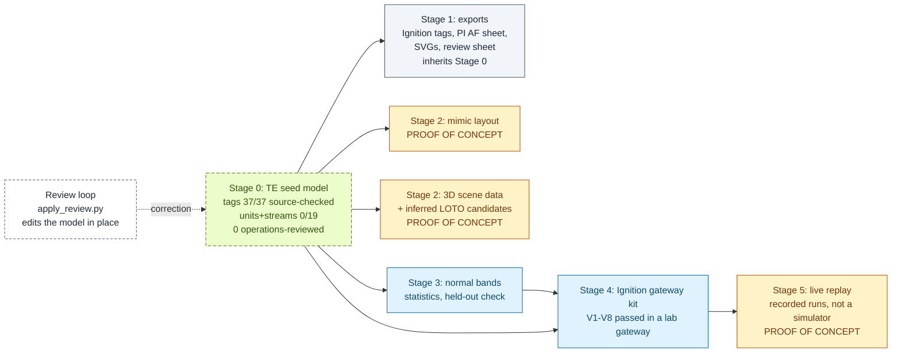
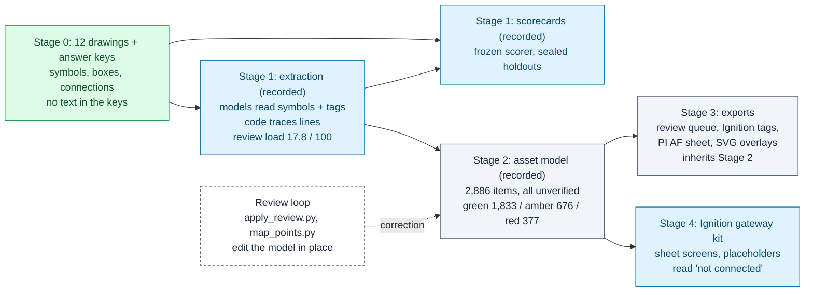

# Data lineage: what we start from, how sure we are, and what each step adds

Every output in this repository is built from one of two datasets. Before anything is built, each dataset gets a
**Stage 0: data state and confidence assessment**: where the data came from, what has been checked against an
independent source, what is inferred or unknown, and how sure we are about each class of element. Every later
stage is written as **input → treatment → output → confidence carried forward → who or what checked it**.

Two rules hold throughout:

1. **An output inherits its inputs' confidence.** Nothing downstream upgrades it. A stage can only add doubt
   (placeholder geometry, an inferred isolation point) or name the specific check that adds evidence.
2. **The simulation replay, the mimic, the 3D tour data and the LOTO candidates are proof-of-concept outputs, built
   to iterate on.** They are not validated deliverables, and every file says so.

The same stages are machine-readable in [`pipeline/stages.json`](../pipeline/stages.json), and
[`scripts/pipeline.py`](../scripts/pipeline.py) follows them:

```
python scripts/pipeline.py status                    # is each stage fresh, and what confidence does it carry?
python scripts/pipeline.py confidence                # per-element confidence, rolled up per dataset
python scripts/pipeline.py rebuild --from te.source  # after a correction: rebuild everything downstream
```

A stage is **stale** when any of its inputs, its code or its config changed since it was last built (hashes in
[`pipeline/pipeline.lock.json`](../pipeline/pipeline.lock.json)). So a correction made at the start, such as a review
applied to a model, shows every downstream stage going stale, and one rebuild carries it through. The test
[`scripts/test_pipeline.py`](../scripts/test_pipeline.py) proves that on a temp copy: one TE tag moved to another unit
by `apply_review.py` reaches the Ignition tags, the PI AF sheet, the review sheet, the mimic layout and the 3D scene
data, with no file edited by hand. To walk the lineage yourself and confirm each step, see
[review-kit/FOLLOW_THE_DATA.md](review-kit/FOLLOW_THE_DATA.md).

**Contents:** [Tennessee Eastman](#tennessee-eastman-te) · [OPEN100](#open100) ·
[Proof-of-concept outputs](#proof-of-concept-outputs) · [What this does not prove](#what-this-does-not-prove) ·
[Adding a stage](#adding-a-stage)

---

## Tennessee Eastman (TE)

A model of a published chemical process, checked against the open simulator code, plus recorded simulator runs
that drive the screens. There is no drawing behind it; a P&ID drawn from this model in the OPEN100 house style is
being built on a separate branch.

<a id="te-stage-0"></a>
### Stage 0: data state and confidence assessment

**Sources and licences**

| Source | What it gives | Licence and handling |
|---|---|---|
| Downs & Vogel (1993), *Computers & Chemical Engineering* 17(3) | The process: units, streams, the 41 measurements and 12 manipulated variables | Journal article, cited and not redistributed. The seed model was transcribed by Claude from the published process ([MODELS.md](MODELS.md)) |
| `teprob.f`, the Braatz group's open TE code (University of Illinois) | The simulator source: every XMEAS and XMV with its name and units | NCSA-style licence; downloaded to `data/external/`, not redistributed |
| Recorded runs `d00_te.dat` (normal) and `d06_te.dat` (fault 6) | Values for the screens, the normal bands and the alarm check | Downloaded by `scripts/fetch_te_data.py`, checked against fixed SHA-256 hashes |

**What is verified, and how**

- **Instruments and final elements (37):** each description and unit checked line by line against `teprob.f` by
  `scripts/verify_te_source.py`: 36 confirmed, 1 corrected (TI-122's description). Report:
  [`out/te_source_check.md`](../out/te_source_check.md).
- **Alarm setpoints:** published values only; the gateway verifier (V8) proves the reactor pressure alarm fires on
  the recorded fault.
- **Normal bands:** statistics on the published normal run, fitted on one half and tested on the other half and on
  the fault run ([OPERATOR_SCREENS.md](OPERATOR_SCREENS.md)).

**What is inferred or unknown**

- **Units, streams and flow directions (19 items) are not checked against a source on this branch.** A topology
  check against the simulator code (51 confirmed, 4 corrected, 1 unresolvable of 56 items) is on a separate branch.
  It moves the purge stream and its three instruments from the compressor K-101 to the separator V-101, and finds
  PI-116's owner unresolvable in the source. When it merges, the model's fields change and every stage below goes
  stale until rebuilt; that is the point of this page.
- **Tag numbers are assigned by this project.** TE publishes indices (XMEAS 7), not plant tags (PI-107). The index is
  kept on every item.
- **One open question is recorded in the model:** which asset owns TI-122.
- **Physical facts are in no source:** tap positions, vessel sizes, elevations, pipe routes. Anything 3D about them
  is placeholder.
- **No operations review has been done.** The review loop is built and tested; nobody who has run a process plant
  has gone through the model yet.

**Confidence per element class** (`python scripts/pipeline.py confidence --dataset te`)

| Class | Count | Source check | Operations review | Notes |
|---|---|---|---|---|
| Instruments | 25 | 24 confirmed, 1 corrected | 0 of 25 | 1 open question (TI-122 owner) |
| Final elements (valves, outputs) | 12 | 12 confirmed | 0 of 12 | XMV is the recorded controller output, not a measured valve position |
| Units | 6 | 0 checked on this branch | 0 of 6 | topology check pending merge |
| Streams | 13 | 0 checked on this branch | 0 of 13 | directions are as listed in the model |

### Pipeline



Light green, dashed: partly checked against an independent source (the tags, not yet the topology). Blue: measured on held-out data or in a lab gateway. Grey: inherits
its inputs, adds nothing. Amber: proof of concept. Dashed: a person's decision going back into the source.

### Stages

| Stage (id) | Input | Treatment | Output | Confidence carried forward | Checked by |
|---|---|---|---|---|---|
| 0 `te.source`, `te.source_check` | Downs & Vogel; `teprob.f` | Hand transcription; tag numbers assigned; source check writes `verification` on each item | `data/te_process_model.json`, `out/te_source_check.md` | per item: `verification.status`, `ops_review` (status and reviewer), `open_question` | `verify_te_source.py` (instruments and valves only on this branch) |
| Review (not a build stage) | `out/ops_review_sheet.csv` filled in by a reviewer | `apply_review.py` checks every row, writes `ops_review` with history, routes alarm changes to MOC | the same model file, changed in place, plus a change record | the reviewer string decides how it counts: only a named operations role is an operations review | the script's refusals; `test_apply_review.py` |
| 1 `te.exports` | the model | `generate.py`: validate, then write every format | `out/ignition/te_tags.json`, `out/pi/pi_builder_af.csv`, `out/svg/`, `out/ops_review_sheet.csv` | each tag's documentation and each PI attribute ends `source check: … \| ops review: …`; the review sheet prints both | `test_generate_validation.py`; the PI sheet has never been imported into a PI System |
| 2 `te.mimic` (proof of concept) | the model, `data/te_display_layout.json` | renders the overview with the gateway's own function, offline | `out/mimic/te_overview_layout.json` | each reading carries its item's provenance; positions and the choice of readings are first-pass | `test_process_mimic.py`, `test_pipeline.py`; screens checked in a lab gateway; not reviewed by operations |
| 2 `te.scene` (proof of concept) | the model | copies equipment, tags, ownership, stream ends; scales the 2D layout; lists valves on each unit's streams as LOTO candidates | `out/scene/te_scene.json` | each element carries its item's provenance; geometry marked placeholder; LOTO marked inferred, not a procedure | `test_pipeline.py` (that it follows the model). The 3D renderer is a separate prototype ([drafts/3d-tour/](../drafts/3d-tour/README.md)) |
| 3 `te.bands` | the model, recorded normal and fault runs | mean ± K·sd, K chosen on held-out normal data | `out/ignition/normal_bands.json`, `.md` | one operating mode assumed; one easy fault, not a detection rate | held-out normal half, fault-6 run |
| 4 `ignition.gateway` (shared) | the model, bands, the extracted twin | tag provider with published alarms, `ReviewStatus` on every tag, 23 views | `out/ignition/gateway/twin_provider.json`, `build_meta.json` (the project ZIP is regenerated locally) | review status per tag; placeholders stay Bad quality, never a false Good | verifier V1–V8 with planted faults, browser contract (lab, not site) |
| 5 `te.replay` (proof of concept) | recorded runs, a running gateway | replays recorded values; does not respond to control changes | live values in the gateway | recorded values only | V8 alarm check; [receipt](../out/ignition/gateway/receipts/native-current-20261013.json) |

---

## OPEN100

Twelve real P&IDs from the OPEN100 design, with third-party answer keys. There is no process data: no live values,
no I/O list. The I/O list used in the mapping demo is synthetic and labelled so.

<a id="open100-stage-0"></a>
### Stage 0: data state and confidence assessment

**Sources and licences**

| Source | What it gives | Licence and handling |
|---|---|---|
| PID2Graph (Zenodo 14803338), OPEN100 set | 12 drawings (PNG) and answer keys (GraphML): symbol classes, boxes and connections | CC BY-SA 4.0; OPEN100 design by the Energy Impact Center. Committed with derived copies under the same licence ([NOTICE.md](../NOTICE.md)) |
| PID2Graph, Dataset-P&ID set | 20 synthetic drawings in another drafting style (holdout B) | CC BY-SA 4.0; fetched by script, not committed |

**What is verified, and how**

- **Answer keys** cover symbol class, box and connection. They carry **no text**, so tag reading cannot be scored on
  this dataset ([EVALUATION.md](EVALUATION.md)).
- **The scorer** had to fail deliberately wrong answers before it was trusted; its first version gave them 15–32%
  credit and was rebuilt.
- **Fixed splits:** sheets 0–5 for development, 6–11 sealed as holdout A, scored once per method; holdout B for style
  transfer ([GOAL.md](GOAL.md)).

**What is inferred or unknown**

- **Tag text:** read by the model and not scored. 56 tags are flagged as placeholders (XXX, TBD), and 356 items have
  no tag read, 340 of them valves and in-line symbols, which a P&ID often leaves untagged.
- **Which equipment each instrument belongs to:** decided by code along the traced line, measured at 87.0% (round 2)
  and 92.2% (round 3) on holdout A, 67.6% on the other drafting style.
- **System codes and drawing numbers** are inferred from off-page references; three sheets are unknown or ambiguous.
- **Flow direction** on extracted links is unknown.
- **Off-page pairs** (7) have no answer key and need checking by hand.
- **No operations review.** Three records carry the author's notes or a scoped text correction; none of them is an
  operations confirmation.

**Confidence per element class** (`python scripts/pipeline.py confidence --dataset open100`; the published twin,
12 sheets, built from GPT with tiling and code line tracing)

| Class | Count | Measured against the answer keys (holdout A, rough match F1) | Risk tier green / amber / red | Tag status |
|---|---|---|---|---|
| Equipment (tanks, pumps) | 74 | tank 0.72, pump 0.50 (5 pumps in the keys) | 46 / 14 / 14 | 14 missing |
| Instruments | 359 | 1.00 | 318 / 36 / 5 | 55 placeholder, 2 missing |
| Line items (valves, in-line symbols) | 477 | valve 0.99, general 0.83 | 241 / 143 / 93 | 340 untagged, 1 placeholder |
| Off-page connectors | 95 | 0.99 | 94 / 1 / 0 | all read |
| Connections | 1,881 | 0.89 | 1,134 / 475 / 265 (the 7 cross-sheet links carry no tier in the model; the review queue shows them amber) | n/a |
| **All items** | **2,886** | review load **17.8** per 100 (holdout A), **20.7** (holdout B) | **1,833 / 676 / 377** in the review queue | every item `unverified` |

Green items were 94–96% right on holdout A and 97–100% on holdout B. Item-level confidence is the risk tier; the
scores above are set-level and do not say which individual item is right.

### Pipeline



### Stages

| Stage (id) | Input | Treatment | Output | Confidence carried forward | Checked by |
|---|---|---|---|---|---|
| 0 `open100.source` | PID2Graph | none: third-party data, committed as published | drawings and answer keys under `data/external/pid2graph/` | ground truth for symbols and connections only | the dataset's authors; scorer controls |
| 1 `open100.extract` (recorded) | drawings, prompt | three models compared; GPT with 2×2 tiles, then the code line tracer (method chosen by a rule fixed before the holdouts) | run records under `runs/` (not committed) | per item: the model's own confidence and the source run | the frozen scorer on sealed holdouts |
| 1 `open100.score` (recorded) | run records, answer keys | frozen scoring rules; failures count as zero | `out/scorecard_r2-tiles-trace_*` | set-level accuracy | `test_scorer_controls.py` |
| 2 `open100.model` (recorded) | run records | `build_twin.py`: hierarchy, parent along the traced line, risk tier and reason per item | `out/twin/r2-tiles-trace/codex/plant_model.json` | `verification` (unverified), `risk.tier`, `tag_status`, later `ops_review` | `score_twin.py`, `score_triage.py` on holdouts |
| Review (not a build stage) | `review_queue.csv` filled in by a reviewer; an I/O list | `apply_review.py` (Track A text corrections never change an item's status); `map_points.py` (never guesses) | the same model file, changed in place, plus change records | as for TE: only a named operations role counts as an operations review | the scripts' refusals; `test_apply_review.py`, `test_map_points.py` |
| 3 `open100.exports` | the model | `generate.py`; signal paths stay placeholders | `review_queue.csv`, `ignition/tags.json`, `pi/*.csv`, `pi/reconciliation.json`, `svg/sheet_*.svg` | every Ignition and PI description carries confidence and `UNVERIFIED` | `test_generate_validation.py`, `test_export_review_boundaries.py`, `test_pi_mapping.py` |
| 4 `ignition.gateway` (shared) | the model | sheet screens with the greyed drawing behind; mapped points live, the rest "not connected" | the gateway kit | placeholders stay Bad quality | V4 (0 false Good) in a lab gateway |

Green: third-party ground truth. Blue: measured against it on sealed holdouts, or in a lab gateway. Grey: inherits
its inputs. Dashed: a person's decision going back into the model. OPEN100 has no live replay stage: there is no
process data.

---

## Proof-of-concept outputs

These are built so we can iterate on them, and labelled that way in their own files (`meta.kind:
"proof_of_concept"`) and in `pipeline.py status`:

| Output | What is real in it | What is placeholder or inferred |
|---|---|---|
| Live replay (TE) | the recorded simulator values and the published alarm setpoints | it is a replay, not a process simulator: control changes do nothing |
| Mimic layout (`out/mimic/`) and the overview screen | which tag each reading shows and the unit that owns it, from the model | positions, which 2–4 readings represent a unit, the display spans: first-pass choices, not reviewed by operations |
| 3D scene data (`out/scene/`) and the 3D tour stills | equipment, tags, ownership and stream ends from the model | sizes, elevations, pipe routes; the narration on the stills |
| LOTO candidates (inside the scene data) | the valves the model places on each unit's streams | that any of them is an isolation point. A LOTO procedure comes from the site's energy-control program (OSHA 1910.147), verified P&IDs and an authorized person |

## What this does not prove

- **Fresh is not correct.** `status` says an output was rebuilt from its current inputs. It says nothing about
  whether those inputs are right; that is what Stage 0 and the review are for.
- **A lock entry for a recorded stage** says the committed files were accepted as the record, not that this
  checkout re-ran the models. `pipeline.py record` after a manual check means someone says they ran it.
- **The confidence rollup trusts the reviewer string.** A string that names an operations role counts as an
  operations review; nothing authenticates it. Anything else, including a confirmation by a non-process-expert,
  keeps its label in every output.
- **Two stages need the TE replay download** (`te.bands`, `ignition.gateway`) and show `NEVER BUILT HERE` until
  someone fetches the data and rebuilds them. Their committed outputs predate the lock.

## Adding a stage

When a branch adds a generator (a P&ID drawn from the TE model, a topology check, a fault evaluation, a PI export
check), plug it in like this:

1. Add an entry to `pipeline/stages.json` in dependency order: `id`, `dataset`, `stage`, `kind`, `rebuild`,
   `upstream`, `inputs` (data it reads, each produced by an upstream stage), `code` and `config` (hashed), `outputs`,
   `command`, `requires` (local prerequisites such as cached downloads), `treatment`, `carries`, `checked_by`, and
   `poc: true` for anything built to iterate on.
2. If the output is a file a person or a platform reads, carry each element's provenance: call
   `provenance.element(item)` and write the record next to the element. Don't upgrade it.
3. Run `python scripts/pipeline.py rebuild --from <the new stage>` and commit the outputs with
   `pipeline/pipeline.lock.json`. `scripts/test_pipeline.py` fails until the manifest is consistent and every offline
   stage is fresh.
4. If a merge changes a generator another stage lists as code, the test will name the stale stage; rebuild it,
   don't hand-edit outputs.
