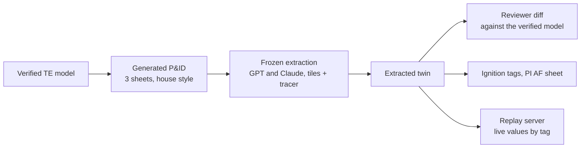

# Results and their limits

This is the research evidence, separate from the [user workflows](WORKFLOWS.md).
The tools are prototypes tested on public inputs. No site's own data, operations review, timed engineer review
or measured operational benefit is established. A successful example does not establish every tool route.

| Evidence | What it answers |
|---|---|
| This page and the [claim receipt](../out/claims_check.md) | What the published research numbers mean, and whether they match their committed evidence. |
| [Generalization matrix](GENERALIZATION.md) | Where eight selected workflows pass or fail on registered public inputs. |
| [Task/model benchmarks](../benchmarks/README.md) | How saved attempts compare on matching task, source, key and scorer cohorts. |
| [Feature reference](FEATURES.md) | Which committed examples have current independent coding-agent reviews. |
| [Evaluation protocol](EVALUATION.md) and [preregistered rounds](GOAL.md) | What was decided before a run, what was inspected and which layer each score measures. |

## Check the published claims

```sh
python scripts/check_claims.py
python scripts/rescore.py --check
```

The first checks the 42 registered numerical claims against their named publication and evidence files.
It does not execute a model. The second re-scores saved predictions: 30 of 35 tables regenerate; five earlier
diagnostic tables lack predictions and report GAP. Holdout-B keys need their separate public download.
See [reviewing the evidence](REVIEWING.md) for test prerequisites, omissions and reproducibility limits.

## Tool coverage

The [corpus matrix](GENERALIZATION.md) covers eight selected workflows:
64 cells pass, 23 fail and 8 are not applicable. Pipe tracing reaches F1 0.912 on the OPEN100 validation sheets
(derived truth, only partly blind), while the mixed vendor-render pool still fails at 0.776. These are tool/input
checks, not a complete-route success rate. Scan cleanup and daily-cycle historian analysis retain their failures.

## Results (held-out drawings, and how they were used)

On the six OPEN100 validation drawings, the five round-5 runs average symbol F1 0.93 and connections 0.87
for GPT with tiling and code tracing. These use the selection split described below.

**The number to quote.** On six held-out OPEN100 drawings, GPT with tiling and code line tracing leaves **20.1**
differences from the answer key per 100 key items for a person to check, and Claude leaves **29.8**. Each is the
mean of five round-5 runs ([replicates_r5_holdout-a.md](../out/replicates_r5_holdout-a.md)). This is the review load:
missed, extra or wrong symbols and connections per 100 key items. Lower is better; 100 means as many counted
differences as key items. Network-pair differences are not independent engineering edits. It counts differences,
not a reviewer's minutes: no review has been timed.

**What kind of test this is.** A same-plant validation split: OPEN100 sheets 6–11 (holdout A) against development
sheets 0–5, from one plant in one drafting style. Holdout A also chose each tool's method, and round-1 outputs had
been seen for all 12 sheets, so these are selection numbers, not an untouched test ([GOAL.md](../docs/GOAL.md)).
Holdout B, 20 synthetic drawings in a different drafting style, is the check of that choice.

**No clear winner across these six drawings.** Resampling the six drawings (a bootstrap), Claude minus GPT is 9.8
points with a 95% interval of −4.5 to 26.5, which includes zero; this does not establish equivalence. Holding the same six drawings fixed, run-to-run
noise alone gives 7.3 to 12.2, so on these six drawings GPT did better. Six drawings are the limit, not the runs.

**How it got there.** Round 2, each method scored once per set:

The earlier single GPT run changed from 48.8 → 17.8 counted differences per 100 key items when tiling and tracing
were added. This is a difference count, not measured review time.

| Model | Model alone, A / B | Tiling + code line tracing, A / B |
|---|---|---|
| GPT (gpt-6.1-sol, via Codex) | 48.8 / 67.0 | **17.8 / 20.7** |
| Claude (claude-opus-5-5) | 61.1 / 76.6 | **32.4 / 16.5** |
| Gemini (gemini-3.1-pro-preview) | 75.9 / 92.7 | **40.2 / 38.3** |

A = 6 real OPEN100 drawings; B = 20 synthetic drawings in a different style. One run per method and set, the runs the
round-2 decisions were taken on (Gemini's are earlier runs; it was not run after round 3). Five later reruns of the
bold method on A give the figures above ([GOAL.md](../docs/GOAL.md#results-round-2-scored-after-the-addendum-above-each-method-once-per-holdout)).

- Reviewers get a risk-ranked queue. The twin built from 12 sheets has 2,886 items: 377 red, 698 amber and 1,811
  green. Green items were 94–100% right on the held-out drawings. The tiers come from agreement between
  extractions (other models, the other pass, the line tracer, a clean tag). What the item does is a separate floor:
  an item whose tag reads as a relief device, shutdown valve, trip switch or isolation valve is never green
  ("safety-relevant: always checked"), which moved 22 instruments from green to amber. The floor only sees what a
  tag says, so an untagged or manual block valve can still be green
  ([docs/TWIN_OUTPUTS.md](../docs/TWIN_OUTPUTS.md#the-safety-floor)).
- **Connections are scored on the network layer:** two items count as connected when they are on the same drawn
  line network, not when a pipe runs directly from one to the other (the pipe layer is scored separately). So these
  numbers **can't be compared directly with the PID2Graph paper**: it uses edge mAP on individual graph edges,
  including connector nodes, while these results use F1 on collapsed network pairs
  ([EVALUATION.md §7](../docs/EVALUATION.md#7-which-layer-each-evaluation-measures), checked against the paper).
- **Seen before?** PID2Graph (holdout B included) and the DEXPI examples are public, and the models were trained on
  web data, so exposure during their training can't be ruled out. Holdout B was sealed from tuning, not from the
  web. Only the drawings this project generated (Tennessee Eastman and Bayer) are certainly new to the models.
- Cost: $16.57 of metered model spend plus two flat-rate subscriptions; reviewer time is the real cost
  ([COSTS.md](../docs/COSTS.md)). The rules that stop me gaming my own score: [EVALUATION.md](../docs/EVALUATION.md).

**Old scans (round 4, pre-registered).** Holdout A degraded to three synthetic scan levels, same method, each level
run once per model:

| Image quality | GPT review load | Claude review load | Connection F1 (GPT / Claude) |
|---|---|---|---|
| Clean (the round-2 run) | 17.8 | 32.4 | 0.89 / 0.78 |
| Photocopy | 20.6 | 29.7 | 0.87 / 0.79 |
| Old scan | 51.5 | 57.0 | 0.51 / 0.45 |
| Bad scan | 72.6 | 70.6 | 0.22 / 0.19 |

Symbol reading fell gently (rough F1 0.94 → 0.77 for GPT, 0.90 → 0.81 for Claude at the worst level). The code
line tracer is what breaks: run on the clean image with the bad-scan symbols, connections recover to 0.53–0.63.
The scans are synthetic degradations, not real archive scans. Details: [GOAL.md, round 4](../docs/GOAL.md#round-4-results-scored-once-per-level-as-pre-registered).

**More drawings, tag text and replicates (round 5, pre-registered).** Five fresh runs per model, Claude and GPT:

| | GPT mean (95% across runs / across drawings) | Claude mean (same) |
|---|---|---|
| Holdout A, review load | 20.1 (18.3–21.8 / 14.2–28.0) | 29.8 (27.5–32.1 / 12.8–47.3) |
| DEXPI sheets, review load | 95.4 (53.2–137.6 / 42.1–138.6) | 61.8 (60.5–63.1 / 26.3–127.9) |
| DEXPI tag text, read exactly | 29 of 33 | 28 of 33 |
| DEXPI tag lists, identifiers found | 145 of 145 | 99.4% |

- **New drawings, worse result.** Five public example and training P&IDs from the DEXPI standards initiative
  (CC BY 4.0) gave 2–5× holdout A's review load. Much of it is what counts as a symbol: equipment nozzles and some
  drawn marks aren't items in the DEXPI key, and GPT reported the nozzles in 3 of 5 runs, which swung one sheet
  between about 33 and 145.
- **Tag text, measured for the first time:** on clean vector drawings both models read almost every printed tag.
  The misses are vertical labels, multi-line labels and a number drawn on a separate actuator bubble. Scans and
  real archives remain untested for tags. Every caveat: [GOAL.md, round 5](../docs/GOAL.md#round-5-results-scored-after-the-pre-registration-above).
- **Review time is still unmeasured.** A timing kit for one sheet: [`out/review_kit/sheet-8/`](../out/review_kit/sheet-8/README.md).

## Source reconstructions and generated drawings

**Tennessee Eastman (TE)** is a model authored from a published process and simulator source, with recorded
simulation data. It is separate from OPEN100 extraction. Source checks report **36 confirmed, 1 corrected**
instrument records. Topology checks report **51 confirmed, 4 corrected, 1 unresolvable of 56** elements.
The reports are [tag checks](../out/te_source_check.md) and [topology checks](../out/te_topology_check.md).
No operations reviewer has accepted that model. The generator initially drew 0 of 19 control loops; the
source-derived audit finds **19 of 19 on revision D** ([loop audit](../out/te_loop_audit.md)).

**Bayer CropScience** is a historical reconstruction from a public CSB investigation, with project-assigned tags.
The report's own drawing supplied an independent comparison: **10 of 21 checks agreed at first; corrected, 20 of 21**.
A second figure has **8 of 11 checks** agreeing, and the narrative walkthrough has **13 of 16 checks agree**.
See the [case and disagreements](BAYER_RT.md), [first figure](../out/bayer_rt/fig10_compare.md),
[second figure](../out/bayer_rt/fig11_check.md) and [walkthrough](../out/bayer_rt/walkthrough.md).
The initial 10-of-21 count rests on narrative, not a saved result table; the claim check labels it prose only.

**MGPI** is a [source-adapted development case](../examples/from-description/mgpi/README.md), not an unfamiliar
original-description trial. Expanding the permitted source passage resolves an initially unsupported placement;
that is a source/key change, not model improvement. Its deliberately false automatic-shutdown claim retains a
perfect selected-field score, and the question engine raises no findings on the sparse model. Both gaps remain.

**OPEN100 structural demonstrations** retain drawing-only limits: direction on **361 of 1,133** process links,
and **38 sheet-to-sheet connections**, **36 with a direction**. Undetermined links stay undirected. The mimic,
3D tour and isolation mockup are research outputs requiring adaptation, not generic own-drawing deliverables.
See [structural evidence](OPEN100_STRUCTURAL.md) and the [TE/OPEN100 demonstration comparison](DELIVERABLES.md).

### One plant, end to end (Tennessee Eastman)



**This is a round trip.** The sheets and their answer keys come from the same model, so the scores measure how
faithfully the frozen method (2×2 tiles, prompt v2, code line tracer; nothing re-tuned) reads our own clean drawings.
They are an upper bound, not real-plant accuracy, and not comparable with the OPEN100 numbers. Gemini was left out.

**Revision A sheets** (no controllers; kept in [`data/te_pid/rev-a/`](../data/te_pid/rev-a/), tags since renumbered
by [this map](../data/te_retag_2026-10-28.json); the extracted twin below was built from them): review load 2.1 (GPT)
and 2.2 (Claude) per 100 with every tag read on clean sheets, rising to 16.9 and 17.3 at the bad-scan level, where
only **14%** and **49%** of tags were read exactly ([roundtrip_scores.md](../out/te_pid/roundtrip_scores.md)).

**Revision C sheets** (controllers, signal lines and valve stations; same frozen method and protocol;
[roundtrip_scores_revC.md](../out/te_pid/roundtrip_scores_revC.md), journal entry 54):

| Image | Review load /100, GPT · Claude | Tags read exactly, GPT · Claude |
|---|---|---|
| Clean (5 runs each) | 1.26 · 1.38 | 100% · 100% |
| Photocopy, L1 (3 runs each) | 1.30 · 4.1 | 100% · 100% |
| Old scan, L2 | 1.20 · 10.0 | **61%** · 89% |
| Bad scan, L3 | 14.9 · 15.7 | **9%** · **50%** |

On bad scans tag text fails first, controller tags before the rest. Claude's higher load at L1 and L2 comes from my
line tracer following a vessel wall inside its tighter boxes; growing them 4 px removes every extra link, but that is
a method change and will be measured as one. 43 printed tags per run: the project's first tag-reading score, because
the OPEN100 keys carry no text. In full: [EVALUATION.md §6](../docs/EVALUATION.md#6-one-plant-end-to-end-tennessee-eastman).
- **On old scans the risk is in the text, not the shapes.** GPT kept finding every symbol and line at L2 but read
  FI as PI, LI as LE and FV as PV. Claude at L3 put three real feed-valve tags each on its neighbour's valve in one
  run. A tag-only check and the live check both pass that; only the position-aware round trip catches it.
- **The reviewer diff** (GPT, clean, first run) has 10 corrections against the verified model. Nine also appear for
  a perfect reader, so they come from the converter and the model's conventions, not from the reading
  ([diff](../out/te_pid/diff_codex-clean-r1.md), [perfect-reader diff](../out/te_pid/diff_key.md)).
- **Live values:** 36 of the extracted twin's 37 tags resolve to points on the TE replay server, and all 36 moved
  between reads; SC-212 has no recorded data ([live check](../out/te_pid/live_codex-clean-r1.md)). Its tag file was
  **not** imported into a gateway: the gateway-tested project is built from the verified model.

## Recorded-data analysis and platform acceptance

On **all 21 published faults** of the TE simulator, shipped normal bands **flag 17 (median 48 min** after onset),
with **0 false alarms in 193 h** of held-out normal running; they **miss faults 3, 9, 15 and 19**.
These are recorded simulator results, not a live plant detection guarantee. The [evaluation](EVALUATION.md#4b-fault-detection-with-the-normal-bands-tennessee-eastman-all-21-faults)
and [operator-screen interpretation](OPERATOR_SCREENS.md) explain the comparison and limits.

The repository's TE demonstration has dated [native Ignition acceptance receipts](IGNITION_ACCEPTANCE.md),
including fault planting and source-loss checks. Those receipts apply to their specific lab candidates.
The generic drawing intake has no plant acceptance. PI files have been checked offline but **never imported into
a PI System**. No operator has reviewed the screens, and no person's review time has been measured.

## Research record and reproduction

[Review the evidence](REVIEWING.md) for a short check; [reproduce the demonstrations](REPLICATE_AT_YOUR_PLANT.md)
for setup and advanced commands. [Data lineage](DATA_LINEAGE.md) records what each output inherits.
[The original plan](PLAN.md), [experiment goals](GOAL.md), [attempt ledger](TRIED.md) and [journal](JOURNAL.md)
retain the historical decisions and failures. They are research records rather than current user instructions.
Model-assisted authorship is described in [MODELS.md](MODELS.md); attribution and licensing are in
[NOTICE.md](../NOTICE.md).
