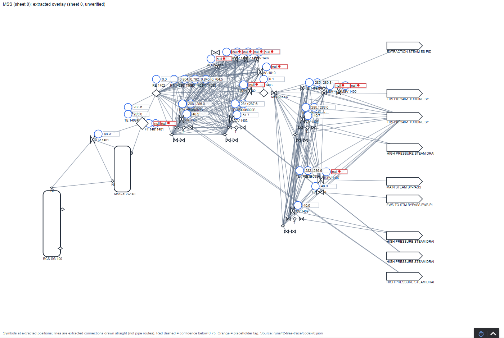

# Closing the loop: operations review and real data points

The extraction gives a draft. Engineering review supplies corrections, and an I/O list supplies candidate signal
addresses. The local tools retain those inputs for checking and handoff. Neither address assignment nor a source
match establishes operational readiness.

Both are files that operations and controls people already know: a review spreadsheet and an I/O list. Both flow
back into the draft through code, with attributed review records and source-referenced address assignments.

```
review sheet (spreadsheet) ──► apply_review.py ──► asset model ──► generate.py ──► Ignition / PI AF / screens
I/O list (spreadsheet)     ──► map_points.py   ──►      │                              │
                                                  change records                 build_gateway.py
                                                  (out/review, out/mapping)      verify_gateway.py
```

The gateway scripts in this diagram build and check this repository's demo. A different plant needs its own
receiving-system adaptation and acceptance; generic file generation does not perform that work.

## 1. The operations review

Native instrument/final-element tag corrections migrate their supported live references together. Supplied
alarm metadata remains intact, including unknown or unreadable values. The
[fictional native correction](../examples/review-and-mapping/native-identity/README.md) shows both behaviors,
repeat review and the separate authored-layout reconciliation step. Use a disposable copy and inspect its full diff.

**The sheet.** It's one row per item, riskiest first (red, amber, green):
- Tennessee Eastman: `out/ops_review_sheet.csv`;
- an extracted twin: `review_queue.csv`.

In an extracted twin, an item whose tag reads as a relief device, shutdown valve, trip switch or isolation valve
is never green: its `why` starts "safety-relevant (...): always checked", whatever the extraction checks say. Green
is a lower review-priority tier under the fitted rating; it does not accept an item or establish safety duty.
Untagged and manual block valves are not caught by that floor. On unfamiliar drawings, check representative
sheets against originals and agree review criteria; a sampled check does not accept the unreviewed remainder.
See the [tier scope and limits](TWIN_OUTPUTS.md#risk-tiers-where-to-spend-review-time) and
[tag-based floor](TWIN_OUTPUTS.md#the-safety-floor).

CSV exports prefix formula-like text (`=`, `+`, `-`, `@`, including after leading
whitespace), control-containing text and leading apostrophes with one apostrophe.
This is intentional spreadsheet text encoding, not a change to the engineering
model. Ordinary cells remain unchanged. The review importer recognizes unchanged
encoded notes against the existing model, so regenerating and reapplying a sheet
preserves the original notes and history. New or edited notes are taken as written;
when editing a protected cell, remove the serialization prefix if it is visible
and is not intended as literal text. Raw or encoded item identifiers must resolve
to exactly one record; ambiguous spellings are refused rather than guessed.

The reviewer fills in the `OPS_` columns:

| Column | What to write |
|---|---|
| `OPS_confirm_or_correct` | `confirm`, `correct` or `reject` (not real). Blank means not reviewed yet |
| `OPS_correct_value` | For `correct`: `field=value` pairs separated by `;`, e.g. `tag=FT-1401; uom=kg/h`. A bare value corrects the main field (the tag; for TE instruments, the description) |
| `OPS_show_on_operator_screen_Y_N` | `Y` or `N` |
| `OPS_alarm_priority_H_M_L_none` | `H`, `M`, `L` or `none` |
| `OPS_notes` | Free text, kept with the decision |

**Apply it:**
```
python scripts/apply_review.py data/te_process_model.json reviewed.csv --reviewer "Name, role" --dry-run
python scripts/apply_review.py data/te_process_model.json reviewed.csv --reviewer "Name, role"
python scripts/generate.py                                  # or: generate.py <twin>/plant_model.json
# Gateway import is a separate, approved isolated-lab step; see IGNITION_ACCEPTANCE.md.
```

**What happens:**
- **Every row is checked against the model before anything changes.** An unknown item, an unknown field, a
  `correct` with no value, or an unreadable decision is refused and listed. Rows are processed independently:
  valid rows can be applied even when other rows are refused, and the run then exits non-zero. Preview with
  `--dry-run` first. After any failure, inspect the change record and model diff before retrying or regenerating;
  a non-zero exit does not mean the model was left unchanged.
- **Sheet identities are frozen before application.** Native instruments/final elements use tags even when an
  auxiliary ID is supplied; extracted assets retain stable IDs. Contradictory rows/cell assignments, collisions,
  chains/swaps, duplicate CSV headers and malformed/ambiguous JSON refuse. A newly created tag cannot retarget a
  later row in the same sheet. Historical tag aliases permit unchanged replay only; use the current identity for
  a new decision. Controllers/manual valves/relief/unplaced records are not newly editable collections here.
- **Decisions are written onto each item** as `ops_review`: status, reviewer, date, notes, screen and alarm choices.
  Each correction keeps the old value in the item's history. The model file is updated in place, so the git diff is
  exactly the review. A dated change record goes to `out/review/`; `Record:` identifies the selected JSON/Markdown
  pair. Different results on the same date get a fingerprint suffix. Earlier records stay intact; identical
  replay reuses its own record. These local checks do not provide filesystem locking or concurrent publication.
- **Re-applying the same sheet changes nothing.** The regenerated sheet prints earlier decisions back into the
  `OPS_` columns, so a reviewer can stop and resume.
- **Downstream:**
  - rejected items leave the Ignition tags, the PI AF sheet and the SVGs (items under rejected equipment move to
    `_Unassigned`);
  - in an extracted twin, each Ignition instance's `ReviewStatus` tag carries the decision, and the verifier checks it matches (V2);
  - in an extracted twin, each Ignition instance's `documentation` and each PI element/attribute description end
    with `review: <status> | risk tier: <tier>`, so the decision and the remaining uncertainty show where the
    tag is used;
  - in extracted-twin SVGs, "don't show" items get no screen label.

For hand-built process models, eligible children of rejected equipment use an explicit `_Unassigned` display
container. Their original OPC server/item and PI point claims are preserved, while their displayed/exported paths
change. `seed_review_projection.json` lists the exclusions and old/new paths. The complete source and review sheet
remain available. Reviewed seed streams are retained in that sheet; unreviewed streams retain its historical scope.
The generated-file inventory retires unchanged obsolete artifacts and refuses manual edits or known conflicts
before writes. The [worked seed refresh](../examples/review-and-mapping/seed-refresh/README.md) explains dedicated
output folders, legacy migration and exact limits. This is local generation behavior, not native platform acceptance.

If you used the question engine, rerun it with the updated model and the same supplemental inputs and selection.
Rejected items also leave question triggers, evidence and relationships; non-rejected children remain eligible
without a rejected owner, parent or stream. The screen lists the recorded rejections and does not let a
supplemental loop list reinstate a rejected controller. The [worked refresh](../examples/opportunity-screen/review-refresh/README.md)
checks this sequence on fictional decisions, including explicit reinstatement and retained history. Refresh an
existing context register with its current `--register` so earlier decisions remain visible. Preserve the old
packet and manifest first; withdraw absent finding IDs from the current manifest's locator bindings before
refreshing, as the [context revision guide](CONTEXT_REGISTER.md#incoming-revisions-reopen-affected-answers) explains.

An existing OPC `data_point` or reviewed PI `pi_point` blocks a scoped valve-callout
conversion before any fields or review history change. Changing or removing that
mapping needs a separate authorized mapping review; the correction never erases it.

**Identifier text only.** An optional `OPS_scope=identifier_text` column on a twin correction row limits
approval to the written identifier. It requires `tag=...`, unchanged function letters and an existing loop
that matches the old tag. The matching derived loop, exact tag-mirroring description and hierarchy display
cache update together. A non-mirrored description, semantic-field edit, invalid tag, screen/alarm decision or
mismatched loop is refused. The whole-record review status stays unchanged; corrected fields and scope are
recorded separately in `ops_review.field_decisions` and history. Extraction provenance, inferred function,
classification, parent, connections and I/O are untouched. Regeneration never turns this into `confirm`.

**Alarms stay a change-review decision.** Supplied numeric setpoint lists remain recorded inputs, with zero a
valid value; they do not establish an installed or approved alarm. Empty, null, unreadable and unrecognized
metadata stays unresolved. The declared TE simulator model can use the gateway's XMEAS(7)/XMEAS(9) reference
without injecting fields or importing gateway configuration; supplied metadata takes precedence. Coincidental
tag text on another model does not qualify. The change record names this basis. Removing a recorded/reference
alarm or requesting a priority with unresolved basis requires a change review (MOC). Priority choices are local
review metadata; the command creates or removes no alarm and changes no setpoint.

Separate authored drawing/display layouts and external loop/mapping files are outside the apply command.
Reconcile their actual tag references and regenerate/check affected outputs. A successful seed SVG/platform
export does not establish detailed layout consistency; the [native example](../examples/review-and-mapping/native-identity/README.md#reconcile-the-companions-explicitly)
shows the exact TE companion correction and its limits. Retain actual signal addresses and original evidence.

## 2. Mapping instruments to data points

**The I/O list.** A CSV with `tag, server, base_path, point` (plus optional `asset_id, units, description`):
- `server`: the Ignition OPC connection name;
- `base_path`: the OPC UA namespace and prefix (`nsu=<uri>;s=<prefix>`);
- `point`: the node under it.

A real site exports this from its control-system or historian database. **Work on a private copy, back it up and preview with `--dry-run` before applying.** Default mapping is a partial update: unrelated mappings remain. The preview includes complete before/after mapping snapshots and every added, changed or removed mapping; `--json` selects machine-readable output. `--sheets` limits eligible targets and replacement scope, but does not resolve globally ambiguous tags. A resolved out-of-scope row rejects the update.

Use `--replace-all` only for an explicitly approved authoritative replacement in that scope (all sheets if omitted). Replacement refuses unmatched, ambiguous or blocked rows. Unknown/rejected explicit IDs never fall back to tags; duplicate target rows, invalid scopes or empty addresses reject the whole transaction without model/report writes. Partial mode reports ambiguous/unmatched/callout rows without assigning them, preserves existing mappings, and may still apply other valid rows. Have the qualified reviewer inspect the complete diff and approve application; inspect the report, not just the exit code. Nonempty address checks do not prove valid OPC syntax, connectivity or signal identity. Validate units, types, scaling and ranges separately: optional CSV units/description do not validate or populate those model properties. This is OPC mapping; the PI exporter still emits placeholder PI point references.

```
python scripts/map_points.py out/twin/r2-tiles-trace/codex/plant_model.json data/io_lists/open100_sheet0_demo.csv --sheets 0 --dry-run
# After inspecting the full diff and approving the partial update, repeat without --dry-run.
python scripts/generate.py out/twin/r2-tiles-trace/codex/plant_model.json
# Gateway import is a separate, approved isolated-lab step; see IGNITION_ACCEPTANCE.md.
```

**Gateway caution:** `build_gateway.py --fresh` deletes/recreates the lab provider and configures gateway resources; it is not a file-only regeneration command. Runtime import and verification require a separately approved isolated lab, not production. See [native acceptance page](IGNITION_ACCEPTANCE.md).

**Matching never guesses.** Tags match after separators and case are normalized, so `FT 1401`, `FT-1401` and
`ft_1401` are the same tag. `asset_id` pins a row when needed. An applied report is saved under `out/mapping/`; dry-run only prints it. In addition to errors and the complete mapping diff, it retains four worklists:

| List | What it usually means at a site |
|---|---|
| Mapped | A supplied address is assigned in the local model; the signal has not been verified |
| On the drawing, not in the I/O list | Spare, demolished, a local gauge with no signal, or a missing I/O row |
| In the I/O list, not on the drawing | The supplied I/O row has no matching model item; reconcile identities and revisions in both sources |
| Ambiguous | The same tag on two drawing items; a person decides, then pins it with `asset_id` |

**Retain the mapping source.** Each new OPC assignment includes the raw CSV's `source_sha256` and
`source_lines: [start, end]`. The report's `io_list_evidence` holds its basename, byte count and fingerprint.
These are physical CSV lines, not spreadsheet record numbers; quoted newlines and intervening blank lines are
counted correctly. Raw fingerprints distinguish BOM, line-ending and prose-only revisions too. Such a revision
can change provenance without changing an address. Inspect that diff and keep the original CSV and approved plan
with the packet. Partial updates retain omitted mappings' earlier evidence; an old address is not silently given
the new file's fingerprint. Mapping reports are current snapshots and same-name reports are replaced on apply.
Hashes locate supplied bytes; they do not prove revision authority, source accuracy, connectivity or plant truth.

**The demo.** OPEN100 has no plant behind it, so `data/io_lists/open100_sheet0_demo.csv` is a synthetic I/O list,
labeled as such. On sheet 0 it maps 24 instruments, with three different spellings of the tag style, and finds 2
points that aren't on the drawing. It also hits one real ambiguity: the drawing shows `FT 1401` on two symbols.
`scripts/ignition/demo_points_server.py` serves synthetic values for those points.

The historical runtime receipt showed 24 mapped tags Good and 335 placeholders Bad. The current reviewed model has 334 placeholder PVs plus the metadata-only MS 14010 valve callout; in the 2026-10-13 native run of the current project, the gateway read 24 mapped points Good and all 334 placeholders Bad, with 0 false-good ([native acceptance page](IGNITION_ACCEPTANCE.md)).



## Status

- **Review loop:** tested on copies of both models (`scripts/test_apply_review.py`, in CI).
- **Point mapping:** offline assignment/provenance checks run in the current suite. The historical synthetic
  gateway demonstration is recorded in `out/ignition/gateway/receipts/20261008T175223Z.md`; it does not validate
  an arbitrary site's address or the new source metadata through a native import.
- **Not done yet:** the Tennessee Eastman operations review itself. A review only means something from someone who knows the process and is looking at the drawings; a sign-off without that would be a rubber stamp, so none has been recorded.
