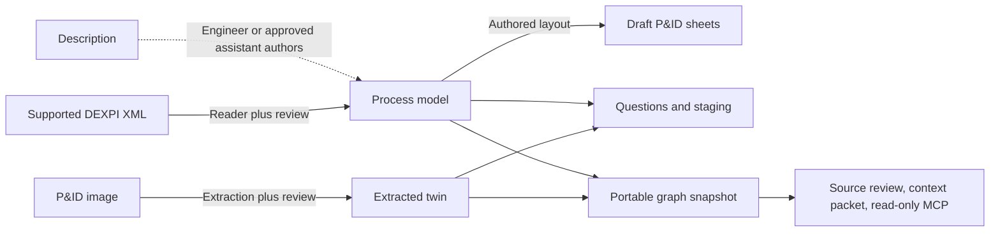

# Supported workflows and formats

Use the [input selector](../README.md#start-wherever-you-are) to choose a guide. This reference explains what
connects after that choice. It describes existing tool contracts, not one universal automated pipeline.

## First choose what the question needs

- **Document clarification:** keep the question and source evidence in the [plain brief](../examples/first-pilot/README.md).
  No model, drawing, graph or server is required.
- **Equipment identities or connections:** use the matching description, image or DEXPI guide to prepare a draft
  model, then check it against independent evidence.
- **Controls/history question:** use loop records or historian CSVs directly. Relate results to assets only after
  reviewing the identity mapping. A CSV does not automatically create a process model.

## Three files with different jobs

| File shape | Role | Important boundary |
|---|---|---|
| **Process model** | Equipment, streams, instruments and controls, authored from sources or read from supported DEXPI XML; for example `data/te_process_model.json`. | Authored or reader-derived interpretation needs review. Detailed P&ID sheets also require a separate authored layout. |
| **Extracted twin** | Assets and connections read from a drawing; for example the own-drawing bundle's `plant_model.json`. | Interpretation, source revision, identities and connections need review. Its logical SVG is not a detailed P&ID. |
| **Portable graph (`twin-graph-1`)** | Exported identities, typed relationships, sourced claims and optional questions for review/access. | It is a snapshot and a one-way export. No general graph-to-generator-model inverse exists. |

The diagram omits setup and optional evidence inputs; the table below states each contract. Image extraction
requires an approved model interface. Supplied offline answers let you try the examples without running a model.
Detailed layout is authored. Neither arrows nor a passing check establish engineering truth.
Eligibility and represented fields still matter: the valid DEXPI C03 reader output lacks the units/instruments
needed by the question engine and is refused. Use a plain source-question brief in that case. The older
converted-key DEXPI adapter produces an extracted twin through its separate contract below.

## Tool input and output contracts

| Tool or route | Current input | Output and integration boundary |
|---|---|---|
| `dexpi_reader.py` | Supported DEXPI XML | A process-model-shaped JSON plus an omissions/placement report. Vendor dialects, mapped classes and downstream eligibility need review; not every source role is used by every generator. |
| `dexpi_to_twin.py` | The pre-adapted DEXPI sheets/keys contract | An extracted twin/review bundle. This route is distinct from the direct XML reader and does not import arbitrary CAD formats. |
| `description_workflow.py` | UTF-8 text for `prepare`; an engineer/approved assistant's model+layout+quotation JSON for `check` and `build` | Source packet and validation feedback, then draft sheets, questions, graph, staging and full supplied-record/source-line review sheets. Interpretation/layout remain authored and all review rows start unreviewed; no model API, automatic detailed layout or tested Copilot tenant. See the [connected example](../examples/from-description/README.md#try-the-connected-route-offline). |
| `draw_pid_from_model.py` | Process-model fields plus an authored drafting-layout JSON | Detailed draft PNG/SVG P&ID sheets and a key. No automatic detailed layout or general graph/extracted-twin conversion into this drawing contract. |
| `generate.py` | This repository's process-model JSON or extracted-twin JSON | Platform staging and the outputs supported by that model kind. A `twin-graph-1` file is not a direct generator input. Signal mapping and native acceptance remain separate steps. |
| `question_engine.py` | Process-model or extracted-twin JSON; optional loop list and equipment schedules | Questions, asset references and collection requests. Findings propose investigations; they do not mutate the model or establish savings. |
| `graph_export.py` | Process-model or extracted-twin JSON, with optional ordinary question-engine questions/review records | `twin-graph-1`, including the source/status information represented by the input. Bound enriched questions are refused: use their complete enriched graph/context pair or explicitly refresh the preserved register. It is an export, with no general graph-to-process-model inverse. |
| `apply_review.py`, then `generate.py` | A supported working model and its engineer-filled `OPS_` review sheet | The existing [local model-correction route](REVIEW_LOOP.md): preview with `--dry-run`, apply whitelisted corrections with old values and review history, then regenerate. Apply updates that working model in place; valid rows may persist when other rows refuse. Preserve the base and inspect its diff/change record. A hub integration must stage the resulting changes under its authority rather than treating local CSV entries as organizational acceptance. |
| `statements.py` | `twin-graph-1`, with supplied source images/report and optional machine-check model | Statements, samples and review material. Applied reviews change statuses and add review events; they do not change engineering values or authenticate the reviewer. See the current [binding and application rules](STATEMENT_REVIEW.md). |
| `context_register.py` | Process model, extracted twin or graph, questions and a manifest of actual local source documents | `context-register-1` and enriched graph/questions. Treat local answers and ownership history as a review packet when transferring into an organizational authority. It does not update the original working model. |
| `serve_snapshot.py` | One selected `twin-graph-1` startup snapshot; optional explicitly selected, hash-bound `context-register-1` sidecar | Bounded read-only assets (including virtual streams), relations and questions; the selected sidecar adds complete retained decision/answer/source readback. Restart to load a new version. No automatic sidecar/source fetching, analysis execution or shared company authentication. |
| Historian CSV tools | Recorded data in the documented CSV shape | Analysis and replay of the supplied history. Joining channels to canonical plant assets is a separate mapping task; an unusual trend is not a validated diagnosis. |
| `estimate_impact.py` | A strict JSON specification containing measurements and site constants, or explicitly requested public defaults | A first-draft calculation with assumptions and source notes. The model alone does not supply the measurements; generator provenance belongs in a sidecar rather than unrecognized calculation fields. |
| `pipeline.py` | The repository's declared stages, inputs, code and configuration | Freshness and rebuilds for its configured research demonstrations. An organization's own recipes and service orchestration need an explicit implementation; the existing stage list is not a universal plant integration. |

Drawing manifests identify their generator, model and layout with the drawer's existing text-hash rule:
CRLF pairs are folded to LF; other bytes remain significant. The topology verifier uses that same rule and
still checks the recorded key networks. This does not normalize original source-document hashes, context
source pins or bundle inventories, and a matching manifest does not establish engineering correctness.

## Carry a finding forward

Keep the source revision and locator, exact asset/finding IDs, unresolved evidence and intended next owner with
the result. The [question brief](../examples/first-pilot/README.md) is the smallest handoff. The optional
[context register](CONTEXT_REGISTER.md) retains supplied answers and revision dependencies in local files.
Its answers do not edit the generator model; use the separate reviewed model-correction route when appropriate.

Ordinary `question_engine.py` questions can be attached by `graph_export.py --questions`. Once the context register
adds answers and a `context_register` content binding, carry `enriched_graph.json` and `context.json` together
directly to the consumer. Do not pass `enriched_questions.json` back to the graph exporter: rebuilding a full or
core graph cannot validate its inherited answer freshness or preserve the complete decision history. The exporter
refuses that input before writing. For changed sources, model or questions, explicitly refresh through
`context_register.py` with the preserved register, then use the new bound pair; the
[context handoff instructions](CONTEXT_REGISTER.md#versioned-handoff-and-limits) describe that route.

For continuing company use, [the lifecycle](CONTEXT_LIFECYCLE.md) owns the intended responsibility and return
path. [Connectivity](INTERNAL_CONNECTIVITY.md) owns client approval, deployment and network boundaries.
Company authentication, accepted imports, live process-data connectors and automatic document updates are
separate integration work. The shipped MCP starter reads one selected snapshot.

For individual tool evidence use [FEATURES.md](FEATURES.md). For results use [RESULTS.md](RESULTS.md).
The [demo deliverables](DELIVERABLES.md) compare TE and OPEN100 research outputs; they do not promise those
screens, tours or isolation mockups for a new plant.
