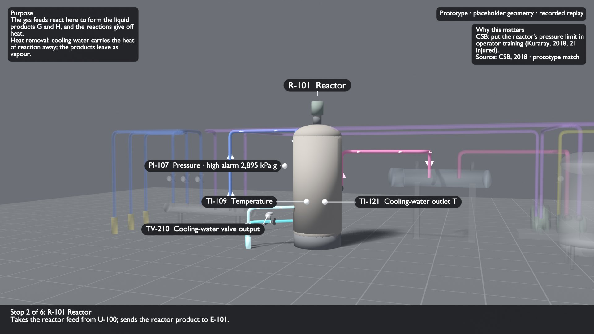
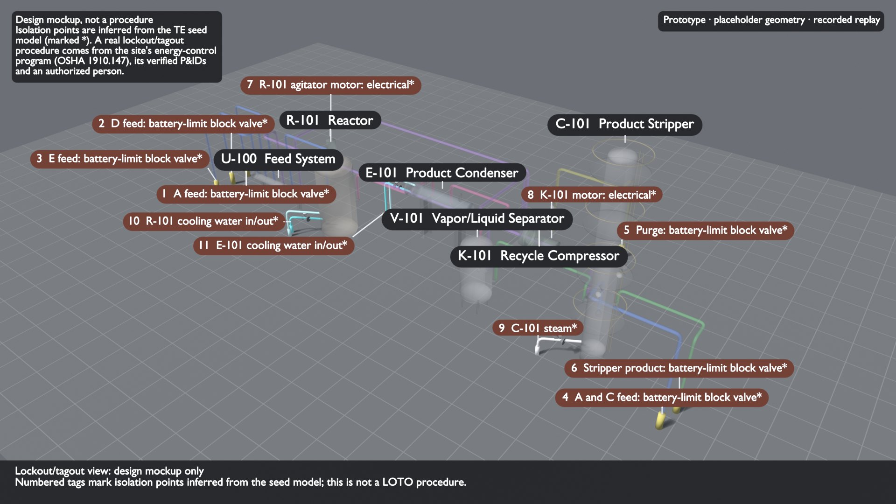

# Draft: 3D operator orientation tour (work in progress, not reviewed)

These are review stills from a prototype that renders the twin's process model as a 3D walkthrough for operator orientation. Geometry, sizes, elevations and pipe routes are placeholders; tag colours come from the recorded Tennessee Eastman replay, not a live plant. Narration and purpose text were written with AI assistance from the data files and have not been reviewed by an operator.

| Still | What it shows |
|---|---|
|  | Elevated overview, normal replay |
|  | Reactor stop: purpose card, key tags, operating alarm, public-incident citation |
|  | Fault 6 at the reactor pressure high alarm (+294 min) |
|  | Process flow coloured by service, arrows showing direction |
|  | Lockout/tagout view design mockup. Isolation points are inferred from the seed model; this is not a procedure. A real LOTO procedure comes from the site's energy-control program (OSHA 1910.147), its verified P&IDs and an authorized person. |

Not built yet: animated flow and per-asset mechanism animations, the remaining unit stops in this style, and the narrated video.
