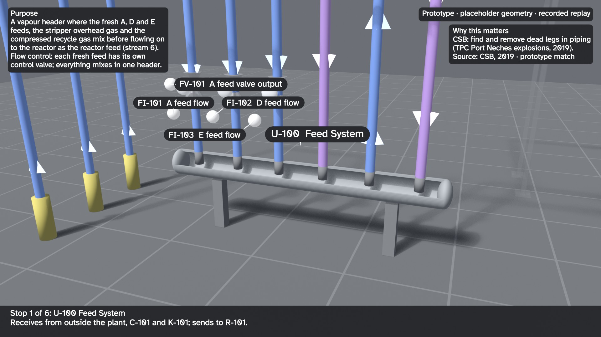
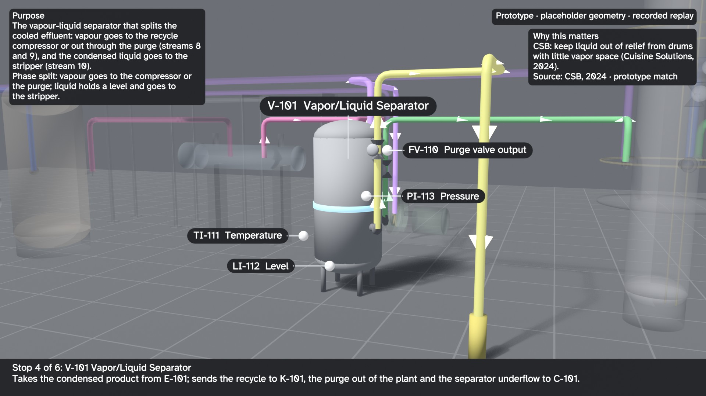
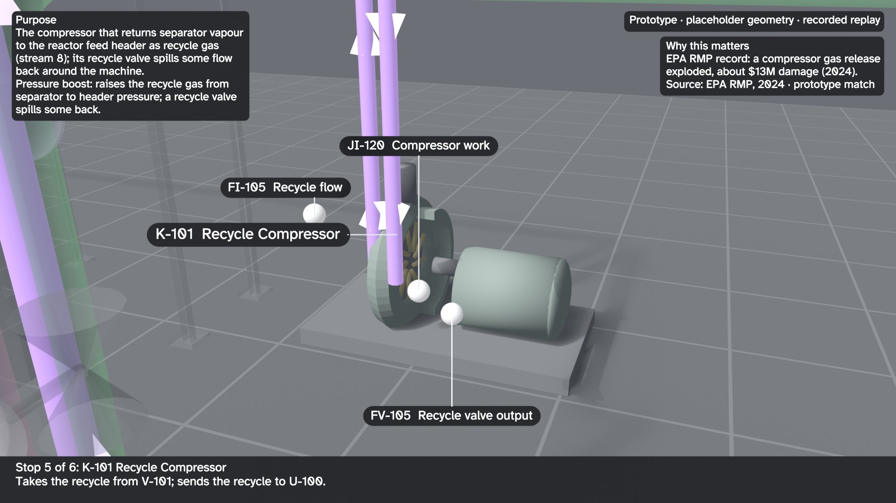

# 3D operator orientation tour: review stills (proof of concept, not reviewed)

These are review stills from a proof of concept that renders the twin's process model as a 3D walkthrough for
operator orientation. Geometry, sizes, elevations and pipe routes are placeholders; tag colours come from the recorded
Tennessee Eastman replay, not a live plant. The narration and the tour's short function lines were written with AI
assistance from the data files; each purpose sentence comes from `data/te_unit_purposes.json`, which cites the
simulator lines it restates. Nothing here has been reviewed by an operator.

The stills were re-rendered on 2026-10-28, after the control valves were renumbered to their loops (journal entry 51),
with the review corrections of 2026-10-15 re-applied (V-101 and K-101 callouts, the overhead rack corridor, the
header bore and an illustrative compressor impeller) (`python scripts/pipeline.py rebuild --from te.tour`, with
`BLENDER_EXE` set; Blender 5.2.2, stills only, no video). They show the source-checked topology (the purge leaves
from the separator V-101, with FI-110, FV-110 and AI-129) and the Atkinson Hyperlegible label font. The OCR
read-back files (`label_truth.json`, `ocr_readback.json`) still describe the 2026-10-13 stills and their
revision-A tags; they were not re-run. Twelve stills were rendered and measured; eight review JPEGs are committed.
The render verifier failed none of its 17 checks on
all twelve: 15 pass, and 2 are informational (drawing coverage, and OCR, which was not run). See
[verification.md](verification.md) and the label boxes in [label_boxes.json](label_boxes.json). The 2026-10-13
[before/](before/label_boxes.json) evidence remains a historical control of the old label rules; it was not re-rendered
with the new cutaway geometry.

This review cut anchors the V-101 and K-101 callouts on their own machine bodies, adds a paired-column overhead
recycle corridor, and opens the header bore and compressor casing. The radial impeller and all rack dimensions are
illustrative placeholders, not verified plant construction or compressor-type evidence. Purpose cards sit in front
of nearby geometry; the render audit now checks them for occlusion by ghosted parts as well.

| Still | What it shows |
|---|---|
|  | Elevated overview, normal replay |
|  | Reactor stop: purpose card, key tags, operating alarm, public-incident citation |
|  | Feed header with an illustrative open bore |
|  | V-101 callout ending on the separator body |
|  | K-101 cutaway with an illustrative radial impeller |
|  | Fault 6 at the reactor pressure high alarm (+294 min) |
|  | Process flow coloured by service, arrows showing direction |
|  | Lockout/tagout view design mockup. Isolation points are inferred from the seed model; this is not a procedure. A real LOTO procedure comes from the site's energy-control program (OSHA 1910.147), its verified P&IDs and an authorized person. |

Not checked on these stills: the OCR read-back ([REVIEW_NOTES.md](REVIEW_NOTES.md) section 3 ran on the earlier
stills; the OCR engine is not installed on the machine that re-rendered them). A person still has to look
([review kit checklist](../../docs/review-kit/CHECKLIST_3D_STILLS.md)).

Not built yet: animated flow and per-asset mechanism animations, and the narrated video (not re-rendered since the
review; it must not be until the stills are approved).
