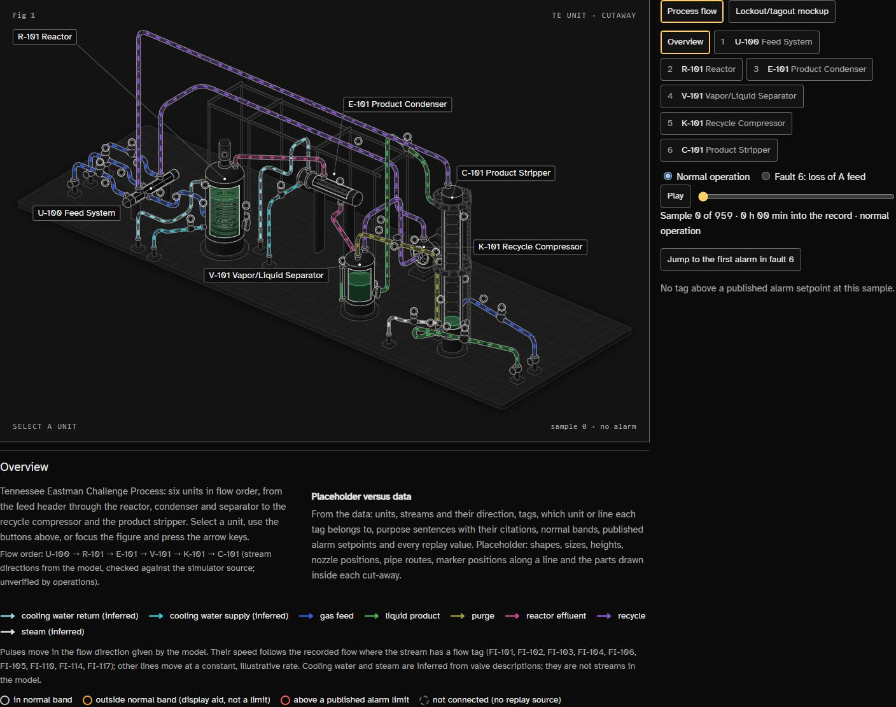
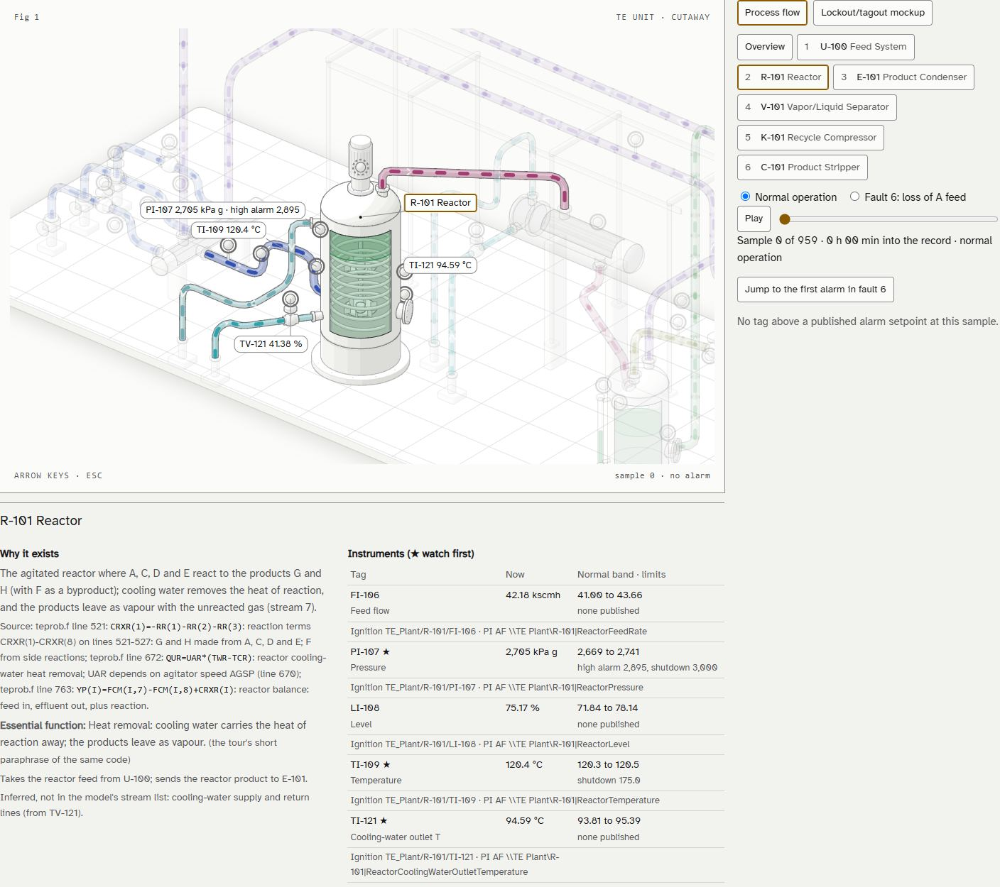
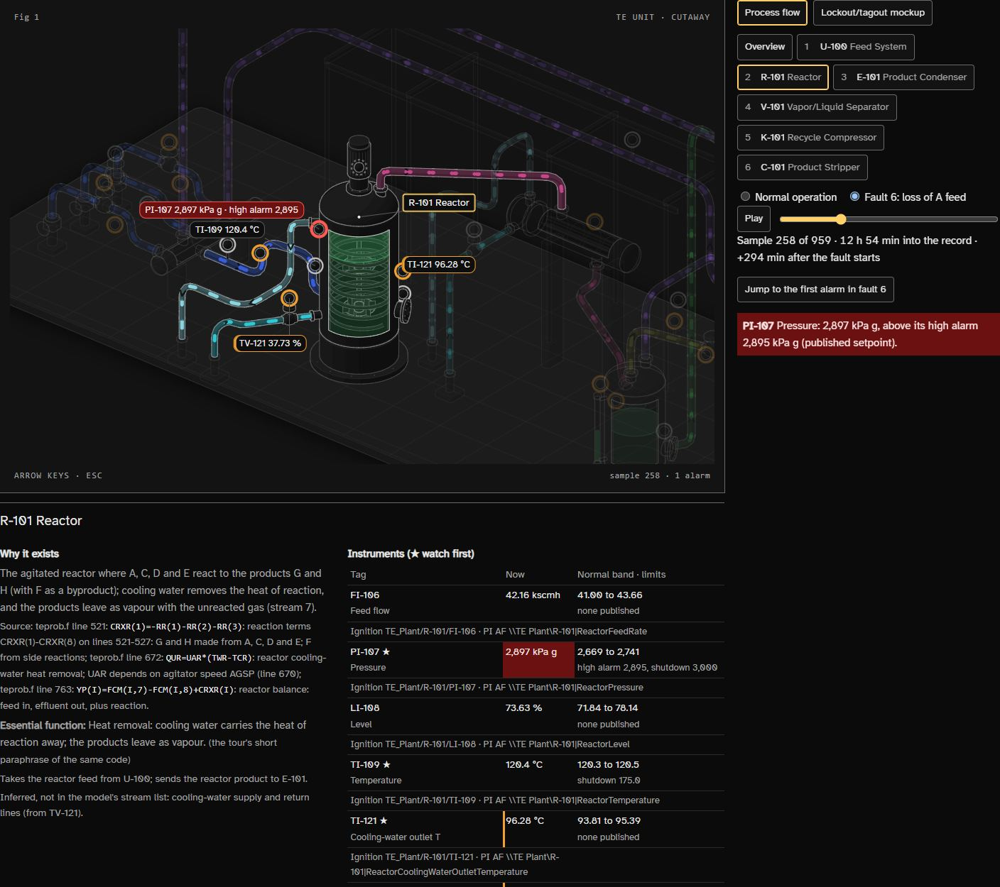
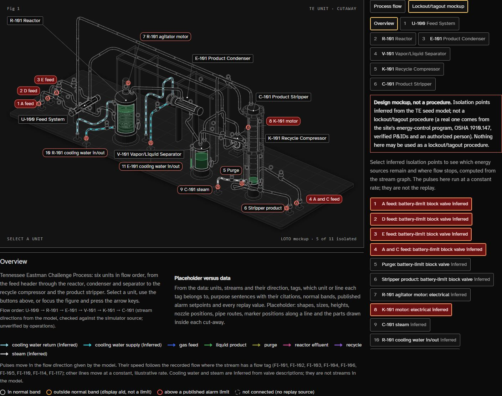
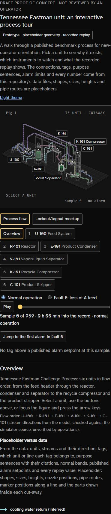

# Interactive process tour: a browser cutaway of the TE unit (proof of concept, not reviewed)

A draft of an interactive, zero-dependency browser page that walks a new operator through the Tennessee Eastman (TE)
seed model: each unit drawn as a recognisable machine with a cut-away window, pipes coloured by service with pulses
moving in the flow direction, a time scrubber over the recorded Braatz replays (normal and fault 6), purpose cards, and
a lockout/tagout design mockup. It complements the Blender tour in [../3d-tour/](../3d-tour/README.md): Blender gives
cinematic stills and video, this gives self-paced orientation in a browser. Nothing here has been reviewed by an
operator.

Geometry, sizes, elevations, nozzle positions, pipe routes and the parts drawn inside each cutaway are placeholders;
the connections, tags, alarm limits and every number shown come from the repository's data files. The tour's short
function lines, captions and the page text were written with AI assistance from the data files; each purpose sentence
comes from `data/te_unit_purposes.json`, which cites the simulator lines it restates.

| Still | What it shows |
|---|---|
|  | Overview, normal replay: six units in flow order, lines coloured by service |
|  | Reactor stop (light theme): agitator, cooling coil and liquid level in the cutaway, key tags with live values, purpose card with its `teprob.f` citations, Ignition and PI AF paths, the public-incident citation |
|  | Fault 6 at the first published alarm: sample 258 (+294 min), PI-107 2,897 kPa g above its 2,895 high alarm |
|  | Lockout/tagout design mockup: every feed block valve and the compressor motor isolated, all process flow stopped, the remaining energy sources listed |
|  | The same page at 390 px |

All stills, both themes and both widths, are in [shots/](shots/).

## What is data and what is placeholder

| Element | Source | Status |
|---|---|---|
| Units, their kind, streams with `from`/`to` and direction | `data/te_process_model.json`, `data/te_display_layout.json` (read through `build_3d_scene.build_scene`, the Blender tour's own function) | Sourced; source-checked against the simulator, not reviewed by operations |
| Tags, which unit or line each belongs to, units of measure | the same model and layout | Sourced; marker position along a line or on a shell is a **placeholder** |
| Ignition tag path and PI AF path on each card | `out/ignition/gateway/twin_provider.json`, `out/pi/pi_builder_af.csv` | Read from the exports |
| Normal bands, alarm setpoints | `out/ignition/normal_bands.json`, `out/ignition/gateway/build_meta.json` | Sourced; bands are display aids, only published setpoints make an alarm |
| Every value, level, ring colour and pulse speed | `data/external/te-braatz/d00_te.dat`, `d06_te.dat` (downloaded and checksum-verified; the built pages embed their values under [TE_DATA_NOTICE.txt](TE_DATA_NOTICE.txt)) | Recorded replay, not live; lines without a flow tag pulse at a constant, labelled illustrative rate |
| Purpose sentences and citations | `data/te_unit_purposes.json` | Written with AI assistance, checked against `teprob.f` by `scripts/test_te_topology.py`; not operator-reviewed |
| "Why this matters" citations | `data/hazard_citations_prototype.json` (the same one each Blender stop shows) | Prototype keyword match over public records; mechanism analogies, not a hazard analysis |
| Service colours | the Blender flow legend (`SERVICE_COLORS` in `scripts/blender_tour_template.py`) | Presentation; service per stream is the existing reading of the flowsheet |
| Cooling water and steam lines | inferred where a valve's own description names the utility | **Inferred**, labelled so; not streams in the model |
| LOTO isolation points | `orientation_tour.loto_mockup` (the Blender mockup's list) | **Inferred** from the seed model; not a procedure |
| Plan positions | the 2D seed layout | **Placeholder** (relative arrangement, not a plot plan) |
| Sizes, heights, nozzles, pipe routes, overhead rack, valve bodies, cutaway internals (agitator, coil, trays, demister, tube bundle, header bore and compressor impeller) | `build.mjs` | **Placeholder**, chosen to make each machine recognisable; the radial impeller is an illustration, not a verified compressor type |

## Lockout/tagout mockup

Selecting inferred isolation points greys the lines that stop and freezes their pulses; a readout lists which energy
sources are and are not isolated. Both are computed from the stream graph by `model.mjs` (`energized`): battery-limit
inlets and the compressor motor drive flow, a line out of a unit flows when the unit receives flow, a battery-limit
outlet also needs its block valve open. With only the four feeds isolated, the compressor still drives the recycle loop
and the readout says so. Stored energy (pressure and inventory trapped between closed points) is not modelled.

**This is a design mockup, not a lockout/tagout procedure, and nothing here may be used as one.** A real procedure
comes from the site's energy-control program under OSHA 29 CFR 1910.147, its verified P&IDs and isolation lists, and an
authorized person who writes and signs it.

## Procedural verification

`verify.mjs` writes [audit/report.md](audit/report.md) and [audit/report.json](audit/report.json). It re-reads the raw
files itself rather than trusting the export the page is built from:

- **Topology and tags.** Every drawn line is exactly one model stream and exactly one connection in the generated P&ID
  graph (`data/te_pid/key.json`); each end lands on a nozzle of the right unit, as found by the anatomy audit's own mount
  search; every tag drawn exists in the Ignition gateway import and the PI AF sheet, the reverse is reported, and every
  replay value on the page equals the raw Braatz file. The P&ID sheets are drawn from the same model, so that check is a
  round trip, not independent plant evidence.
- **Geometry.** The anatomy kit audit (`kit/audit.mjs`, run by `build.mjs --audit`, result in
  [audit/geometry.json](audit/geometry.json)): no pipe passes through or crowds anything, every end sits on a mount,
  everything is supported, no bend folds on screen, and every overlap is drawn in true depth order. The only excusal
  configured (a valve body against its own pipe, where they meet face to end cap) is listed with every pair it
  excuses; the current build needs none.
- **Legibility.** In headless Chrome at 390 and 1440 px, both themes, overview, each unit, the fault alarm and LOTO: no
  overlapping labels, no label with more than 10% of its box over drawn (undimmed) pipes or machines (labels are
  placed off the drawing with leader lines, from an occupancy grid of the projected geometry), smallest text at least
  12 px, WCAG AA contrast for every visible text run.
- **Behaviour.** "Jump to the first alarm" lands on the first sample at which the raw replay crosses a published
  setpoint and shows the alarm; one sample earlier shows none; pulses advance from each line's `from` end; arrows point
  downstream; isolating a point stops exactly the lines the graph says; the arrow keys walk the units.

Passing means the drawing agrees with the repository's model, exports and replay and is legible by these measures. It
does not mean an operator finds it useful.

## Build it

```
python scripts/fetch_te_data.py                       # download the source replays
python scripts/pipeline.py rebuild --from te.interactive_tour
```

or step by step: `python scripts/export_interactive_tour.py`, `node drafts/interactive-tour/build.mjs --audit`,
`node drafts/interactive-tour/build.mjs --light`, `node --test drafts/interactive-tour/review-geometry.test.mjs`,
`node drafts/interactive-tour/verify.mjs`. Needs Node.js 20.10+ and,
for `verify.mjs`, a Chrome or Chromium (`CHROME_PATH`, or a Playwright browser cache). The pages are written to
`out/interactive_tour/te-tour.html` and `te-tour-light.html`. Copies of the current build are committed in [page/](page/) (open `page/te-tour.html` in a browser after downloading the repository); they embed the replay under the University of Illinois notice in [TE_DATA_NOTICE.txt](TE_DATA_NOTICE.txt).
Open them directly in a browser: no server and no network are needed.

## Credits

Drawing technique, kit and audit adapted from [anatomy](https://github.com/wheresryan22/anatomy) by Ryan (MIT, commit
`e6600ff`); `kit/` is vendored unchanged with its licence in [kit/LICENSE](kit/LICENSE), and `cdp.mjs` adapts its
headless-Chrome scripts. See [NOTICE.md](../../NOTICE.md). Labels in Atkinson Hyperlegible (SIL OFL 1.1).

## Open questions for review

The 2026-10-15 review cut gives V-101 and K-101 on-body callout dots, keeps their short equipment names on phones,
adds a framed overhead recycle corridor, simplifies the separator-to-compressor suction to one rise and one drop,
and opens the feed header and compressor casing. The stream graph, tag ownership and recorded replay are unchanged.
The [header](shots/header-1440-light.jpg), [separator](shots/separator-1440-dark.jpg) and
[compressor](shots/compressor-1440-dark.jpg) focus views are included at 1440 and 390 px in both themes.

- Is the cut-away machine picture useful for orientation, or does it invite reading sizes and positions that are
  placeholders?
- Which units deserve more internal detail, and which instruments should each stop show first?
- The LOTO mockup's energy model is reachability only; is that the right first picture, or should stored energy be
  shown per vessel?
