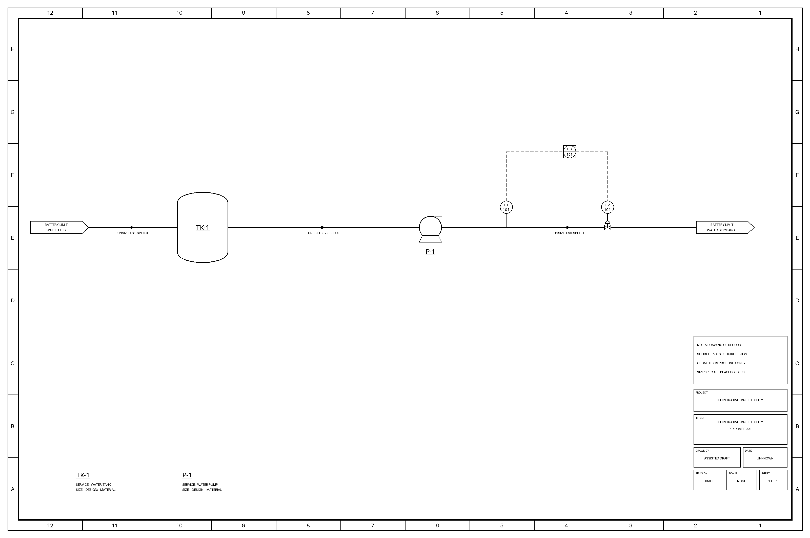

# Follow one pump from description to an engineering question

This is a worked path through the existing **authored, illustrative water utility**, not a real plant case or
an independent description benchmark. It shows how the toolkit connects its pieces and where an engineer still
needs evidence. The useful first result is an investigation packet; it establishes no savings or approved change.

## Follow the same identities

| Step | Inspect the actual file | What it contributes |
|---|---|---|
| Starting description | [source.txt](source.txt), lines 3–7 | P-1 pumps from TK-1 to a downstream battery limit. FT-101 measures discharge flow; FV-101 controls that stream; FIC-101 reads the transmitter and adjusts the valve. |
| Authored interpretation | [model.json](result/model.json): `units[P-1]`, `streams[S2]`, `streams[S3]`, `instruments[FT-101]`, `final_elements[FV-101]`, `controllers[FIC-101]` | Stable identities and typed records retain their source-line references. An engineer or approved assistant authors these records; the text is not automatically parsed into a verified design. |
| Structure and drawing | [validation.json](result/validation.json), [draft D1](result/pid/D1.png), [review instructions](result/REVIEW.md) | The workflow checks quotations, record references and model/layout consistency, then renders the supplied geometry. The drawing remains DRAFT; these checks do not establish engineering truth. |
| A useful question | [questions.json](result/questions/questions.json): `E1@P-1`, and [readable screen](result/questions/screen.md#energy) | The question engine connects the pump, discharge valve and flow measurement, then asks whether variable-speed control is worth investigating. |
| Portable relationships | [graph.json](result/graph.json): node `P-1`, stream edges `S2` and `S3`, question `E1@P-1` | The asset, relationships, source references, unverified status and investigation question travel together. This is a snapshot, not a live plant model. |
| Company handoff | A private copy of the [first-question brief](../../first-pilot/pilot-brief.md) | Retain the selected source/model versions, question, missing evidence and intended recipient in the company's maintained information and decision system. Ownership and acceptance still need to be established. |

## What the question engine actually knows

The generated question is:

> Is this pump throttled by a control valve when it could run on a variable speed drive?

It is triggered by P-1, a discharge control valve and flow measurement in the supplied model, with no speed-control
record found there. **Not recorded in this model does not mean not installed.** The source does not establish the
actual drive, operating duty, valve position or an energy-saving opportunity. A discharge valve alone cannot settle
the question.

The five `data_requests` for `E1@P-1` remain `not_on_drawing`:

1. Control-valve position over normal operation.
2. Flow over the same period.
3. Pump rated flow/head and curve.
4. Motor rating and speed.
5. Static head versus friction head.

No historian tags are mapped in this example. The screen names possible collection locations, but connecting to
a system, validating signal identity and obtaining company approval are separate work. Generic benefits quoted
elsewhere in the screen are not estimates for P-1.

## The first packet this can support

For this example, a plain brief would retain:

- **Question:** `E1@P-1`; investigate whether further assessment of the flow-control arrangement is justified.
- **What the illustrative source supports:** the stated pump/stream/control arrangement, with exact line references.
- **What remains unknown:** actual installed configuration, duty, operating history, pump/motor data and head split.
- **Source-investigation disposition:** open; operating evidence still needed.
- **Next action:** identify the accountable engineer and confirm the assets and approved evidence-collection route.
- **Receiving owner and handoff acceptance:** unassigned / not recorded.
- **Trial and benefit:** trial not run; benefit not measured.

These are example contents for a draft packet, not completed approvals or a populated company record. Use the
company's existing process for review, ownership and any operating decision. As more people contribute, that
system must retain governing revisions, access, accepted decisions and history. The toolkit's generated files
provide a starting packet; they do not supply that organizational responsibility.

## Reproduce and continue

Run the three offline `prepare`, `check` and `build` commands in the
[connected-route guide](../README.md#try-the-connected-route-offline), choosing new output folders. Then open
the same files listed above in your new result. They are produced by the workflow, rather than being separate
presentation mockups. The committed answer is a format/development fixture for this source, not a model accuracy
result.

The graph includes `E1@P-1` and is suitable input for the optional
[read-only MCP snapshot starter](../../internal-mcp/README.md). An approved client can retrieve supplied asset
and question records through that interface. The server does not answer the question, obtain operating data,
update documents or accept a decision. Loading the graph is not a tested company Copilot deployment.

For another asset or document family, retain the same chain: source → authored records → checked output →
question → missing evidence → receiving owner. Contribute the case and its failures through
[CONTRIBUTING.md](../../../CONTRIBUTING.md). A new source family or model interpretation needs its own reviewed
answer key and task evaluation; repeating this authored example does not establish generalization.
